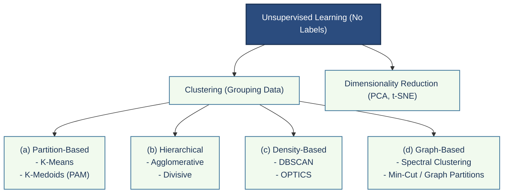
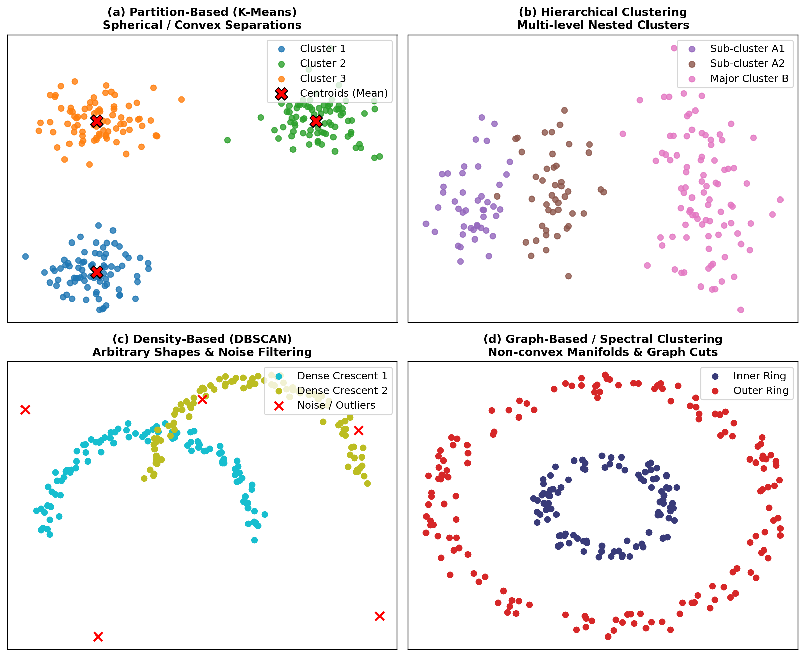
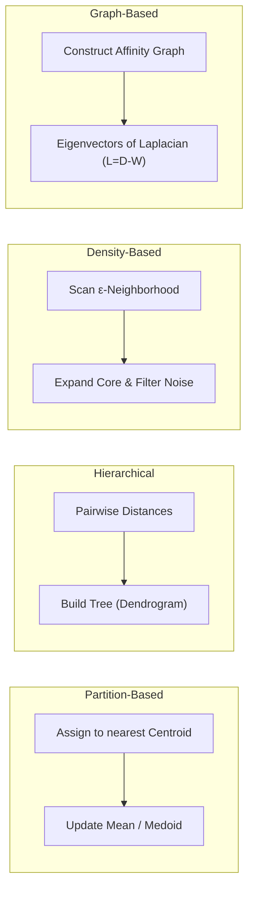
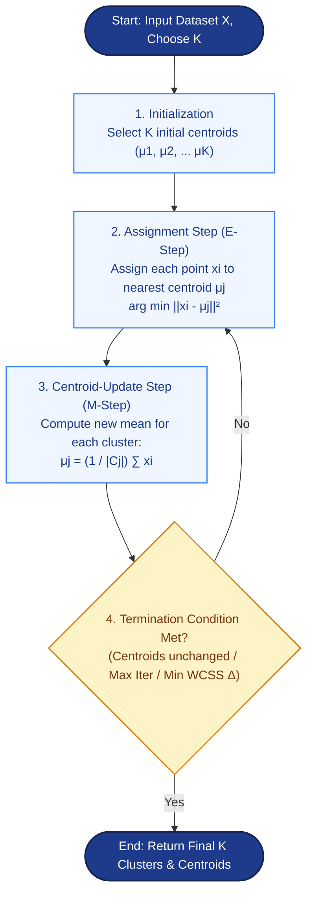
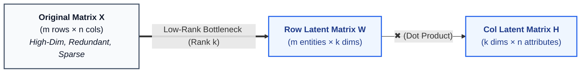
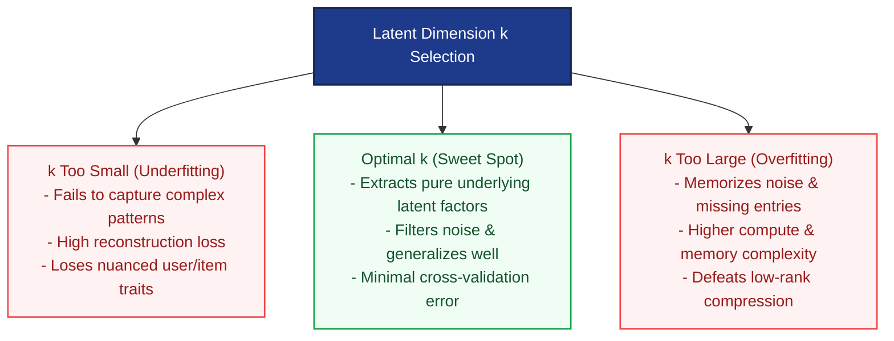
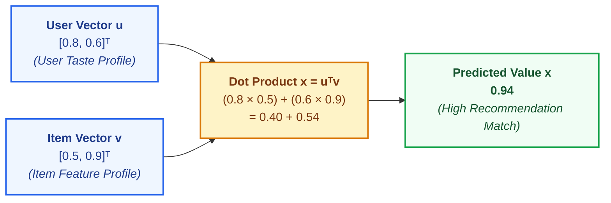
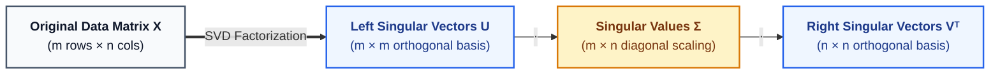
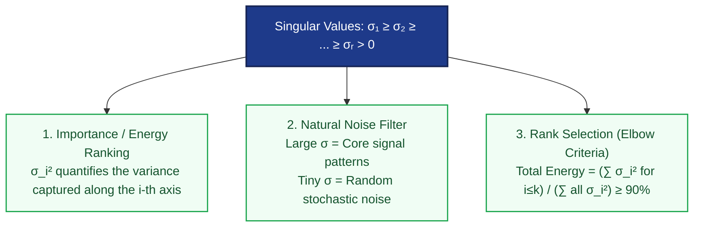

# Machine Learning (ML) Exam Study Notes & Comprehensive Guide

This master repository contains structured, exam-ready notes, conceptual breakdowns, numerical solutions, step-by-step algorithms, visual architecture diagrams, comparison tables, and an integrated technical appendix.

---

## 📑 Table of Contents (Index)

| # | Question / Topic | Category | Jump Link |
|---|------------------|----------|-----------|
| **Q1** | [Unsupervised Learning, Clustering Concept & Major Types of Clustering Algorithms](#q1) | Clustering Foundations | [Go to Q1](#q1) |
| **Q2** | [K-Means Algorithm: Steps, Numerical Example, Advantages & Limitations](#q2) | Partition-Based Clustering | [Go to Q2](#q2) |
| **Q10** | [Matrix Factorization, Low-Rank Representation, Significance of Latent Dimension $k$, & ML Applications](#q10) | Dimensionality Reduction & Matrix Factorization | [Go to Q10](#q10) |
| **Q11** | [Numerical: Matrix Factorization Rating Prediction ($x = u^T v$) in Recommender Systems](#q11) | Recommender Systems & Matrix Factorization | [Go to Q11](#q11) |
| **Q12** | [Singular Value Decomposition (SVD): Low-Rank Approximation & Significance of Singular Values](#q12) | Dimensionality Reduction & Matrix Factorization | [Go to Q12](#q12) |

---

## 📖 Technical Concepts & Appendix Index

| Concept / Terminology | Category | Jump Link |
|-----------------------|----------|-----------|
| [Dataset Notation ($N, K, d, t$)](#concept-dataset-notation) | Mathematical Notations | [Jump to Concept](#concept-dataset-notation) |
| [Unsupervised Learning](#concept-unsupervised-learning) | ML Paradigms | [Jump to Concept](#concept-unsupervised-learning) |
| [Clustering](#concept-clustering) | ML Foundations | [Jump to Concept](#concept-clustering) |
| [Intra-cluster Similarity vs Inter-cluster Dissimilarity](#concept-cluster-distance-metrics) | Distance & Optimization | [Jump to Concept](#concept-cluster-distance-metrics) |
| [Centroid vs. Medoid (Mean vs. Actual Point)](#concept-centroid-vs-medoid) | Partition-based | [Jump to Concept](#concept-centroid-vs-medoid) |
| [Centroid](#concept-centroid) | Partition-based | [Jump to Concept](#concept-centroid) |
| [WCSS / SSE Objective Function](#concept-wcss-sse) | Optimization | [Jump to Concept](#concept-wcss-sse) |
| [Matrix Factorization (MF)](#concept-matrix-factorization) | Dimensionality Reduction | [Jump to Concept](#concept-matrix-factorization) |
| [Low-Rank Representation vs Matrix Factorization (Relationship)](#concept-mf-vs-low-rank) | Recommender Systems | [Jump to Concept](#concept-mf-vs-low-rank) |
| [Low-Rank Representation & Latent Factors](#concept-low-rank) | Dimensionality Reduction | [Jump to Concept](#concept-low-rank) |
| [Latent Dimension $k$ / Rank Hyperparameter](#concept-latent-dimension-k) | Dimensionality Reduction | [Jump to Concept](#concept-latent-dimension-k) |
| [Information Bottleneck (Size $k$)](#concept-information-bottleneck) | ML Theory & Compression | [Jump to Concept](#concept-information-bottleneck) |
| [Rating Prediction with Biases ($\hat{X}_{u, i}$)](#concept-rating-prediction-biases) | Recommender Systems | [Jump to Concept](#concept-rating-prediction-biases) |
| [Vector Transpose ($u^T$)](#concept-vector-transpose) | Linear Algebra Foundations | [Jump to Concept](#concept-vector-transpose) |
| [Vector Dot Product ($u^T v$) in Recommenders](#concept-vector-dot-product) | Mathematical Foundations | [Jump to Concept](#concept-vector-dot-product) |
| [Singular Value Decomposition (SVD: $U \Sigma V^T$)](#concept-svd) | Dimensionality Reduction | [Jump to Concept](#concept-svd) |
| [Orthogonal Matrix ($U, V$)](#concept-orthogonal-matrix) | Linear Algebra Foundations | [Jump to Concept](#concept-orthogonal-matrix) |
| [Diagonal Matrix ($\Sigma$)](#concept-diagonal-matrix) | Linear Algebra Foundations | [Jump to Concept](#concept-diagonal-matrix) |
| [Singular Values ($\sigma_i$) & Energy Retention](#concept-singular-values) | Dimensionality Reduction | [Jump to Concept](#concept-singular-values) |
| [Eckart-Young-Mirsky Theorem](#concept-eckart-young) | Linear Algebra & SVD | [Jump to Concept](#concept-eckart-young) |
| [Linear Independence & Matrix Rank](#concept-linear-independence) | Linear Algebra Foundations | [Jump to Concept](#concept-linear-independence) |
| [Frobenius Norm](#concept-frobenius-norm) | Linear Algebra & Loss | [Jump to Concept](#concept-frobenius-norm) |
| [K-Means++ Initialization](#concept-kmeans-pp) | Partition-based | [Jump to Concept](#concept-kmeans-pp) |
| [Dendrogram](#concept-dendrogram) | Hierarchical | [Jump to Concept](#concept-dendrogram) |
| [Core, Border & Noise Points (DBSCAN)](#concept-dbscan-points) | Density-based | [Jump to Concept](#concept-dbscan-points) |
| [Graph Laplacian / Spectral Clustering](#concept-spectral-clustering) | Graph-based | [Jump to Concept](#concept-spectral-clustering) |

---

<a id="q1"></a>
## Q1. Define Unsupervised Learning and Explain the Concept of Clustering. Discuss Major Types of Clustering Algorithms: (a) Partition-based, (b) Hierarchical, (c) Density-based, and (d) Graph-based Clustering.

---

### 1. Core Definitions & Principles

- **[Unsupervised Learning](#concept-unsupervised-learning):** A branch of Machine Learning where an algorithm is provided only input data ($X$) without corresponding ground-truth target labels ($Y$). The goal is to discover underlying patterns, intrinsic structures, probability distributions, or natural groupings directly from unlabeled data:
  $$\mathcal{D} = \{x_1, x_2, \dots, x_N\}, \quad x_i \in \mathbb{R}^d$$
- **[Clustering](#concept-clustering):** The task of partitioning an unlabeled dataset into distinct groups (clusters) such that:
  1. **High [Intra-cluster Similarity](#concept-cluster-distance-metrics):** Data points within the same cluster are as close/similar to each other as possible.
  2. **High [Inter-cluster Dissimilarity](#concept-cluster-distance-metrics):** Data points belonging to different clusters are as distinct/separated from each other as possible.



---

### 2. Visual Comparison of Clustering Paradigms





---

#### (a) Partition-Based Clustering
- **Mechanism:** Divides $N$ objects into exactly $K$ distinct, non-overlapping partitions (flat clustering) where each object belongs to the cluster with the nearest [centroid](#concept-centroid) or medoid.
- **Optimization Criterion:** Minimizes the Within-Cluster Sum of Squares (WCSS):
  $$\mathcal{J} = \sum_{j=1}^{K} \sum_{x_i \in C_j} \|x_i - \mu_j\|^2$$
- **Key Algorithms:**
  - **K-Means:** Represents cluster center as the mean vector ($\mu_j$). Fast, but sensitive to outliers.
  - **K-Medoids (PAM):** Uses actual representative data points (medoids) instead of means; robust against outliers.
- **Strengths & Limitations:**
  - *Pros:* Simple, computationally efficient ($\mathcal{O}(t \cdot K \cdot N)$), highly scalable.
  - *Cons:* Must pre-specify $K$; assumes spherical/globular cluster shapes; struggles with outliers.

---

#### (b) Hierarchical Clustering
- **Mechanism:** Builds a nested tree of clusters called a **[Dendrogram](#concept-dendrogram)** without needing to pre-specify the number of clusters $K$ in advance.
- **Two Paradigms:**
  1. **Agglomerative (Bottom-Up):** Starts with $N$ single-element clusters and iteratively merges the closest pair of clusters until only one cluster remains.
  2. **Divisive (Top-Down):** Starts with all data points in a single mega-cluster and recursively splits clusters down to individual points.
- **Linkage Criteria:** Single Linkage (min distance), Complete Linkage (max distance), Average Linkage (mean pair distance), and Ward's Method (variance minimization).
- **Strengths & Limitations:**
  - *Pros:* Generates an interpretable hierarchy; no need to define $K$ initially (cut dendrogram at chosen height).
  - *Cons:* High computational complexity ($\mathcal{O}(N^2)$ to $\mathcal{O}(N^3)$); merge/split decisions cannot be undone.

---

#### (c) Density-Based Clustering
- **Mechanism:** Identifies clusters as continuous dense regions of data points separated by regions of low density. Can discover arbitrarily shaped clusters and naturally isolates outliers.
- **Key Algorithms:** **DBSCAN** (Density-Based Spatial Clustering of Applications with Noise), **OPTICS**, **HDBSCAN**.
- **Key Parameters & Point Classifications:**
  - **$\epsilon$ (Eps / Radius):** Neighborhood distance threshold.
  - **$\text{MinPts}$:** Minimum points within $\epsilon$-radius to form a dense region.
  - **[Core Points](#concept-dbscan-points):** Points with $\ge \text{MinPts}$ within $\epsilon$.
  - **[Border Points](#concept-dbscan-points):** Points within $\epsilon$ of a core point but with $<\text{MinPts}$ neighbors.
  - **[Noise Points](#concept-dbscan-points):** Points that are neither core nor border points (isolated anomalies).
- **Strengths & Limitations:**
  - *Pros:* Discovers complex shapes (e.g., rings, spirals, crescents); automatic outlier/noise detection; $K$ is not pre-set.
  - *Cons:* Fails on datasets with widely varying densities; sensitive to hyperparameter choices ($\epsilon, \text{MinPts}$).

---

#### (d) Graph-Based Clustering
- **Mechanism:** Treats data points as nodes $V$ in a graph $G = (V, E)$, with edges $E$ weighted by similarity/affinity ($W_{ij}$). Clustering is formulated as graph partitioning (e.g., finding graph cuts that minimize cut weight between clusters while maximizing internal connectivity).
- **Key Algorithms:** **[Spectral Clustering](#concept-spectral-clustering)** (uses eigenvectors of the Graph Laplacian $L = D - W$), **Minimum Spanning Tree (MST) Clustering**, **Markov Cluster Algorithm (MCL)**.
- **Strengths & Limitations:**
  - *Pros:* Highly effective for complex non-convex geometries and manifold structures; flexible similarity metrics.
  - *Cons:* Computationally expensive for very large datasets ($\mathcal{O}(N^3)$ for eigenvalue decomposition).

---

### 3. Step-by-Step Mechanism & Pseudocode / Python Example

```python
import numpy as np
from sklearn.cluster import KMeans, AgglomerativeClustering, DBSCAN, SpectralClustering
from sklearn.datasets import make_moons

# Generate synthetic non-linear data
X, _ = make_moons(n_samples=300, noise=0.05, random_state=42)

# 1. Partition-based (K-Means)
kmeans = KMeans(n_clusters=2, random_state=42, n_init='auto').fit(X)

# 2. Hierarchical (Agglomerative)
agg = AgglomerativeClustering(n_clusters=2, linkage='ward').fit(X)

# 3. Density-based (DBSCAN)
dbscan = DBSCAN(eps=0.2, min_samples=5).fit(X)

# 4. Graph-based (Spectral Clustering)
spectral = SpectralClustering(n_clusters=2, affinity='nearest_neighbors', random_state=42).fit(X)
```

---

### 4. Defenses, Best Practices & Practical Evaluation

#### Technical Layer (Model Selection & Diagnostics)
1. **Determining $K$ for Partitioning:** Use the **Elbow Method** (Sum of Squared Errors) combined with **Silhouette Analysis** (optimal score close to $+1$).
2. **Feature Preprocessing:** Always normalize/scale features (e.g., `StandardScaler`) prior to clustering because distance metrics (Euclidean, Manhattan) are highly sensitive to variable scales.
3. **Handling High Dimensions:** Perform dimensionality reduction (PCA/UMAP) before clustering to mitigate the **Curse of Dimensionality**.

#### Administrative & Operational Layer
1. **Domain Validation:** Evaluate cluster profiles with domain experts to ensure clusters represent actionable segments.
2. **Stability & Reproducibility:** Run multiple random restarts (e.g., `K-Means++` initialization) to prevent convergence to poor local optima.

---

### 5. Summary Comparison Table

| Feature / Metric | (a) Partition-based (e.g., K-Means) | (b) Hierarchical (e.g., Agglomerative) | (c) Density-based (e.g., DBSCAN) | (d) Graph-based (e.g., Spectral) |
| :--- | :--- | :--- | :--- | :--- |
| **Cluster Shape** | Spherical / Convex | Variable depending on linkage | Arbitrary / Non-linear | Complex manifolds / Non-convex |
| **Pre-specify $K$?** | Yes (Mandatory) | No (Cut dendrogram) | No (Driven by $\epsilon, \text{MinPts}$) | Yes (Number of eigenvectors/cuts) |
| **Complexity** | $\mathcal{O}(t \cdot K \cdot N)$ — Very fast | $\mathcal{O}(N^2)$ to $\mathcal{O}(N^3)$ — Slow | $\mathcal{O}(N \log N)$ to $\mathcal{O}(N^2)$ | $\mathcal{O}(N^3)$ — Matrix eigensolver |
| **Noise / Outlier Handling** | Highly sensitive | Merges outliers into singletons | Built-in explicit noise detection | Robust via affinity graph |
| **Best Use Case** | Large-scale, well-separated data | Small datasets requiring taxonomy | Spatial data, anomaly detection | Manifold learning, graph networks |

---

<a id="q2"></a>
## Q2. Explain the K-Means Clustering Algorithm with a Suitable Example. Describe the Initialization, Assignment, Centroid-Update, and Termination Steps. Also Mention Two Advantages and Two Limitations of K-Means.

---

### 1. Core Definitions & Principles

- **K-Means Clustering:** A widely-used iterative, partition-based clustering algorithm that groups $N$ observations into $K$ predefined, non-overlapping clusters ($C_1, C_2, \dots, C_K$).
- **Objective (Loss Function):** Minimizes the **[Within-Cluster Sum of Squares (WCSS) / Sum of Squared Errors (SSE)](#concept-wcss-sse)** between data points and their respective assigned cluster center ([centroid](#concept-centroid) $\mu_j$):
  $$\mathcal{J}_{\text{WCSS}} = \sum_{j=1}^{K} \sum_{x_i \in C_j} \|x_i - \mu_j\|^2$$
- **Nature of Optimization:** It is an instance of the **Expectation-Maximization (EM)** heuristic:
  - *E-step (Assignment):* Assign points to the closest centroid.
  - *M-step (Update):* Recompute the centroid mean to minimize squared errors.



---

### 2. The 4 Fundamental Steps of K-Means

```
+--------------------------------------------------------------------------------------------------+
|                                K-MEANS ITERATIVE CYCLE                                           |
+--------------------------------------------------------------------------------------------------+
|  [Step 1: Init]              [Step 2: Assign]            [Step 3: Update]         [Step 4: Stop] |
|   *       *                   (A)         (B)             (A)         (B)          Converged!    |
|       C1(x)                     *   *       *               *   *       *                        |
|   *       *           --->        \       /         --->      \       /        --->  Centroid    |
|       C2(x)                     *  C1   C2  *               *  C1'  C2' *            positions   |
|   *       *                                                                          stable.     |
+--------------------------------------------------------------------------------------------------+
```

#### Step 1: Initialization
- Choose the number of clusters $K$.
- Select $K$ initial points in $\mathbb{R}^d$ as the starting centroids $\{\mu_1, \mu_2, \dots, \mu_K\}$.
- *Methods:*
  - **Random Initialization:** Pick $K$ random observations from the dataset (Forgy method).
  - **[K-Means++](#concept-kmeans-pp):** Spreads out initial centroids probabilistically proportional to their squared distance from nearest existing centroids, avoiding poor local minima.

#### Step 2: Assignment Step (Expectation)
- For every data point $x_i \in \mathcal{D}$, calculate its Euclidean distance to all $K$ centroids:
  $$\text{dist}(x_i, \mu_j) = \|x_i - \mu_j\| = \sqrt{\sum_{d=1}^{D} (x_{id} - \mu_{jd})^2}$$
- Assign $x_i$ to the cluster $C_{j^*}$ with the minimum squared distance:
  $$C_j = \left\{ x_i : \|x_i - \mu_j\|^2 \le \|x_i - \mu_l\|^2 \quad \forall \, 1 \le l \le K \right\}$$

#### Step 3: Centroid-Update Step (Maximization)
- Recompute the centroid (center of mass / arithmetic mean) of each cluster using all points currently assigned to it:
  $$\mu_j^{(t+1)} = \frac{1}{|C_j^{(t)}|} \sum_{x_i \in C_j^{(t)}} x_i$$
- If a cluster receives zero points, its centroid is typically re-initialized to a random data point.

#### Step 4: Termination (Convergence Criteria)
The iterative loop terminates when any of the following stopping criteria is satisfied:
1. **Centroid Stability:** Centroid positions do not shift between consecutive iterations ($\|\mu_j^{(t+1)} - \mu_j^{(t)}\| < \epsilon$).
2. **Assignment Stability:** No data point changes its cluster assignment.
3. **WCSS Convergence:** The reduction in WCSS drops below a predefined threshold $\Delta \mathcal{J} < \text{tol}$.
4. **Max Iterations Reached:** Execution hits a predefined limit `max_iter` (e.g., 300).

---

### 3. Step-by-Step Illustrative Example

Consider a 1D dataset: $\mathcal{D} = \{2, 4, 10, 12, 3, 20, 30, 11\}$ with $K = 2$.

```
Initial Centroids: C1 = 2,  C2 = 12
```

#### **Iteration 1:**
1. **Distance & Cluster Assignment:**
   - For point $2$: $\text{dist}(2, C_1)=|2-2|=0$, $\text{dist}(2, C_2)=|2-12|=10 \implies \mathbf{C_1}$
   - For point $3$: $|3-2|=1$, $|3-12|=9 \implies \mathbf{C_1}$
   - For point $4$: $|4-2|=2$, $|4-12|=8 \implies \mathbf{C_1}$
   - For point $10$: $|10-2|=8$, $|10-12|=2 \implies \mathbf{C_2}$
   - For point $11$: $|11-2|=9$, $|11-12|=1 \implies \mathbf{C_2}$
   - For point $12$: $|12-2|=10$, $|12-12|=0 \implies \mathbf{C_2}$
   - For point $20$: $|20-2|=18$, $|20-12|=8 \implies \mathbf{C_2}$
   - For point $30$: $|30-2|=28$, $|30-12|=18 \implies \mathbf{C_2}$
   - **Formed Clusters:**
     - $C_1 = \{2, 3, 4\}$
     - $C_2 = \{10, 11, 12, 20, 30\}$
2. **Centroid Update:**
   - $\mu_1 = \frac{2 + 3 + 4}{3} = \frac{9}{3} = \mathbf{3.0}$
   - $\mu_2 = \frac{10 + 11 + 12 + 20 + 30}{5} = \frac{83}{5} = \mathbf{16.6}$

#### **Iteration 2:**
1. **Re-assignment (Comparing ALL $N=8$ points against new centroids $\mu_1 = 3.0$ and $\mu_2 = 16.6$):**
   Every single point in the dataset is compared to both new centroids:

   | Point ($x_i$) | Dist to $\mu_1 = 3.0$ ($\|x_i - 3.0\|$) | Dist to $\mu_2 = 16.6$ ($\|x_i - 16.6\|$) | Minimum Distance | Assigned Cluster |
   | :---: | :---: | :---: | :---: | :---: |
   | **2** | $\|2 - 3.0\| = \mathbf{1.0}$ | $\|2 - 16.6\| = 14.6$ | $1.0$ | $\mathbf{C_1}$ |
   | **3** | $\|3 - 3.0\| = \mathbf{0.0}$ | $\|3 - 16.6\| = 13.6$ | $0.0$ | $\mathbf{C_1}$ |
   | **4** | $\|4 - 3.0\| = \mathbf{1.0}$ | $\|4 - 16.6\| = 12.6$ | $1.0$ | $\mathbf{C_1}$ |
   | **10** | $\|10 - 3.0\| = 7.0$ | $\|10 - 16.6\| = \mathbf{6.6}$ | $6.6$ | $\mathbf{C_2}$ |
   | **11** | $\|11 - 3.0\| = 8.0$ | $\|11 - 16.6\| = \mathbf{5.6}$ | $5.6$ | $\mathbf{C_2}$ |
   | **12** | $\|12 - 3.0\| = 9.0$ | $\|12 - 16.6\| = \mathbf{4.6}$ | $4.6$ | $\mathbf{C_2}$ |
   | **20** | $\|20 - 3.0\| = 17.0$ | $\|20 - 16.6\| = \mathbf{3.4}$ | $3.4$ | $\mathbf{C_2}$ |
   | **30** | $\|30 - 3.0\| = 27.0$ | $\|30 - 16.6\| = \mathbf{13.4}$ | $13.4$ | $\mathbf{C_2}$ |

   - **Clusters after Iteration 2:**
     - $C_1 = \{2, 3, 4\}$
     - $C_2 = \{10, 11, 12, 20, 30\}$

2. **Centroid Update & Convergence Check:**
   - The cluster memberships did not change at all from Iteration 1 ($C_1$ still has $\{2, 3, 4\}$ and $C_2$ still has $\{10, 11, 12, 20, 30\}$).
   - Therefore, new centroids remain unchanged: $\mu_1 = 3.0, \mu_2 = 16.6$.
   - **Termination Condition Triggered:** Zero membership shifts $\implies$ Algorithm **converges and halts!**

---

### 4. Advantages & Limitations

#### ✅ Two Major Advantages
1. **Computational Efficiency & Scalability:**
   - Linear time complexity $\mathcal{O}(t \cdot K \cdot N \cdot d)$, where $N$ is number of points, $K$ is clusters, $d$ is dimensions, and $t$ is iterations ($t, K, d \ll N$). It runs significantly faster than hierarchical clustering $\mathcal{O}(N^3)$.
2. **Simplicity of Implementation & Mathematical Guarantees:**
   - Extremely easy to understand, implement, and interpret. It is mathematically guaranteed to converge to a local minimum of WCSS.

#### ❌ Two Major Limitations
1. **High Sensitivity to Initialization & Local Optima Trap:**
   - Standard random initialization can lead to poor local optima and suboptimal clustering depending on initial seed locations (mitigated by [K-Means++](#concept-kmeans-pp)).
2. **Inability to Handle Non-Convex / Irregular Shapes & Outliers:**
   - Assumes spherical (isotropic), equal-variance clusters because of Euclidean distance metric. Fails on elongated, ring-shaped, or crescent clusters.
   - Outliers severely distort the arithmetic mean calculation.

---

### 5. Summary Comparison Table

| Phase / Aspect | Description | Mathematical Expression | Key Considerations |
| :--- | :--- | :--- | :--- |
| **1. Initialization** | Select $K$ seed points | Random or [K-Means++](#concept-kmeans-pp) | Poor init leads to local minima |
| **2. Assignment** | Assign $x_i$ to closest centroid | $\arg\min_{j} \|x_i - \mu_j\|^2$ | Evaluates Euclidean distances |
| **3. Update** | Recompute cluster means | $\mu_j = \frac{1}{\|C_j\|} \sum_{x \in C_j} x$ | Arithmetic mean sensitive to outliers |
| **4. Termination** | Check convergence conditions | $\|\mu^{(t+1)} - \mu^{(t)}\| < \epsilon$ or zero label shifts | Prevents infinite oscillation |
| **Complexity** | Time & Space Efficiency | Time: $\mathcal{O}(t K N d)$, Space: $\mathcal{O}(N d + K d)$ | Highly scalable to millions of rows |


---

<a id="q10"></a>
## Q10. What is Matrix Factorization? Explain the Low-Rank Representation, Describe the Significance of the Latent Dimension $k$, and Give Suitable Machine Learning Applications.

---

### 1. Core Definitions & Principles

- **[Matrix Factorization (MF)](#concept-matrix-factorization):** A mathematical and machine learning technique that decomposes a large target matrix $X \in \mathbb{R}^{m \times n}$ into the product of two lower-dimensional constituent matrices:
  $$X \approx W \cdot H$$
  where:
  - $X \in \mathbb{R}^{m \times n}$ is the original observed data matrix (e.g., $m$ users $\times$ $n$ items, or $m$ samples $\times$ $n$ features).
  - $W \in \mathbb{R}^{m \times k}$ is the **basis / latent factor representation** of the rows (e.g., user profiles across $k$ latent traits).
  - $H \in \mathbb{R}^{k \times n}$ is the **coefficient / encoding matrix** of the columns (e.g., item loadings across $k$ latent traits).
  - $k$ is the **inner [latent dimension / rank](#concept-latent-dimension-k)** ($k \ll \min(m, n)$).

- **[Low-Rank Representation & Latent Factors](#concept-low-rank):** 
  - Real-world high-dimensional data matrices exhibit high correlation, redundancy, and hidden multi-collinearity.
  - The matrix rank $\text{rank}(X)$ represents the maximum number of [linearly independent row or column vectors](#concept-linear-independence).
  - Constraining the factorization to a rank $k \ll \min(m, n)$ forces the model to compress interactions through an **[information bottleneck of size $k$](#concept-information-bottleneck)**, uncovering the dominant unobserved generative variables known as **latent factors** (e.g., semantic topics in text, hidden genres in movies).



---

### 2. Architecture & Geometry of Low-Rank Representation

```
+--------------------------------------------------------------------------------------------------+
|                            LOW-RANK MATRIX FACTORIZATION SCHEMATIC                                |
+--------------------------------------------------------------------------------------------------+
|                                                                                                  |
|   Original Data Matrix X                Factor Matrix W             Factor Matrix H              |
|        (m x n)                             (m x k)                     (k x n)                   |
|                                                                                                  |
|     n items / features               k latent factors            n items / features              |
|      ┌───────────────┐                 ┌─────┐                   ┌───────────────┐               |
|    m │               │               m │     │                 k │               │               |
|    u │      X        │       ≈       u │  W  │        X          └───────────────┘               |
|    s │               │               s │     │                                                   |
|    e │               │               e │     │               Condition: k << min(m, n)           |
|    r │               │               r │     │               Total params: m*n  --->  (m + n)*k  |
|    s └───────────────┘                 └─────┘                                                   |
|                                                                                                  |
|   Element-wise Dot Product:                                                                      |
|                  X_{i, j} ≈ w_i^T · h_j = ∑_{l=1}^{k} W_{i, l} · H_{l, j}                        |
+--------------------------------------------------------------------------------------------------+
```

---

### 3. Significance of the Latent Dimension $k$

The hyperparameter $k$ (the latent dimension or truncation rank) is the central lever controlling model expressiveness:



1. **Bias-Variance & Reconstruction Trade-off:**
   - **If $k$ is too small:** The model underfits. The latent bottleneck is too restrictive to represent subtle nuances in the data (e.g., grouping all foreign films together without distinguishing genres).
   - **If $k$ is too large:** The model overfits. The factor matrices memorize random noise, sparsity artifacts, and spurious correlations, failing to generalize to unseen test entries.
2. **Noise Filtering vs. Signal Preservation:**
   - By the Eckart-Young-Mirsky theorem in SVD, retaining the top $k$ components captures the maximal variance ($\sum_{i=1}^k \sigma_i^2$) while discarding tail singular values that correspond to random stochastic noise.
3. **Computational & Memory Footprint:**
   - Storage scales as $\mathcal{O}((m + n)k)$ instead of $\mathcal{O}(mn)$. Smaller $k$ allows serving low-latency real-time dot products ($w_i^T h_j$) on mobile/embedded systems.
4. **Interpretability:**
   - A moderate $k$ (e.g., $k=10$ to $50$) often yields clearly identifiable semantic concepts (e.g., in text/topic modeling or movie preferences). As $k$ grows excessively large, latent factors become diffuse and uninterpretable.

---

### 4. Machine Learning Applications of Matrix Factorization

```
+--------------------------------------------------------------------------------------------------+
|                           PRIMARY MACHINE LEARNING APPLICATIONS                                  |
+-----------------------------------+--------------------------------------------------------------+
| Application Domain                | Mechanism & Role of Latent Dimension k                       |
+-----------------------------------+--------------------------------------------------------------+
| 1. Recommender Systems            | Collaborative Filtering (Netflix Prize): Predicts missing    |
|    (Matrix Completion)            | user-item ratings via dot product r̂_ui = w_u^T h_i.          |
+-----------------------------------+--------------------------------------------------------------+
| 2. Natural Language Processing    | Latent Semantic Analysis (LSA): Factorizes term-document     |
|    (Topic Modeling)               | matrix; k represents the number of abstract semantic topics. |
+-----------------------------------+--------------------------------------------------------------+
| 3. Computer Vision & Audio        | Non-Negative Matrix Factorization (NMF): Parts-based image   |
|    (Facial Recognition & Audio)   | decomposition (faces = eyes + nose + mouth) where k is parts.|
+-----------------------------------+--------------------------------------------------------------+
| 4. Bioinformatics & Genomics      | Gene expression profiling: Groups co-expressed genes into    |
|                                   | k biological pathways across thousands of patient samples.   |
+-----------------------------------+--------------------------------------------------------------+
```

#### Detailed Spotlight Application: Collaborative Filtering (Recommender Systems)
In platforms like Netflix, Spotify, or Amazon:
- **Matrix $X$ ($m \times n$):** $m$ users $\times$ $n$ items (e.g., $10^6$ users $\times 10^4$ movies). Over 99% of entries are unobserved (missing).
- **Latent Dimension $k$ ($k \approx 20\text{--}100$):** Each user $u$ gets a preference vector $w_u \in \mathbb{R}^k$, and each movie $i$ gets an attribute vector $h_i \in \mathbb{R}^k$.
- **Inference Equation (Predicting the Missing Rating):**
  $$\hat{X}_{u, i} = \mu + b_u + c_i + w_u^T h_i$$
  Where every term has a specific real-world meaning:
  - $\mathbf{\hat{X}_{u, i}}$: The **predicted rating** that user $u$ would give to movie $i$ (e.g., predicted stars out of 5).
  - $\mathbf{\mu}$ (Global Baseline): The **average rating across ALL movies and ALL users** on the entire platform (e.g., 3.6 stars).
  - $\mathbf{b_u}$ (User Bias): How strict or generous user $u$ is compared to the average (e.g., if Alice is very critical, $b_u = -0.5$).
  - $\mathbf{c_i}$ (Item/Movie Bias): How critically acclaimed or bad movie $i$ is overall (e.g., if *Shawshank Redemption* is universally loved, $c_i = +0.8$).
  - $\mathbf{w_u^T h_i}$ (User-Movie Match): The **pure taste interaction** between user $u$'s preferences and movie $i$'s traits across the $k$ latent factors.
  
  *Items with the highest predicted $\hat{X}_{u, i}$ are recommended to user $u$!*

---

---

### 5. Intuitive Analogy & Complete Worked-Out Example

#### 💡 The Everyday Food Analogy (Making Sense of the Math)
Imagine you run a cafe and want to understand how **3 customers** (Alice, Bob, Charlie) rate **3 specific dishes** (Burger, Chocolate Cake, Green Salad). 

Instead of treating each of the **3 dishes** as completely unrelated items, you realize every food preference is driven by just **$k=2$ hidden taste traits (latent factors)**:
1. **Factor 1:** Love for *Savory / Salty*
2. **Factor 2:** Love for *Sweet / Dessert*

*(And in a real restaurant with 50 or 500 menu items, you still only need those same 2 or 3 taste traits to predict everything!)*

```
         USER PROFILES (W)                         DISH RECIPES (H)
       [Savory]  [Sweet]                          [Burger]  [Cake]  [Salad]
Alice  [  5   ,    1  ]                  [Savory] [   5   ,   0  ,    2   ]
Bob    [  1   ,    5  ]                  [Sweet]  [   1   ,   5  ,    0   ]
Charlie[  3   ,    4  ]

What these numbers mean:
• Alice [5, 1] : Alice rates Savory a 5/5 (Loves it!) and Sweet a 1/5 (Dislikes it).
• Bob   [1, 5] : Bob rates Savory a 1/5 (Dislikes it) and Sweet a 5/5 (Loves sugar!).
• Burger [5, 1]: Burger is heavily Savory (5) and barely Sweet (1).
• Cake   [0, 5]: Cake has zero Savory taste (0) and is pure Sweet (5).
```

How do we get the **Original Target Matrix $X$ ($3 \times 3$)** from these?
Just multiply $W \times H$:

$$
\begin{aligned}
\text{Alice on Burger}  &= (5 \times 5) + (1 \times 1) = 25 + 1 = \mathbf{26} \\
\text{Alice on Cake}    &= (5 \times 0) + (1 \times 5) = 0 + 5  = \mathbf{5} \\
\text{Alice on Salad}   &= (5 \times 2) + (1 \times 0) = 10 + 0 = \mathbf{10} \\
\text{Bob on Burger}    &= (1 \times 5) + (5 \times 1) = 5 + 5  = \mathbf{10} \\
\text{Bob on Cake}      &= (1 \times 0) + (5 \times 5) = 0 + 25 = \mathbf{25} \\
\text{Bob on Salad}     &= (1 \times 2) + (5 \times 0) = 2 + 0  = \mathbf{2} \\
\text{Charlie on Burger}&= (3 \times 5) + (4 \times 1) = 15 + 4 = \mathbf{19} \\
\text{Charlie on Cake}  &= (3 \times 0) + (4 \times 5) = 0 + 20 = \mathbf{20} \\
\text{Charlie on Salad} &= (3 \times 2) + (4 \times 0) = 6 + 0  = \mathbf{6}
\end{aligned}
$$

So the **Original Target Matrix $X$** that got broken down was:

$$
X = \begin{matrix}
 & \text{Burger} & \text{Cake} & \text{Salad} \\
\text{Alice}   & \mathbf{26} & \mathbf{5}  & \mathbf{10} \\
\text{Bob}     & \mathbf{10} & \mathbf{25} & \mathbf{2}  \\
\text{Charlie} & \mathbf{19} & \mathbf{20} & \mathbf{6}
\end{matrix}
$$

> 💡 **The Two Directions:**
> - **In our explanation (Forward Multiplication):** We showed you $W$ and $H$ first, and multiplied them ($W \times H$) to produce the big matrix $X$ so the mechanics are easy to see.
> - **In real Machine Learning (Factorization / Decomposition):** The algorithm **starts with the big matrix $X$** (the raw table of customer ratings) and **breaks it down** into $W$ (who the people are) and $H$ (what the items are).

---

#### 🔢 Full Matrix Multiplication Breakdown
Let $m=3$ users, $n=3$ movies, and latent dimension $k=2$:
- **Latent Factor 1 ($F_1$):** *Action / Explosions*
- **Latent Factor 2 ($F_2$):** *Romance / Emotional Drama*

$$
W = \begin{bmatrix}
4 & 1 \\
1 & 5 \\
3 & 3
\end{bmatrix}
\begin{matrix}
\text{(User 1: Loves Action, Ignores Romance)} \\
\text{(User 2: Ignores Action, Loves Romance)} \\
\text{(User 3: Enjoys Both Equally)}
\end{matrix}
$$

$$
H = \begin{bmatrix}
5 & 1 & 0 \\
0 & 4 & 5
\end{bmatrix}
\begin{matrix}
\text{(Factor 1 Loading)} \\
\text{(Factor 2 Loading)}
\end{matrix}
\qquad
\begin{matrix}
\text{M1: Avengers} & \text{M2: Titanic} & \text{M3: The Notebook} \\
\text{(Pure Action)} & \text{(Action+Romance)} & \text{(Pure Romance)}
\end{matrix}
$$

Now calculate the predicted full matrix $\hat{X} = W \times H$:

$$\hat{X}_{1, 1} = (4 \times 5) + (1 \times 0) = 20 + 0 = \mathbf{20} \quad \text{(User 1 loves Avengers)}$$
$$\hat{X}_{1, 2} = (4 \times 1) + (1 \times 4) = 4 + 4 = \mathbf{8} \quad \text{(User 1 gives average rating to Titanic)}$$
$$\hat{X}_{1, 3} = (4 \times 0) + (1 \times 5) = 0 + 5 = \mathbf{5} \quad \text{(User 1 dislikes The Notebook)}$$

$$\hat{X}_{2, 1} = (1 \times 5) + (5 \times 0) = 5 + 0 = \mathbf{5} \quad \text{(User 2 dislikes Avengers)}$$
$$\hat{X}_{2, 2} = (1 \times 1) + (5 \times 4) = 1 + 20 = \mathbf{21} \quad \text{(User 2 loves Titanic)}$$
$$\hat{X}_{2, 3} = (1 \times 0) + (5 \times 5) = 0 + 25 = \mathbf{25} \quad \text{(User 2 adores The Notebook)}$$

$$\hat{X}_{3, 1} = (3 \times 5) + (3 \times 0) = 15 + 0 = \mathbf{15}$$
$$\hat{X}_{3, 2} = (3 \times 1) + (3 \times 4) = 3 + 12 = \mathbf{15}$$
$$\hat{X}_{3, 3} = (3 \times 0) + (3 \times 5) = 0 + 15 = \mathbf{15}$$

Resulting Full Predicted Matrix $\hat{X}$:
$$
\hat{X} = W \cdot H = \begin{bmatrix}
\mathbf{20} & \mathbf{8} & \mathbf{5} \\
\mathbf{5} & \mathbf{21} & \mathbf{25} \\
\mathbf{15} & \mathbf{15} & \mathbf{15}
\end{bmatrix}
$$
Notice how natural and predictable the numbers are! By just storing **$3 \times 2 = 6$ numbers in $W$** and **$2 \times 3 = 6$ numbers in $H$** (total 12 numbers), we reconstruct all $3 \times 3 = 9$ movie ratings. For $1,000,000$ users and $10,000$ movies with $k=10$, we only store $10,010,000$ numbers instead of $10,000,000,000$ (a 99.9% compression)!

---

### 6. Summary Comparison Table

| Attribute / Parameter | Full-Rank Matrix $X$ | Low-Rank Factorization ($W \cdot H$) with Latent Dim $k$ |
| :--- | :--- | :--- |
| **Storage Complexity** | $\mathcal{O}(m \cdot n)$ | $\mathcal{O}((m + n) \cdot k)$ |
| **Degrees of Freedom** | Up to $\min(m, n)$ dimensions | Constrained to rank $\le k$ |
| **Role of Latent Dim $k$** | N/A | Controls bias-variance trade-off, expressiveness & noise filtering |
| **Handling Missing Values** | Cannot predict missing values directly | Readily predicts missing entries via dot product $\langle w_i, h_j \rangle$ |
| **Interpretability** | Raw surface interactions | Semantic latent concepts (factors / topics / components) |

---

<a id="q11"></a>
## Q11. Numerical Problem — Matrix Factorization:
**Let $u = [0.8, 0.6]^T$ and $v = [0.5, 0.9]^T$.**
1. **Calculate the predicted value $x = u^T v$.**
2. **Explain how this type of calculation is used in a recommendation system.**

---

### 1. Core Definitions & Mathematical Setup

- **User Latent Feature Vector ($u$):** Represents a specific user's affinity across $k=2$ latent dimensions:
  $$u = \begin{bmatrix} 0.8 \\ 0.6 \end{bmatrix} \in \mathbb{R}^2$$
- **Item Latent Feature Vector ($v$):** Represents a specific item's (e.g., movie's) characteristics along the same $k=2$ latent dimensions:
  $$v = \begin{bmatrix} 0.5 \\ 0.9 \end{bmatrix} \in \mathbb{R}^2$$
- **Predicted Interaction ($x$):** The inner (dot) product representing the predicted score / rating using the **[Vector Transpose ($u^T$)](#concept-vector-transpose)**:
  $$x = u^T v = \sum_{l=1}^{k} u_l \cdot v_l$$



---

### 2. Step-by-Step Numerical Calculation

Given:
$$u = \begin{bmatrix} 0.8 \\ 0.6 \end{bmatrix}, \qquad v = \begin{bmatrix} 0.5 \\ 0.9 \end{bmatrix}$$

Taking the transpose of $u$:
$$u^T = \begin{bmatrix} 0.8 & 0.6 \end{bmatrix}$$

Multiplying $u^T$ and $v$:
$$
x = u^T v = \begin{bmatrix} 0.8 & 0.6 \end{bmatrix} \begin{bmatrix} 0.5 \\ 0.9 \end{bmatrix}
$$
$$x = (0.8 \times 0.5) + (0.6 \times 0.9)$$
$$x = 0.40 + 0.54$$
$$\mathbf{x = 0.94}$$

$$\therefore \text{The predicted interaction value is } \mathbf{0.94}$$

---

### 3. Intuitive Analogy & Practical Meaning

#### 💡 The Movie Lover Analogy:
Suppose the $k=2$ latent dimensions are:
- **Dimension 1:** *Sci-Fi / Mind-Bending Concepts*
- **Dimension 2:** *Action / Adrenaline*

```
               [Sci-Fi] , [Action]
User  (u)  =  [  0.8   ,   0.6   ]  --> Strong lover of Sci-Fi (0.8), decent fan of Action (0.6)
Movie (v)  =  [  0.5   ,   0.9   ]  --> Moderate Sci-Fi plot (0.5), heavy Action scenes (0.9)
```

- Match on Sci-Fi: $0.8 \times 0.5 = 0.40$
- Match on Action: $0.6 \times 0.9 = 0.54$
- **Total Alignment Score:** $0.40 + 0.54 = \mathbf{0.94}$ *(High overall compatibility!)*

---

### 4. How This Calculation Is Used in a Recommendation System

In production systems (e.g., Netflix, Spotify, Amazon, YouTube), this dot product is the core engine behind **Collaborative Filtering**:

```
+--------------------------------------------------------------------------------------------------+
|                          RECOMMENDER PIPELINE FLOW (OFFLINE vs. ONLINE)                          |
+--------------------------------------------------------------------------------------------------+
|  OFFLINE TRAINING (Slow Batch Optimization):                                                     |
|    Massive Rating Matrix X (Millions of Users & Items)                                           |
|       │                                                                                          |
|       ▼ [SVD / Alternating Least Squares (ALS) / SGD]                                            |
|    Learned User Matrix W (row u)  and  Learned Item Matrix H (col v)                             |
|                                                                                                  |
|  ONLINE INFERENCE (Sub-Millisecond Serving):                                                     |
|    Active User 'u' opens Netflix Home Page                                                       |
|       │                                                                                          |
|       ├─► Compute dot product: score_i = u^T · v_i  for all unviewed items 'i'                   |
|       ├─► Add optional baseline biases: rating = μ + b_u + c_i + (u^T · v_i)                     |
|       ├─► Sort candidate items in descending order of predicted score                            |
|       ▼                                                                                          |
|    Recommend Top-N items with highest scores to the user!                                        |
+--------------------------------------------------------------------------------------------------+
```

#### The 4 Step Deployment Workflow:
1. **Offline Representation Learning:**
   - The platform uses past ratings/clicks to learn dense latent vectors for every user ($u \in \mathbb{R}^k$) and every item ($v \in \mathbb{R}^k$) using Matrix Factorization algorithms (e.g., ALS, SGD, or SVD).
2. **Real-Time Scoring of Unseen Catalog Items:**
   - When user $u$ visits the app, the system iterates over items they have **not yet seen** and calculates the dot product $\hat{x}_{u, i} = u^T v_i$.
3. **Sub-Millisecond Retrieval via Vector Search:**
   - Because $u^T v$ is a simple inner product, modern vector databases (e.g., FAISS, ScaNN, Milvus) can evaluate millions of candidate items in less than **$5$ milliseconds** using approximate nearest neighbor (ANN) search.
4. **Top-$N$ Personalized Ranking:**
   - Items are sorted in descending order of their predicted scores $\hat{x}$, and the highest $N$ items (e.g., Top 10) are rendered in the recommendation carousel.

---

### 5. Summary Comparison Table

| Property / Stage | Offline Phase (Learning $u$ and $v$) | Online Phase (Calculating $x = u^T v$) |
| :--- | :--- | :--- |
| **Operation** | Matrix Factorization ($X \approx W H$) via ALS/SGD | Vector Inner Product / Dot Product ($u^T v$) |
| **Input Data** | Huge, sparse observed ratings matrix | Precomputed dense vectors $u \in \mathbb{R}^k, v \in \mathbb{R}^k$ |
| **Latency / Time** | Hours to days (Batch compute on clusters) | Milliseconds (Real-time serving per user request) |
| **Objective** | Minimize reconstruction error $\|X - WH\|_F^2$ | Rank unobserved items to show Top-$N$ recommendations |

---

<a id="q12"></a>
## Q12. Explain Singular Value Decomposition (SVD): Discuss How SVD Can Be Used for Dimensionality Reduction and Low-Rank Approximation. Explain the Significance of Singular Values.

---

### 1. Core Definitions & Mathematical Formulation

- **[Singular Value Decomposition (SVD)](#concept-svd):** A fundamental matrix factorization theorem in linear algebra stating that **any** real matrix $X \in \mathbb{R}^{m \times n}$ (whether square or rectangular) can be factorized into the product of three constituent matrices:
  $$X = U \Sigma V^T$$
  where:
  - $U \in \mathbb{R}^{m \times m}$ is an **[orthogonal matrix](#concept-orthogonal-matrix)** whose columns are the **left singular vectors** (eigenvectors of $X X^T$).
  - $\Sigma \in \mathbb{R}^{m \times n}$ is a **[diagonal matrix](#concept-diagonal-matrix)** containing non-negative **[singular values](#concept-singular-values)** sorted in descending order:
    $$\sigma_1 \ge \sigma_2 \ge \sigma_3 \ge \dots \ge \sigma_r > 0$$
  - $V^T \in \mathbb{R}^{n \times n}$ is the transpose of an **[orthogonal matrix](#concept-orthogonal-matrix)** $V$ whose columns are the **right singular vectors** (eigenvectors of $X^T X$).



---

### 2. Architecture: Full SVD vs. Truncated SVD (Low-Rank Approximation)

```
+--------------------------------------------------------------------------------------------------+
|                             SVD & TRUNCATED LOW-RANK APPROXIMATION                                |
+--------------------------------------------------------------------------------------------------+
|  FULL SVD:                                                                                       |
|                                                                                                  |
|      X (m x n)     =       U (m x m)           Σ (m x n)            V^T (n x n)                  |
|   ┌─────────────┐       ┌─────────────┐     ┌───┬─────────┐       ┌─────────────┐                |
|   │             │       │             │   r │ σ │    0    │     r │             │                |
| m │             │   = m │             │ · ──┼───┼─────────┤   · ──┼─────────────┤                |
|   │             │       │             │     │ 0 │    0    │       │             │                |
|   └─────────────┘       └─────────────┘     └───┴─────────┘       └─────────────┘                |
|         n                     m                    n                     n                       |
|                                                                                                  |
|  TRUNCATED RANK-k APPROXIMATION (Keep top k components, k << r):                                 |
|                                                                                                  |
|     X_k (m x n)    ≈      U_k (m x k)         Σ_k (k x k)          V_k^T (k x n)                 |
|   ┌─────────────┐            ┌───┐               ┌───┐                                           |
|   │             │          m │   │             k │ σ │           k ┌─────────────┐               |
| m │     X_k     │   ≈        │   │        ·      └───┘        ·    └─────────────┘               |
|   │             │            └───┘                 k                      n                      |
|   └─────────────┘              k                                                                 |
|         n                                                                                        |
|                                                                                                  |
|   Sum of Rank-1 Matrices Form:                                                                   |
|                        X_k = ∑_{i=1}^{k} σ_i · u_i · v_i^T                                       |
+--------------------------------------------------------------------------------------------------+
```

---

### 3. How SVD is Used for Dimensionality Reduction & Low-Rank Approximation

#### (a) The Low-Rank Approximation Formula
Any matrix can be written as a sum of rank-1 outer products weighted by its singular values:
$$X = \sum_{i=1}^{r} \sigma_i u_i v_i^T$$
To construct the best rank-$k$ approximation ($X_k$), we truncate the summation by keeping only the **first $k$ terms** ($k < r$):
$$X_k = \sum_{i=1}^{k} \sigma_i u_i v_i^T = U_k \Sigma_k V_k^T$$

#### (b) Optimality: The [Eckart-Young-Mirsky Theorem](#concept-eckart-young)
The Eckart-Young-Mirsky theorem proves mathematically that $X_k$ is the **globally optimal** rank-$k$ approximation of $X$ in terms of both the Frobenius norm and the spectral norm:
$$\min_{\text{rank}(B) \le k} \|X - B\|_F = \|X - X_k\|_F = \sqrt{\sum_{i=k+1}^{\min(m, n)} \sigma_i^2}$$
*No other rank-$k$ matrix in the universe can achieve a lower approximation error!*

#### (c) Dimensionality Reduction (Projecting Data into $k$ Dimensions)
- **Transforming Samples/Users:** Project original $m$ rows into a $k$-dimensional latent space:
  $$Z = X V_k = U_k \Sigma_k \in \mathbb{R}^{m \times k}$$
  *(This is identical to Principal Component Analysis / PCA!)*
- **Data Compression:** Instead of storing $m \times n$ floats, you only store $k(m + n + 1)$ floats.

---

### 4. Significance of the Singular Values ($\sigma_i$)

The singular values $\sigma_i$ are the diagonal entries of $\Sigma$. They hold paramount physical and geometric significance:



1. **Quantification of Information & Variance ("Energy"):**
   - Each singular value measures the strength/stretch of the data along its corresponding principal axis.
   - The total "energy" (squared Frobenius norm) of matrix $X$ equals the sum of squared singular values:
     $$\|X\|_F^2 = \sum_{i=1}^{\min(m, n)} \sigma_i^2$$
2. **Signal vs. Noise Separation:**
   - Dominant singular values ($\sigma_1, \sigma_2, \dots$) represent the structural signals and underlying patterns.
   - Tail singular values ($\sigma_r \approx 0$) represent random noise, sensor artifacts, or minor fluctuations. Discarding them actually **improves model generalization**!
3. **Exact Criteria for Choosing Rank $k$:**
   - The percentage of total energy retained by keeping $k$ singular values is:
     $$\text{Retained Energy Ratio} = \frac{\sum_{i=1}^k \sigma_i^2}{\sum_{i=1}^{\min(m,n)} \sigma_i^2} \times 100\%$$
   - Typically, we choose $k$ such that $\ge 85\%\text{--}95\%$ of the total energy is retained.

---

### 5. Intuitive Analogy & Real-World Example

#### 💡 The Audio Equalizer Analogy (Bass, Mid, Treble)
Think of an audio track:
- **$\sigma_1$ (Massive value, e.g., 100):** The Main Melody / Bassline (holds 80% of what makes the song recognizable).
- **$\sigma_2$ (Medium value, e.g., 30):** The Vocals / Guitar rhythm.
- **$\sigma_5, \sigma_6$ (Tiny values, e.g., 0.2):** Background room hiss, AC hum, and microphone static.

If you discard the tiny singular values, you don't ruin the song—you actually **clean the audio track** while compressing the MP3 file size!

---

### 6. Summary Comparison Table

| Component | Mathematical Definition | Physical Meaning in SVD | Role in Low-Rank Reduction |
| :--- | :--- | :--- | :--- |
| **$U$ ($m \times m$)** | Eigenvectors of $X X^T$ ($U^T U = I$) | Left singular vectors (User / Row bases) | Retain top $k$ columns ($U_k$) |
| **$\Sigma$ ($m \times n$)** | Diagonal with $\sigma_i = \sqrt{\lambda_i(X^T X)}$ | Scaling weights / Energy of each axis | Retain top $k$ values ($\Sigma_k$) |
| **$V^T$ ($n \times n$)** | Eigenvectors of $X^T X$ ($V^T V = I$) | Right singular vectors (Item / Feature bases) | Retain top $k$ rows ($V_k^T$) |
| **Singular Values ($\sigma_i$)** | $\sigma_1 \ge \sigma_2 \ge \dots \ge 0$ | Variance captured along orthogonal directions | Drives truncation threshold via $\frac{\sum_{i=1}^k \sigma_i^2}{\sum \sigma^2}$ |
| **$X_k = U_k \Sigma_k V_k^T$** | $\sum_{i=1}^k \sigma_i u_i v_i^T$ | Optimal rank-$k$ matrix approximation | Guaranteed lowest reconstruction error (Eckart-Young) |

---

## 📚 Appendix: Deep-Dive Concepts & Terminology

---

<a id="concept-dataset-notation"></a>
### 🔹 Dataset Notation ($N, K, d, t$) in Machine Learning & Clustering
- **$N$ (Total Sample Size):** The total count of individual data points, records, or instances present in the entire dataset ($\mathcal{D} = \{x_1, x_2, \dots, x_N\}$).
- **$K$ (Number of Clusters):** The user-defined parameter representing the target number of groups into which the $N$ points should be partitioned.
- **$d$ (Dimensionality / Features):** The number of attributes or coordinate dimensions each sample $x_i$ has (e.g., $x_i \in \mathbb{R}^d$).
- **$t$ (Number of Iterations):** The number of repeating cycles of assignment and centroid update required until convergence.
- **Intuitive Analogy:** If a school has **500 students** ($N=500$), and the principal wants to divide them into **4 sports houses** ($K=4$) based on **2 measurements: height and sprint speed** ($d=2$), and the sports coach runs **5 reassignment rounds** ($t=5$) until teams are balanced, then:
  - $N = 500$
  - $K = 4$
  - $d = 2$
  - $t = 5$

---

<a id="concept-unsupervised-learning"></a>
### 🔹 Unsupervised Learning
- **Simple Analogy:** Imagine dropping a child into a room full of unsorted Lego bricks without any manual or labels. The child naturally sorts them by color, shape, or size purely by observing intrinsic patterns.
- **Technical Definition:** A class of machine learning algorithms that infer patterns from unlabeled datasets without supervision, human feedback, or target response values.

---

<a id="concept-clustering"></a>
### 🔹 Clustering
- **Simple Analogy:** Grouping people at a party into distinct conversation circles based on shared interests, body language, and physical proximity.
- **Technical Definition:** The unsupervised process of dividing a dataset into subsets (clusters) such that intra-cluster data points share high similarity while inter-cluster data points share high dissimilarity.

---

<a id="concept-cluster-distance-metrics"></a>
### 🔹 Intra-cluster Similarity vs Inter-cluster Dissimilarity
- **Intra-cluster Similarity:** The degree of closeness among samples belonging to the same cluster (ideally minimized distance / maximized cohesion).
- **Inter-cluster Dissimilarity:** The separation distance between boundaries or centers of different clusters (ideally maximized separation).

---

<a id="concept-centroid"></a>
### 🔹 Centroid
- **Simple Analogy:** The center of gravity of a physical object.
- **Technical Definition:** The mathematical arithmetic mean position of all data points belonging to a specific cluster:
  $$\mu_k = \frac{1}{|C_k|} \sum_{x \in C_k} x$$

---

<a id="concept-wcss-sse"></a>
### 🔹 WCSS / SSE Objective Function
- **Simple Analogy:** Measuring how tightly packed a group of students is around their respective tour guides.
- **Technical Definition:** Within-Cluster Sum of Squares (WCSS), also known as Sum of Squared Errors (SSE), measures the total squared Euclidean distance between every data point and its assigned cluster centroid. Minimizing WCSS maximizes cluster compactness.

---

<a id="concept-kmeans-pp"></a>
### 🔹 K-Means++ Initialization
- **Simple Analogy:** Setting up observation towers across a territory by placing each new tower as far away as possible from all existing towers to ensure maximum geographic coverage.
- **Technical Definition:** An smart initialization algorithm for K-Means that chooses the first centroid uniformly at random, and then selects each subsequent centroid with a probability proportional to its squared distance $D(x)^2$ to the closest already-chosen centroid:
  $$P(x) = \frac{D(x)^2}{\sum_{x' \in X} D(x')^2}$$
  This provides an $\mathcal{O}(\log K)$ competitive bound against the optimal clustering solution.

---

<a id="concept-dendrogram"></a>
### 🔹 Dendrogram
- **Simple Analogy:** A biological family tree showing evolutionary ancestral relationships and branch splits.
- **Technical Definition:** A 2D tree diagram illustrating the hierarchical arrangement of clusters produced by agglomerative or divisive algorithms. Cutting the tree horizontally at height $h$ yields a specific flat partition.

---

<a id="concept-dbscan-points"></a>
### 🔹 Core, Border & Noise Points (DBSCAN)
- **Core Point:** A point having at least $\text{MinPts}$ neighbors within a radius $\epsilon$. (The heart of a dense crowd).
- **Border Point:** A point within $\epsilon$-neighborhood of a Core Point, but containing fewer than $\text{MinPts}$ neighbors itself. (The edge of the crowd).
- **Noise Point:** A point that is neither a core point nor reachable from any core point. (An isolated bystander/outlier).

---

<a id="concept-centroid-vs-medoid"></a>
### 🔹 Centroid vs. Medoid (Mean vs. Actual Point)
- **Centroid (K-Means):** The calculated arithmetic mean (center of gravity) of all points in the cluster. It is a virtual coordinate and almost **never corresponds to an actual raw data point** in the dataset (e.g., mean height of a group could be 172.34 cm even if nobody is exactly 172.34 cm).
- **Medoid (K-Medoids):** The centrally located, **actual real data point** from the cluster that minimizes the sum of dissimilarities to all other points in that cluster.
- **Why it matters:** Centroids are computationally cheaper to compute ($\mathcal{O}(N)$ per update via mean), but are very sensitive to outliers. Medoids are robust to outliers and work with arbitrary distance metrics, but cost more to compute ($\mathcal{O}(N^2)$).

---

<a id="concept-spectral-clustering"></a>
### 🔹 Graph Laplacian & Spectral Clustering
- **Simple Analogy:** Analyzing the resonant frequencies (vibrations) of a bridge structure to identify natural structural joints where it can be cleanly partitioned.
- **Technical Definition:** A graph-theoretic clustering technique that uses eigenvalues and eigenvectors of graph affinity matrices ($L = D - W$) to project data into a lower-dimensional space where standard clustering (like K-Means) easily separates non-linear structures.

---

<a id="concept-matrix-factorization"></a>
### 🔹 Matrix Factorization (MF)
- **Simple Analogy:** Decomposing a compound chemical substance into its basic chemical elements ($H_2O \rightarrow H, O$). Similarly, decomposing an enormous spreadsheet of ratings into small user profiles and item profiles that multiply back to form the table.
- **Technical Definition:** Approximating a large matrix $X \in \mathbb{R}^{m \times n}$ by the product of two lower-dimensional matrices $W \in \mathbb{R}^{m \times r}$ and $H \in \mathbb{R}^{r \times n}$, where $r \ll \min(m, n)$.

---

<a id="concept-low-rank"></a>
### 🔹 Low-Rank Representation & Latent Factors
- **Simple Analogy:** Instead of asking a consumer their opinion on 50,000 distinct grocery products individually, you measure their appetite for 3 broad hidden categories: *Sweets*, *Organic*, and *Spicy*. These 3 underlying concepts are the **latent factors**, creating a **low-rank representation** of shopping behavior.
- **Technical Definition:** Constraining the inner dimension $r$ of the matrix approximation to be strictly smaller than the full rank. Because data vectors lie near a low-dimensional linear subspace, this low-rank bottleneck extracts intrinsic latent structure and eliminates uncorrelated noise.

---

<a id="concept-frobenius-norm"></a>
### 🔹 Frobenius Norm
- **Simple Analogy:** Calculating the standard Euclidean straight-line distance across all cells in a matrix simultaneously.
- **Technical Definition:** The matrix norm defined as the square root of the sum of the absolute squares of all elements:
  $$\|A\|_F = \sqrt{\sum_{i=1}^{m} \sum_{j=1}^{n} |a_{ij}|^2}$$
  Used as the standard loss criterion in reconstruction error $\|X - WH\|_F^2$.

---

<a id="concept-latent-dimension-k"></a>
### 🔹 Latent Dimension $k$ / Rank Hyperparameter
- **Simple Analogy:** Imagine reading a 500-page historical novel and summarizing every character using only **3 core tags** ($k=3$): *Loyalty*, *Ambition*, and *Wealth*. If $k$ is too small (e.g., $k=1$, just *Good vs. Evil*), characters lose their depth. If $k$ is too large (e.g., $k=200$), you are practically rewriting the entire book word-for-word without synthesizing any patterns.
- **Technical Definition:** The inner dimension size of the low-rank factorization matrices ($W \in \mathbb{R}^{m \times k}, H \in \mathbb{R}^{k \times n}$). It governs the capacity of the model, mediating the fundamental bias-variance trade-off between expressive reconstruction and noise regularization.

---

<a id="concept-linear-independence"></a>
### 🔹 Linear Independence & Matrix Rank
- **Simple Analogy:** Think of a team of 3 employees submitting weekly status reports:
  - Employee 1 writes original updates on Software.
  - Employee 2 writes original updates on Marketing.
  - Employee 3 simply copies Employee 1's report and doubles the numbers.
  Does Employee 3 provide *any new information*? No! Employee 3 is **linearly dependent** on Employee 1. The team truly only has **2 independent sources of information** (Rank = 2).
- **Core Concept (Vectors that bring UNIQUE Information):**
  - A set of vectors $\{v_1, v_2, \dots, v_p\}$ is **linearly independent** if **no vector in the set can be created by combining or scaling the other vectors**.
  - If a row vector can be formed by adding or multiplying other rows ($v_3 = 2 v_1 + 0.5 v_2$), it is **redundant** (linearly dependent).
- **Matrix Rank ($\text{rank}(X)$):**
  - The matrix rank is simply the **count of truly unique, non-redundant rows (or columns)** in that matrix.
  - If a matrix is $1000 \times 1000$, but its rank is only $5$, it means **995 rows are just copies or linear blends of only 5 foundational rows!** That is why we can compress it into a tiny low-rank representation.

---

<a id="concept-mf-vs-low-rank"></a>
### 🔹 Low-Rank Representation vs. Matrix Factorization (The Relationship)
- **The Core Distinction:**
  - **Low-Rank Representation** is the **THEORY / PROPERTY**: It is the conceptual hypothesis that a high-dimensional dataset can be accurately described by a small number of underlying latent dimensions ($k \ll \min(m, n)$).
  - **Matrix Factorization** is the **METHOD / ALGORITHM**: It is the actual mathematical vehicle used to achieve that low-rank representation ($X \approx W \times H$).
- **Simple Analogy:**
  - **Low-Rank Representation** is like saying: *"This 1000-page book can be summarized in a 5-page cheat sheet because it only repeats 3 core themes."*
  - **Matrix Factorization** is the **printer and pencil** you use to actually write those 5 pages.
  - Therefore, **Low-Rank Representation is not a separate topic**—it is the guiding principle and foundational property of Matrix Factorization!

---

<a id="concept-information-bottleneck"></a>
### 🔹 Information Bottleneck (Size $k$)
- **Simple Analogy:** Think of a wide hourglass:
  - Sand pours in from a wide opening (high-dimensional raw data: 10,000 movies).
  - It is forced to squeeze through a **very narrow neck of width $k$** (the bottleneck: only $k=5$ numbers).
  - Because the neck is narrow, bulky gravel and leaves (random noise, typos, mood fluctuations) get blocked, while only the essential fine sand (core taste in Action, Romance, etc.) passes through.
- **Why it is called a "Bottleneck":**
  - If you allow the model 10,000 dimensions, it can just memorize every single data point like a photocopy machine (overfitting).
  - By restricting the internal channel to a tiny size $k$ ($k \ll 10,000$), the network is forced to **prioritize only the most vital patterns**. That tiny channel is the **information bottleneck**.

---

<a id="concept-rating-prediction-biases"></a>
### 🔹 Rating Prediction with Biases ($\hat{X}_{u, i} = \mu + b_u + c_i + w_u^T h_i$)
- **What are we finding?** We are finding the **predicted rating** (e.g., predicted number of stars from 1 to 5) that user $u$ will give to movie $i$.
- **Why do we need $\mu, b_u, c_i$ along with $w_u^T h_i$?**
  - A simple dot product $w_u^T h_i$ assumes ratings only depend on taste. But human ratings are naturally biased:
    1. **$\mu$ (Global Baseline):** The platform average (e.g., on Netflix, average rating is $3.7$ stars).
    2. **$b_u$ (User Bias):** Some users are overly harsh (they give 1 star to almost everything: $b_u = -1.0$), while others are very cheerful (they give 5 stars to everything: $b_u = +0.8$).
    3. **$c_i$ (Item/Movie Bias):** Some movies are universal masterpieces (*The Godfather*: $c_i = +1.0$), while others are universally hated disasters ($c_i = -1.5$).
    4. **$w_u^T h_i$ (Specific Match):** What remains is the **pure match of personal taste**!
- **Simple Analogy:** If an Olympic judge gives a gymnast a score of $8.5$:
  - The average routine gets an $8.0$ ($\mu$).
  - This specific judge is notoriously strict and subtracts $0.5$ from everyone ($b_u = -0.5$).
  - The routine difficulty was exceptionally high, adding $+0.6$ ($c_i = +0.6$).
  - The judge personally loved the artistic style, adding $+0.4$ ($w_u^T h_i = +0.4$).
  - Final score $= 8.0 - 0.5 + 0.6 + 0.4 = \mathbf{8.5}$!

---

<a id="concept-vector-transpose"></a>
### 🔹 Vector Transpose ($u^T$)
- **What it means:** The little $T$ in the exponent stands for **Transpose**. 
  - It simply means **flipping / rotating a vector by $90^\circ$**: converting a **vertical column** into a **horizontal row** (or vice versa).
- **Why do we need it?**
  - In linear algebra, you **cannot** multiply two vertical columns directly: $\begin{bmatrix} 0.8 \\ 0.6 \end{bmatrix} \times \begin{bmatrix} 0.5 \\ 0.9 \end{bmatrix}$ is mathematically illegal.
  - To multiply them and get a single number (a scalar dot product), the rules of matrix multiplication require a **Horizontal Row ($1 \times 2$) $\times$ Vertical Column ($2 \times 1$)**:
    $$u = \begin{bmatrix} 0.8 \\ 0.6 \end{bmatrix} \quad \xrightarrow{\text{Transpose } T} \quad u^T = \begin{bmatrix} 0.8 & 0.6 \end{bmatrix}$$
    $$u^T v = \begin{bmatrix} 0.8 & 0.6 \end{bmatrix} \begin{bmatrix} 0.5 \\ 0.9 \end{bmatrix} = (0.8 \times 0.5) + (0.6 \times 0.9) = 0.94$$
- **Simple Analogy:** Think of a domino or an electrical plug:
  - If two plugs are facing the exact same vertical direction, they cannot plug into each other.
  - You rotate one plug $90^\circ$ (transpose it) so the horizontal prongs lock cleanly into the vertical slots!

---

<a id="concept-vector-dot-product"></a>
### 🔹 Vector Dot Product ($u^T v$) in Recommenders
- **Simple Analogy:** Think of a compatibility quiz in a magazine:
  - Question 1: *"Do you like hiking?"* (User: $0.8$, Partner: $0.5$) $\rightarrow 0.8 \times 0.5 = 0.40$
  - Question 2: *"Do you like board games?"* (User: $0.6$, Partner: $0.9$) $\rightarrow 0.6 \times 0.9 = 0.54$
  - Total Compatibility Score: $0.40 + 0.54 = \mathbf{0.94}$.
- **Technical Definition:** The algebraic inner product between a user embedding vector $u \in \mathbb{R}^k$ and item embedding vector $v \in \mathbb{R}^k$. Geometrically, $u^T v = \|u\| \|v\| \cos(\theta)$, measuring both the magnitude of user/item interest and their directional alignment in latent space.

---

<a id="concept-svd"></a>
### 🔹 Singular Value Decomposition (SVD: $U \Sigma V^T$)
- **Simple Analogy:** Think of breaking down sunlight with a prism into pure rainbow colors:
  - Any raw matrix $X$ (white light) can be separated into its fundamental, pure orthogonal vibration directions ($U$ and $V$) and the intensity of each color channel ($\Sigma$).
- **Technical Definition:** Factorization of any rectangular matrix $X \in \mathbb{R}^{m \times n}$ into $X = U \Sigma V^T$, where $U$ and $V$ are orthonormal matrices, and $\Sigma$ is a non-negative diagonal matrix containing singular values.

---

<a id="concept-singular-values"></a>
### 🔹 Singular Values ($\sigma_i$) & Energy Retention
- **Simple Analogy:** Think of a company's product line:
  - Product 1 makes **\$10,000,000** ($\sigma_1 = 10$).
  - Product 2 makes **\$6,000,000** ($\sigma_2 = 6$).
  - Product 3 makes **\$100** ($\sigma_3 = 0.1$).
  If the CEO wants to streamline the business, they keep Products 1 & 2 (retaining 99.9% of the revenue) and cancel Product 3. The singular values quantify exactly how much "revenue / variance" each latent factor generates!
- **Technical Definition:** The square roots of the eigenvalues of $X^T X$ (or $X X^T$). They scale the axes of the data ellipsoid and measure the variance preserved by each singular vector.

---

<a id="concept-eckart-young"></a>
### 🔹 Eckart-Young-Mirsky Theorem
- **Simple Analogy:** If someone asks you to summarize the Mona Lisa painting using only 2 colors instead of millions, this theorem mathematically guarantees the exact 2 colors that will produce the closest possible replica.
- **Technical Definition:** A cornerstone theorem in numerical linear algebra stating that the truncated SVD matrix $X_k = \sum_{i=1}^k \sigma_i u_i v_i^T$ minimizes the distance $\|X - B\|$ over all possible matrices $B$ of rank at most $k$, under both the Frobenius norm and the operator (spectral) norm.

---

<a id="concept-orthogonal-matrix"></a>
### 🔹 Orthogonal Matrix ($U, V$)
- **Simple Analogy:** Think of standard 3D space with the $X$, $Y$, and $Z$ axes:
  - The axes are at **exact $90^\circ$ right angles (perpendicular)** to each other.
  - Moving along the $X$-axis tells you **zero** information about the $Y$-axis (zero overlap/redundancy).
  - An orthogonal matrix is simply a coordinate system of axes that are strictly perpendicular to each other and have unit length (orthonormal).
- **Mathematical Definition:** A square matrix $Q$ whose columns are mutually perpendicular unit vectors:
  $$Q^T Q = Q Q^T = I \quad (\text{Identity Matrix})$$
  This means its inverse is simply its transpose: $Q^{-1} = Q^T$.
- **Why it matters in SVD:** Multiplying by an orthogonal matrix performs a **pure rotation** of space without stretching, shrinking, or distorting distances!

---

<a id="concept-diagonal-matrix"></a>
### 🔹 Diagonal Matrix ($\Sigma$)
- **Simple Analogy:** Think of volume slider dials on an audio mixer:
  - Each slider only controls **one specific channel** (Bass, Mid, Treble) completely independently without bleeding into the others.
- **Mathematical Definition:** A matrix where **every single number outside the main top-left to bottom-right diagonal is zero**:
  $$\Sigma = \begin{bmatrix} \sigma_1 & 0 & 0 \\ 0 & \sigma_2 & 0 \\ 0 & 0 & \sigma_3 \end{bmatrix}$$
- **Why it matters in SVD:** Because all off-diagonal numbers are $0$, multiplying by $\Sigma$ performs **pure independent scaling (stretching/shrinking)** along the orthogonal axes by factors $\sigma_1, \sigma_2, \sigma_3$.
