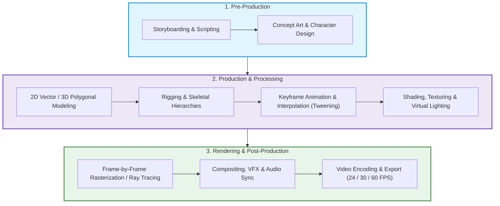
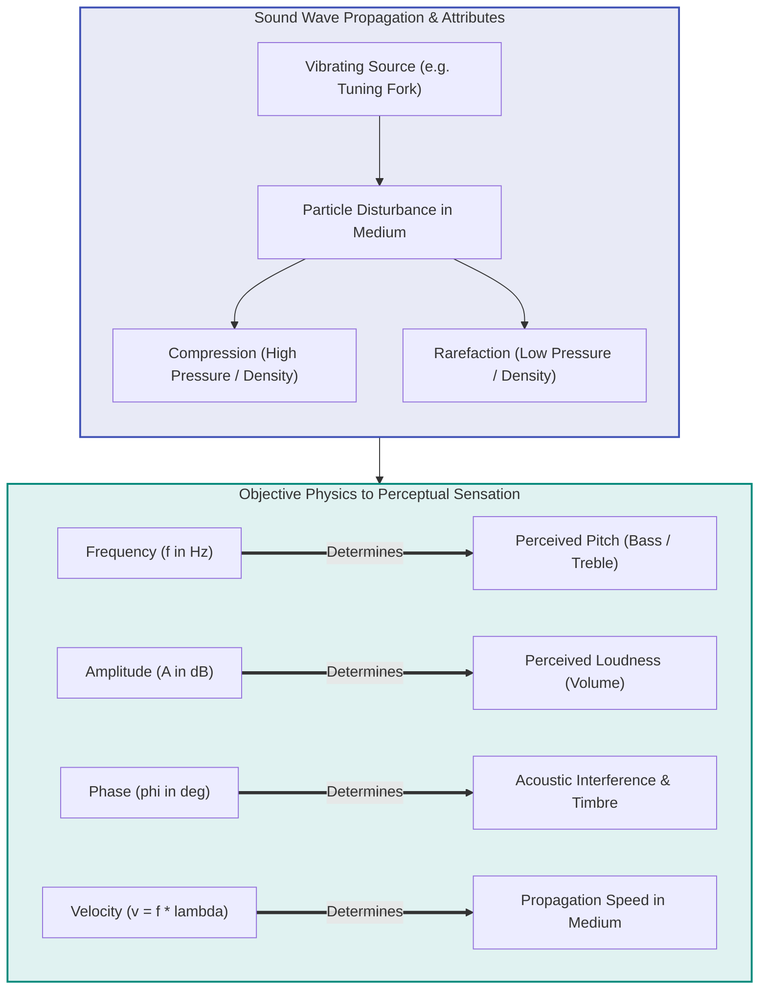
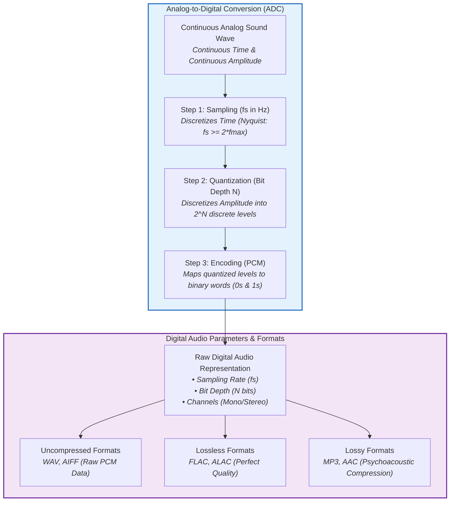
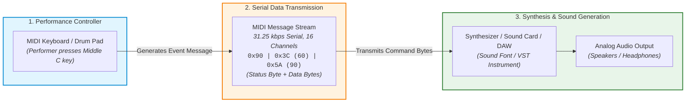

# Master Study Notes: Multimedia Systems & Applications

---

## 📑 Table of Contents

### 🎯 Main Exam Questions
| # | Question / Topic | Link |
|---|------------------|------|
| Q1 | What is computer-based animation? | [Go to Q1](#q1) |
| Q2 | What is sampling? | [Go to Q2](#q2) |
| Q3 | What is sound? | [Go to Q3](#q3) |
| Q4 | What do you mean by digital audio? | [Go to Q4](#q4) |
| Q5 | What is MIDI? | [Go to Q5](#q5) |

---

### 📖 Appendix Index (Key Terminology, Concepts & Deep Dives)
| # | Concept / Terminology | Topic Area | Link |
|---|-----------------------|------------|------|
| A1 | [Persistence of Vision](#concept-persistence-of-vision) | Animation Fundamentals | [Jump to Concept](#concept-persistence-of-vision) |
| A2 | [Keyframing & Inbetweening (Tweening)](#concept-keyframing-tweening) | Animation Techniques | [Jump to Concept](#concept-keyframing-tweening) |
| A3 | [Frame Rate (FPS)](#concept-frame-rate) | Video & Animation Metrics | [Jump to Concept](#concept-frame-rate) |
| A4 | [Nyquist-Shannon Sampling Theorem](#concept-nyquist-theorem) | Audio & Signal Processing | [Jump to Concept](#concept-nyquist-theorem) |
| A5 | [Aliasing & Anti-Aliasing Filter](#concept-aliasing) | Signal & Image Processing | [Jump to Concept](#concept-aliasing) |
| A6 | [Quantization vs Sampling](#concept-quantization-vs-sampling) | A/D Digitization Process | [Jump to Concept](#concept-quantization-vs-sampling) |
| A7 | [Compression & Rarefaction](#concept-compression-rarefaction) | Acoustics & Sound Waves | [Jump to Concept](#concept-compression-rarefaction) |
| A8 | [Acoustic Wave Phase & Interference](#concept-wave-phase) | Acoustics & Sound Waves | [Jump to Concept](#concept-wave-phase) |
| A9 | [Pulse Code Modulation (PCM)](#concept-pcm) | Digital Audio Representation | [Jump to Concept](#concept-pcm) |
| A10 | [Audio Bit Depth & Dynamic Range](#concept-bit-depth) | Digital Audio Metrics | [Jump to Concept](#concept-bit-depth) |
| A11 | [MIDI Channel & Status Byte Architecture](#concept-midi-architecture) | Music Protocols & Synthesizers | [Jump to Concept](#concept-midi-architecture) |
| A12 | [MIDI Velocity & Pitch Bend](#concept-midi-velocity) | Musical Performance Data | [Jump to Concept](#concept-midi-velocity) |

---

## 📝 Main Questions & Comprehensive Answers

<a id="q1"></a>
## Q1. What is computer-based animation?

### 1. Core Definitions & Principles
* **Definition:** **Computer-based animation** (or Computer Animation) is the art and science of creating moving images through the sequential generation, manipulation, and rendering of digital graphic objects, characters, or scenes using computer hardware and specialized software.
* **Underlying Principle:** It operates on the physiological principle of [Persistence of Vision](#concept-persistence-of-vision), where the human eye and brain fuse a rapid sequence of discrete static images into a continuous perception of motion.
* **Core Mechanisms:** Unlike traditional hand-drawn cel animation, computer animation uses mathematical algorithms, geometric coordinate transformations (translation, rotation, scaling), [Keyframing & Inbetweening (Tweening)](#concept-keyframing-tweening), and physics engines.

---

### 2. Conceptual Architecture & Pipeline



---

### 3. Step-by-Step Mechanisms & Categories

#### A. 2D Computer Animation
* **Mechanism:** Operates on a 2D coordinate grid $(X, Y)$ utilizing raster (bitmap) or vector graphics.
* **Techniques:**
  * **Morphing:** Seamless shape and color transformation from one image to another.
  * **Cut-out / Puppet Animation:** Layered vector segments connected by digital bones.
  * **[Tweening](#concept-keyframing-tweening):** Algorithmic calculation of intermediate frames between two defined keyframes.

#### B. 3D Computer Animation
* **Mechanism:** Constructs and manipulates geometric objects in a virtual 3-dimensional coordinate space $(X, Y, Z)$.
* **Core Stages:**
  1. **3D Modeling:** Designing polygon meshes, vertices, edges, and curved surfaces.
  2. **Rigging & Skinning:** Building an underlying skeleton and binding it to the surface mesh.
  3. **Animation:** Keyframing transformations using Forward Kinematics (FK), Inverse Kinematics (IK), or Motion Capture data.
  4. **Texturing & Virtual Lighting:** Applying UV surface maps and positioning virtual illumination sources.
  5. **Rendering:** Algorithmic calculation of reflections, shadows, and light paths into rasterized frames.

---

### 4. Implementation Best Practices & Optimization Layers

| Layer | Best Practices & Implementation Strategies |
|---|---|
| **Technical Layer (Performance & Quality)** | • Maintain standardized [Frame Rates (FPS)](#concept-frame-rate) (24 fps for cinematic motion blur, 60+ fps for real-time interactivity).<br>• Use Level of Detail (LOD) mesh optimization for real-time 3D pipelines.<br>• Apply anti-aliasing and motion blur to eliminate digital strobing and jagged edges. |
| **Administrative & Pipeline Layer** | • Enforce strict asset naming conventions and modular directory structures.<br>• Implement version control across 3D models, textures, rigs, and scene timelines.<br>• Perform early audio-video synchronization checks to avoid late-stage re-rendering. |

---

### 5. Summary Comparison: Traditional vs. Computer-Based Animation

| Parameter | Traditional (Cel) Animation | Computer-Based Animation (2D/3D) |
|---|---|---|
| **Medium** | Physical paper, acetate cels, paint | Digital workspace (Vectors, 3D Polygons, Pixels) |
| **Inbetweening** | Manually drawn frame-by-frame by hand | Automated algorithmic interpolation ([Tweening](#concept-keyframing-tweening)) |
| **Modification / Reusability** | Extremely difficult; requires complete redrawing | High reusability of models, rigs, motions, and textures |
| **Depth & Camera Control** | Simulated manually with layered multiplane stands | Full mathematical 3D virtual cameras with dynamic depth of field |
| **Production Efficiency** | Labor-intensive, time-consuming, expensive | Highly scalable, automated, and cost-efficient for complex scenes |

---

<a id="q2"></a>
## Q2. What is sampling?

### 1. Core Definitions & Principles
* **Definition:** **Sampling** is the initial fundamental stage in Analog-to-Digital Conversion (ADC) in which a continuous analog signal (e.g., sound pressure waves or continuous optical scenes) is measured at uniform, discrete time or spatial intervals.
* **Core Function:** It **discretizes the continuous time domain (or spatial domain)** into distinct measurement points along the time axis ($T_s$).
* **Sampling Rate ($f_s$):** The total number of discrete samples captured per second, expressed in **Hertz (Hz)**:
  $$f_s = \frac{1}{T_s}$$
* **Governing Principle:** Strictly defined by the [Nyquist-Shannon Sampling Theorem](#concept-nyquist-theorem), which requires:
  $$f_s \ge 2 \times f_{\max}$$
  *(where $f_{\max}$ is the highest frequency component contained in the original analog signal).*

---

### 2. Conceptual Flow & Signal Transformation Diagram

```mermaid
flowchart LR
    A["Continuous Analog Signal<br><i>Continuous Time (t) & Continuous Amplitude (V)</i>"] 
    --> B["Anti-Aliasing Low-Pass Filter<br><i>Cutoff: f_cutoff <= fs / 2</i>"]
    --> C["Periodic Sampler (Ts = 1/fs)<br><i>Discretizes Time Domain (t -> nTs)</i>"]
    --> D["Discrete-Time PAM Signal<br><i>Discrete Time & Continuous Amplitude</i>"]
    --> E["Quantizer (Bit Depth N)<br><i>Discretizes Amplitude (Levels = 2^N)</i>"]
    --> F["Binary Encoder<br><i>Generates 0s and 1s Bitstream</i>"]
    --> G["Digital Audio Data<br><i>(e.g., 44.1 kHz, 16-bit PCM)</i>"]

    style A fill:#fff3e0,stroke:#e65100,stroke-width:2px;
    style C fill:#e1f5fe,stroke:#0288d1,stroke-width:2px;
    style E fill:#f3e5f5,stroke:#7b1fa2,stroke-width:2px;
    style G fill:#e8f5e9,stroke:#2e7d32,stroke-width:2px;
```



---

### 3. Step-by-Step Mechanisms & Domains

#### A. Temporal Sampling (Audio & Speech)
1. **Low-Pass Filtering:** The input analog wave passes through an analog anti-aliasing filter to eliminate components above the Nyquist frequency ($f_s / 2$).
2. **Sample-and-Hold:** An electronic circuit samples the instantaneous voltage at constant intervals $T_s$ and holds the value stable for the quantizer.
3. **Standard Industry Sampling Rates:**
   * **Telephone Speech Quality:** $f_{\max} = 4\text{ kHz} \implies f_s = 8\text{ kHz}$ (8,000 samples/sec).
   * **Clear Speech Recording:** $f_{\max} = 8\text{ kHz} \implies f_s = 16\text{ kHz}$ (16,000 samples/sec).
   * **Audio CD Standard:** $f_{\max} = 20\text{ kHz} \implies f_s = 44.1\text{ kHz}$ (44,100 samples/sec).
   * **Professional Studio / Video:** $f_s = 48\text{ kHz}$ or $96\text{ kHz}$.

#### B. Spatial Sampling (Digital Images)
* In 2D digital image acquisition, spatial sampling discretizes the continuous optical image plane $(x, y)$ into a discrete 2D grid of **pixels**. The spatial sampling frequency directly dictates the **image resolution** (e.g., DPI or pixel dimensions $M \times N$).

---

### 4. Technical Best Practices & Failure Countermeasures

| Layer | Technical Strategy / Countermeasure |
|---|---|
| **Aliasing Prevention (Technical Layer)** | • Apply an analog **Anti-Aliasing Filter (Low-Pass Filter)** prior to sampling to eliminate frequencies above $f_s / 2$.<br>• Use **Oversampling** ($f_s \gg 2 f_{\max}$) to simplify analog filter design and improve Signal-to-Noise Ratio (SNR). |
| **System & Bandwidth Optimization** | • Select $f_s$ appropriate for the use-case (e.g., 8 kHz for VoIP to save bandwidth; 44.1 kHz / 48 kHz for high-fidelity music). |

---

### 5. Summary Comparison: Sampling vs. Quantization

| Parameter | [Sampling](#concept-quantization-vs-sampling) | [Quantization](#concept-quantization-vs-sampling) |
|---|---|---|
| **Discretized Axis** | **Time / Spatial axis** ($x$-axis) | **Amplitude / Intensity axis** ($y$-axis) |
| **Input $\rightarrow$ Output** | Continuous-time signal $\rightarrow$ Discrete-time signal | Continuous-amplitude sample $\rightarrow$ Discrete-level value |
| **Primary Metric** | **Sampling Rate** ($f_s$ in Hz / kHz) | **Bit Depth** ($N$ bits, Levels $= 2^N$) |
| **Distortion if Insufficient** | [Aliasing Distortion](#concept-aliasing) (ghost frequencies) | **Quantization Error / Noise** (granular hiss) |
| **Standard Values (CD)** | $44.1\text{ kHz}$ (44,100 samples/sec) | $16\text{ bits}$ ($2^{16} = 65,536$ levels) |

---

<a id="q3"></a>
## Q3. What is sound?

### 1. Core Definitions & Principles
* **Definition:** **Sound** is a form of **mechanical energy** that propagates through a physical medium (such as air, water, or solids) as particle vibrations.
* **Propagation Nature:** It travels as a **longitudinal mechanical wave**, where the particles of the medium oscillate back and forth parallel to the direction of wave propagation.
* **Generation Mechanism:** When a physical object vibrates, it disturbs surrounding medium particles, creating alternating cycles of:
  * **[Compression](#concept-compression-rarefaction):** Regions where particles are pushed tightly together (high pressure / high density).
  * **[Rarefaction](#concept-compression-rarefaction):** Regions where particles are spread apart (low pressure / low density).
* **Medium Requirement:** Sound strictly **requires a physical medium** to propagate and **cannot travel through a vacuum**.

---

### 2. Conceptual Wave Propagation & Property Relationships



---

### 3. Key Physical Properties & Mathematical Formulas

1. **Frequency ($f$):**
   * Number of complete cycles per second: $f = \frac{\text{Number of cycles}}{\text{Time (seconds)}}$
   * **Unit:** Hertz (Hz). Perceived as **Pitch**.
   * **Human Hearing Range:** **$20\text{ Hz}$ to $20,000\text{ Hz}$ ($20\text{ kHz}$)**.
   * *Example:* $440$ oscillations/second $= 440\text{ Hz}$ (Standard Concert Pitch A).

2. **Wavelength ($\lambda$):**
   * Spatial distance between two consecutive compressions or rarefactions: $\lambda = \frac{v}{f}$
   * *Example:* For a $440\text{ Hz}$ wave in air ($v = 343\text{ m/s}$), $\lambda = \frac{343}{440} \approx 0.78\text{ m}$.

3. **Amplitude ($A$):**
   * Maximum displacement of particles from equilibrium. Perceived as **Loudness**.
   * Measured logarithmically in **Decibels (dB)** (e.g., whisper $\approx 40\text{ dB}$; jet engine $\ge 120\text{ dB}$).

4. **Velocity / Speed of Sound ($v$):**
   * Speed of sound wave propagation: $v = f \times \lambda$
   * **Air ($20^\circ\text{C}$):** $\approx 343\text{ m/s}$ | **Water:** $\approx 1500\text{ m/s}$ | **Steel:** $\approx 5960\text{ m/s}$

5. **[Phase ($\phi$)](#concept-wave-phase):**
   * Fractional point in the wave cycle measured in degrees ($^\circ$) or radians.
   * **In-Phase ($0^\circ$):** Constructive interference (amplified sound).
   * **Out-of-Phase ($180^\circ$):** Destructive interference (phase cancellation / silence).

---

### 4. Classification: Types of Sound in Multimedia

| Sound Type | Acoustic & Structural Characteristics | Primary Applications |
|---|---|---|
| **1. Speech** | • Structured sequence of phonemes.<br>• Dynamic variations in pitch, rhythm, and tone.<br>• Contains voiced and unvoiced components. | • Voice assistants (Siri, Alexa).<br>• Speech recognition & NLP.<br>• VoIP & Telephony. |
| **2. Music** | • Harmonic combinations structured into notes, chords, and scales.<br>• Rich harmonic multiples of fundamental frequency ($f_0$). | • Audio synthesizers & MIDI systems.<br>• MP3 / AAC streaming.<br>• Video game & film scoring. |
| **3. Noise** | • Random, aperiodic mix of frequencies with no recognizable pitch or pattern. | • Active Noise Cancellation (ANC).<br>• Equalization & Audio filtering. |

---

### 5. Summary Comparison: Fundamental Sound Properties

| Property | Symbol & Unit | Physical Definition | Perceived Sensation | Governed By Formula |
|---|---|---|---|---|
| **Frequency** | $f$ (Hz) | Cycles per unit time | **Pitch** (Bass / Treble) | $f = \frac{1}{T}$ |
| **Amplitude** | $A$ (dB) | Particle displacement | **Loudness / Volume** | $\text{dB} = 20 \log_{10}(P/P_0)$ |
| **Wavelength** | $\lambda$ (m) | Distance per full cycle | Physical wave scale | $\lambda = \frac{v}{f}$ |
| **Velocity** | $v$ (m/s) | Wave travel speed | Arrival latency | $v = f \times \lambda$ |
| **Phase** | $\phi$ ($^\circ$ / rad) | Offset in wave cycle | Interference / Timbre | $\Delta \phi = \frac{2\pi \Delta x}{\lambda}$ |

---

<a id="q4"></a>
## Q4. What do you mean by digital audio?

### 1. Core Definitions & Principles
* **Definition:** **Digital Audio** refers to the numerical, binary representation of physical sound waves $(0\text{s and } 1\text{s})$ that enables acoustic signals to be stored, manipulated, copied, and transmitted by digital computer systems without generational signal degradation.
* **Fundamental Purpose:** Natural sound is continuous (analog) in both time and amplitude. Digital audio bridges this by digitizing the analog waveform into a stream of discrete binary numbers through the three-step **Analog-to-Digital Conversion (ADC)** pipeline.
* **Storage Reality:** Unlike symbolic musical formats (such as MIDI), a digital audio file **stores the actual physical sound wave data** in digital format.

---

### 2. Conceptual Architecture: Audio Digitization & Storage Pipeline



---

### 3. Step-by-Step Mechanisms & Digitization Process

1. **Step 1: [Sampling](#concept-quantization-vs-sampling)**
   * Measures the amplitude of the continuous analog sound wave at fixed time intervals $T_s$.
   * Governed by the [Nyquist–Shannon Theorem](#concept-nyquist-theorem) ($f_s \ge 2 \times f_{\max}$).
   * *Example:* For standard human audible limit ($20\text{ kHz}$), CD Audio samples at $44.1\text{ kHz}$ ($44,100\text{ samples/sec}$).

2. **Step 2: [Quantization](#concept-quantization-vs-sampling)**
   * Maps each sampled continuous amplitude to the nearest discrete level from a finite set of $2^{\text{Bit Depth}}$ values.
   * **Formula:** $\text{Discrete Levels} = 2^{\text{Bit Depth}}$
   * *Example:* An 8-bit system yields $2^8 = 256$ discrete levels; a 16-bit system yields $2^{16} = 65,536$ discrete amplitude levels.

3. **Step 3: Encoding ([PCM](#concept-pcm))**
   * Transforms discrete, quantized amplitude numbers into binary words ($0\text{s and } 1\text{s}$).
   * *Example:* A decimal quantized sample value of $150$ in an 8-bit system is encoded as `10010110`.

---

### 4. Key Parameters Defining Digital Audio

* **1. Sampling Rate ($f_s$):** The number of samples taken per second (e.g., $44.1\text{ kHz}$ for CD, $48\text{ kHz}$ for video soundtracks). Higher $f_s \rightarrow$ captures higher audio frequencies accurately.
* **2. [Bit Depth / Sample Size](#concept-bit-depth):** Number of bits used per sample (e.g., 16-bit, 24-bit). Higher bit depth $\rightarrow$ greater dynamic range and reduced quantization noise.
* **3. Channels:** 
  * **Mono (1 channel):** Single signal delivered uniformly to all speakers.
  * **Stereo (2 channels):** Independent Left ($L$) and Right ($R$) audio channels for spatial stereo imaging.
  * **Surround Sound (5.1 / 7.1 channels):** Multi-channel configurations providing immersive 3D positional audio.
* **4. Bitrate ($\text{bps}$):** Total data processed per second:
  $$\text{Bitrate} = f_s \times \text{Bit Depth} \times \text{Number of Channels}$$
  * *Example (Standard CD Audio):*
    $$\text{Bitrate} = 44,100\text{ Hz} \times 16\text{ bits} \times 2\text{ channels} = 1,411,200\text{ bps} \approx 1411.2\text{ kbps}$$

---

### 5. Technical Best Practices & Audio Format Selection

| Audio Category | Standard Formats | Technical Trade-offs | Recommended Use-Cases |
|---|---|---|---|
| **Uncompressed** | **WAV**, **AIFF** | Stores raw [PCM](#concept-pcm) stream; highest fidelity, very large file sizes. | Studio recording, professional DAW mixing, audio master copies. |
| **Lossless Compressed** | **FLAC**, **ALAC** | Perfect bit-for-bit audio recreation; ~50% smaller file size than raw WAV. | Audiophile playback, high-grade archival, mastering backup. |
| **Lossy Compressed** | **MP3**, **AAC**, **OGG** | Discards psychoacoustically inaudible frequencies; ultra-compact file sizes (~10:1 ratio). | Web streaming (Spotify, YouTube), podcasts, mobile devices. |

---

### 6. Summary Comparison: Digital Audio vs. MIDI

| Parameter | Digital Audio | MIDI (Musical Instrument Digital Interface) |
|---|---|---|
| **Underlying Nature** | Digital representation of **physical sound waves** (sample stream) | **Control instructions/commands** representing musical performance |
| **Data Content** | Stores **actual sound data** as a series of 0s and 1s | Stores **no actual sound**; transmits Note-On, Pitch, Velocity, Channel |
| **File Size** | Large file sizes (proportional to duration and quality) | Extremely small and compact (text/command-based) |
| **Acoustic Fidelity** | Reproduces the exact recorded voice, instrument, or acoustic event | Sound depends on the receiving synthesizer / sound font module |
| **Primary Usage** | Recording, editing, and playback of voice, music, and sound effects | Controlling synthesizers, sequencers, electronic keyboards, drum machines |

---

<a id="q5"></a>
## Q5. What is MIDI?

### 1. Core Definitions & Principles
* **Definition:** **MIDI** stands for **Musical Instrument Digital Interface**. Introduced in 1983, it is an industry-standard digital communications protocol and specification that enables electronic musical instruments (keyboards, drum machines), computers, and audio hardware to communicate musical performance data.
* **Core Principle:** **MIDI does NOT store or transmit actual digitized audio waveforms.** Instead, it transmits symbolic performance **instructions/commands** describing how music should be generated by a target sound synthesizer.
* **Key Commands Transmitted:**
  * Which note is pressed (Note Number $0\text{--}127$).
  * When a note starts and stops ([Note-On / Note-Off](#concept-midi-architecture)).
  * How hard or fast the key was struck ([Velocity](#concept-midi-velocity) $0\text{--}127$).
  * Performance modifiers (Pitch Bend, Modulation, Aftertouch, Program/Instrument Changes).

---

### 2. Conceptual Architecture & Data Flow Pipeline



---

### 3. Step-by-Step Mechanisms: Message Structure & Specs

#### A. Structure of a Standard MIDI Channel Message (3 Bytes)
Standard MIDI event commands are transmitted as 3-byte packets:

```
+------------------------------------+------------------------------------+------------------------------------+
|            STATUS BYTE             |            DATA BYTE 1             |            DATA BYTE 2             |
+------------------------------------+------------------------------------+------------------------------------+
|  Event Type + Channel (1 to 16)    |     Note Number (0 to 127)         |      Velocity (0 to 127)           |
|  e.g., 0x90 (Note-On, Channel 1)   |     e.g., 60 (Middle C)            |      e.g., 90 (Key Strike Force)   |
+------------------------------------+------------------------------------+------------------------------------+
```

* **[Status Byte](#concept-midi-architecture):** MSB is `1` (range `0x80` to `0xFF`). Defines the event type (e.g., `0x9_` = Note-On, `0x8_` = Note-Off) and the target channel ($1\text{--}16$).
* **Data Byte 1:** MSB is `0` (range `0` to `127`). Identifies the note pitch ($60 = \text{Middle C}$).
* **[Data Byte 2 (Velocity)](#concept-midi-velocity):** MSB is `0` (range `0` to `127`). Represents key impact dynamics (loudness/attack).

#### B. Hardware & Transmission Specifications
* **Communication Type:** Asynchronous serial transmission.
* **Baud Rate:** Exactly **$31.25\text{ kbps}$** ($\pm 1\%$).
* **Multi-Channel Architecture:** Supports **16 discrete logical channels** over a single standard 5-pin DIN or USB MIDI connection.
* **Connectors:** Traditional 5-pin DIN cable ports:
  * **MIDI IN:** Receives incoming MIDI messages.
  * **MIDI OUT:** Transmits MIDI messages generated by the device.
  * **MIDI THRU:** Direct duplicate passthrough of the incoming MIDI IN stream for daisy-chaining devices.

---

### 4. Technical Best Practices & System Integration

| Layer | Technical Strategy / Best Practice |
|---|---|
| **System & Routing Layer** | • Use **General MIDI (GM)** standard mapping for universal instrument bank consistency across different synthesizers.<br>• Utilize MIDI over USB or virtual MIDI loopbacks to eliminate serial cable latency and jitter in modern DAWs. |
| **Performance & Sound Design** | • Combine MIDI tracks with high-resolution sample libraries (VST plugins) for realistic orchestral rendering.<br>• Apply quantize filters carefully in software sequencers to prevent music from sounding unnaturally rigid/robotic. |

---

### 5. Summary Comparison: Digital Audio vs. MIDI

| Parameter | Digital Audio (PCM, WAV, MP3) | MIDI (.mid) |
|---|---|---|
| **Fundamental Nature** | Digitized stream of physical sound waves | Digital score / control instructions for synthesizers |
| **Stored Content** | Actual sound waveform data ($0\text{s and } 1\text{s}$) | Performance events (Note-On, Pitch, Velocity, Channel) |
| **File Size** | **Large** (e.g., ~10 MB per minute for WAV, ~1 MB for MP3) | **Extremely Tiny** (e.g., ~10 KB to 50 KB for an entire song) |
| **Hardware Dependency** | Sounds identical on any playback system | Sound quality depends entirely on the receiving sound synthesizer / sound card |
| **Editability** | Difficult to alter individual instruments or notes after recording | Extremely easy to modify pitch, tempo, key, instrument, and velocity note-by-note |
| **Voice & Acoustics** | Can record human voice, singing, live guitar, ambient sound | Cannot directly record human speech or organic vocals |

---

## 📚 Appendix: Conceptual Explanations & Terminology Deep Dives

<a id="concept-persistence-of-vision"></a>
### 📌 Concept: Persistence of Vision
* **Simple Analogy:** Think of spinning a glowing sparkler at night in a fast circle—you see a continuous glowing ring rather than isolated points of light.
* **Technical Definition:** The physiological phenomenon where an image remains retained on the retina of the human eye for a fraction of a second ($\approx 1/16^{\text{th}}$ to $1/10^{\text{th}}$ of a second) after the actual stimulus is removed. When static frames are shown faster than the eye's visual decay rate, the visual cortex fuses them into smooth motion.

---

<a id="concept-keyframing-tweening"></a>
### 📌 Concept: Keyframing & Inbetweening (Tweening)
* **Simple Analogy:** A master artist sketches only the extreme poses of a jump (crouch, peak jump, landing), and the assistant fills in all the tiny stepping poses in between.
* **Technical Definition:** 
  * **Keyframe:** A reference frame marking the beginning, apex, or termination of an action, explicitly defining parameters (position, rotation, scale, color).
  * **Tweening (In-Betweening):** The automated mathematical interpolation (linear, Bézier, or spline) performed by animation software to generate all transitional frames between two keyframes.

---

<a id="concept-frame-rate"></a>
### 📌 Concept: Frame Rate (FPS)
* **Simple Analogy:** The speed at which you flip the pages of a flipbook. Flip too slowly and it looks like a slideshow; flip fast enough and it becomes a movie.
* **Technical Definition:** The frequency at which consecutive images (frames) are captured or displayed per second, measured in **Frames Per Second (FPS)**. Common industry standards:
  * **24 FPS:** Standard Film / Cinema (natural motion blur)
  * **25 / 30 FPS:** Television broadcast (PAL / NTSC)
  * **60+ FPS:** Modern Interactive Video Games & Virtual Reality (eliminates latency and motion sickness)

---

<a id="concept-nyquist-theorem"></a>
### 📌 Concept: Nyquist-Shannon Sampling Theorem
* **Simple Analogy:** To know whether a seesaw is going up or down, you must look at it at least twice per swing (once at the top, once at the bottom). If you look only once per full swing, it will seem completely stationary.
* **Technical Definition:** A fundamental theorem of digital signal processing stating that a continuous-time signal containing maximum frequency $f_{\max}$ can be completely and uniquely reconstructed from its samples if and only if the sampling rate $f_s$ is strictly greater than or equal to twice the maximum frequency:
  $$f_s \ge 2 f_{\max}$$
  The threshold $2 f_{\max}$ is termed the **Nyquist Rate**, and $f_s / 2$ is the **Nyquist Frequency**.

---

<a id="concept-aliasing"></a>
### 📌 Concept: Aliasing & Anti-Aliasing Filter
* **Simple Analogy:** The "wagon-wheel effect" in Western movies where a stagecoach wheel moving rapidly forward appears to spin backward or stand still because the camera's frame rate is too slow to capture the true rotational speed.
* **Technical Definition:** A high-frequency signal sampled below the Nyquist rate ($f_s < 2 f_{\max}$) impersonates (aliases as) a non-existent lower-frequency artifact upon reconstruction. An **Anti-Aliasing Filter** is an analog low-pass filter placed prior to the sampler to cut off frequencies above $f_s / 2$.

---

<a id="concept-quantization-vs-sampling"></a>
### 📌 Concept: Quantization vs Sampling
* **Simple Analogy:** Imagine drawing a curved graph on graph paper. **Sampling** is drawing vertical grid lines (deciding how often in time to take a reading), while **Quantization** is snapping the readings to the nearest horizontal grid line (rounding the measured value to fixed steps).
* **Technical Definition:** 
  * **Sampling:** Discretization along the independent variable axis (Time $t$ for audio, Space $(x,y)$ for images).
  * **Quantization:** Discretization along the dependent variable axis (Amplitude/Voltage for audio, Brightness/Color intensity for images).

---

<a id="concept-compression-rarefaction"></a>
### 📌 Concept: Compression & Rarefaction
* **Simple Analogy:** Think of an accordion or a slinky spring. When pushed together, the coils squeeze tightly together (**compression**). When pulled apart, the coils stretch wide with lots of space between them (**rarefaction**).
* **Technical Definition:**
  * **Compression:** A region in a longitudinal sound wave where medium particles are compressed together under higher pressure and higher density.
  * **Rarefaction:** A region in a longitudinal sound wave where medium particles are spread apart under lower pressure and lower density.

---

<a id="concept-wave-phase"></a>
### 📌 Concept: Acoustic Wave Phase & Interference
* **Simple Analogy:** Two people pushing a swing at the exact same time make it go much higher (constructive interference). If one person pushes while the other pulls in the opposite direction, the swing stops moving completely (destructive interference).
* **Technical Definition:**
  * **Phase ($\phi$):** The specific fractional point in time or space within a wave's periodic cycle, measured in degrees ($0^\circ$ to $360^\circ$) or radians ($0$ to $2\pi$).
  * **In-Phase ($0^\circ$ difference):** Peaks match peaks, resulting in constructive summation and doubled acoustic power.
  * **Out-of-Phase ($180^\circ$ difference):** Peaks match troughs, resulting in destructive phase cancellation (the principle behind Active Noise-Cancelling headphones).

---

<a id="concept-pcm"></a>
### 📌 Concept: Pulse Code Modulation (PCM)
* **Simple Analogy:** Reading the temperature once an hour and writing down the rounded numbers in a digital diary as a row of binary numbers.
* **Technical Definition:** The standard raw method used to digitally represent analog audio signals. In PCM, the amplitude of the analog signal is sampled regularly at uniform intervals (sampling), and each sample is quantized to the nearest value within a range of digital steps, stored directly as binary words (used in WAV, AIFF, and Audio CD-DA).

---

<a id="concept-bit-depth"></a>
### 📌 Concept: Audio Bit Depth & Dynamic Range
* **Simple Analogy:** Measuring heights using a ruler marked only in feet versus a ruler marked in millimeters. The millimeter ruler gives far finer steps with negligible rounding errors.
* **Technical Definition:** The number of bits of information in each audio sample, which directly determines the resolution and **Dynamic Range** (the ratio between the quietest and loudest possible undistorted sound). 
  * Rule of thumb: **$\approx 6\text{ dB}$ of dynamic range per bit** ($16\text{-bit} \approx 96\text{ dB}$, $24\text{-bit} \approx 144\text{ dB}$).

---

<a id="concept-midi-architecture"></a>
### 📌 Concept: MIDI Channel & Status Byte Architecture
* **Simple Analogy:** Sheet music sent via digital mail. Instead of hearing the orchestra playing, the conductor receives a letter saying: *"Violins (Channel 1), play Middle C now with forte loudness (Velocity 90)"*.
* **Technical Definition:** The hierarchical message layout of the MIDI 1.0 specification. A status byte begins with a binary `1` bit (MSB=1), identifying commands such as `0x8_` (Note Off), `0x9_` (Note On), `0xB_` (Control Change), and `0xC_` (Program Change), multiplexing 16 individual instrument channels on one communication line.

---

<a id="concept-midi-velocity"></a>
### 📌 Concept: MIDI Velocity & Pitch Bend
* **Simple Analogy:** How gently or aggressively a pianist strikes the physical piano key.
* **Technical Definition:** 
  * **Velocity:** A 7-bit data value ($0\text{ to }127$) transmitted alongside Note-On events measuring key strike velocity, controlling output volume and timbre dynamics.
  * **Pitch Bend:** A 14-bit dual-byte parameter allowing smooth, continuous microtonal pitch variations up and down without jumping discrete chromatic steps.
