# Master Study Notes: Multimedia Systems & Applications

---

## 📑 Table of Contents

### 🎯 Main Exam Questions
| # | Question / Topic | Link |
|---|------------------|------|
| Q1 | What is computer-based animation? | [Go to Q1](#q1) |
| Q2 | What is sampling? | [Go to Q2](#q2) |
| Q3 | What is sound? | [Go to Q3](#q3) |
| Q4 | What do you mean by digital audio? | [Go to Q4](#q4) |
| Q5 | What is MIDI? | [Go to Q5](#q5) |
| Q7 | What is pixel? | [Go to Q7](#q7) |
| Q8 | What is tweening? | [Go to Q8](#q8) |
| Q9 | What is JPEG? | [Go to Q9](#q9) |
| Q10 | What is RAW image? | [Go to Q10](#q10) |
| Q11 | Difference between Raster and Vector Image | [Go to Q11](#q11) |
| Q12 | Digital Audio VS MIDI (Comprehensive Comparison) | [Go to Q12](#q12) |
| Q13 | Explain Different Types of Sound (Speech, Music, Noise) | [Go to Q13](#q13) |
| Q14 | Compare and Contrast JPEG and MPEG | [Go to Q14](#q14) |
| Q15 | Explain RGB Model Briefly (RGB vs. CMYK Color Models) | [Go to Q15](#q15) |
| Q16 | Explain All Common Raster Image Formats (BMP, JPEG, PNG, GIF, TIFF) | [Go to Q16](#q16) |

---

### 📖 Appendix Index (Key Terminology, Concepts & Deep Dives)
| # | Concept / Terminology | Topic Area | Link |
|---|-----------------------|------------|------|
| A1 | [Persistence of Vision](#concept-persistence-of-vision) | Animation Fundamentals | [Jump to Concept](#concept-persistence-of-vision) |
| A2 | [Keyframing & Inbetweening (Tweening)](#concept-keyframing-tweening) | Animation Techniques | [Jump to Concept](#concept-keyframing-tweening) |
| A3 | [Frame Rate (FPS)](#concept-frame-rate) | Video & Animation Metrics | [Jump to Concept](#concept-frame-rate) |
| A4 | [Nyquist-Shannon Sampling Theorem](#concept-nyquist-theorem) | Audio & Signal Processing | [Jump to Concept](#concept-nyquist-theorem) |
| A5 | [Aliasing & Anti-Aliasing Filter](#concept-aliasing) | Signal & Image Processing | [Jump to Concept](#concept-aliasing) |
| A6 | [Quantization vs Sampling](#concept-quantization-vs-sampling) | A/D Digitization Process | [Jump to Concept](#concept-quantization-vs-sampling) |
| A7 | [Compression & Rarefaction](#concept-compression-rarefaction) | Acoustics & Sound Waves | [Jump to Concept](#concept-compression-rarefaction) |
| A8 | [Acoustic Wave Phase & Interference](#concept-wave-phase) | Acoustics & Sound Waves | [Jump to Concept](#concept-wave-phase) |
| A9 | [Pulse Code Modulation (PCM)](#concept-pcm) | Digital Audio Representation | [Jump to Concept](#concept-pcm) |
| A10 | [Audio Bit Depth & Dynamic Range](#concept-bit-depth) | Digital Audio Metrics | [Jump to Concept](#concept-bit-depth) |
| A11 | [MIDI Channel & Status Byte Architecture](#concept-midi-architecture) | Music Protocols & Synthesizers | [Jump to Concept](#concept-midi-architecture) |
| A12 | [MIDI Velocity & Pitch Bend](#concept-midi-velocity) | Musical Performance Data | [Jump to Concept](#concept-midi-velocity) |
| A13 | [Color Depth (Bits Per Pixel / bpp)](#concept-color-depth) | Image Fundamentals | [Jump to Concept](#concept-color-depth) |
| A14 | [Spatial Resolution & Pixel Density (PPI/DPI)](#concept-spatial-resolution) | Display & Sensor Metrics | [Jump to Concept](#concept-spatial-resolution) |
| A15 | [Pixelation & Aliasing Artifacts](#concept-pixelation) | Digital Raster Artifacts | [Jump to Concept](#concept-pixelation) |
| A16 | [MIDI Guitar Controllers vs Audio Guitars](#concept-midi-guitar) | MIDI Hardware & Synthesis | [Jump to Concept](#concept-midi-guitar) |
| A17 | [Interpolation Curves: Linear vs Bézier vs Spline](#concept-interpolation-curves) | Animation Interpolation | [Jump to Concept](#concept-interpolation-curves) |
| A18 | [Morphing vs Motion Tweening](#concept-morphing-vs-motion) | Computer Animation Techniques | [Jump to Concept](#concept-morphing-vs-motion) |
| A19 | [Discrete Cosine Transform (DCT) in JPEG](#concept-dct) | Lossy Image Compression | [Jump to Concept](#concept-dct) |
| A20 | [Chroma Subsampling (YCbCr vs RGB)](#concept-chroma-subsampling) | Image & Video Compression | [Jump to Concept](#concept-chroma-subsampling) |
| A21 | [Lossy vs Lossless Image Compression](#concept-lossy-vs-lossless) | Compression Paradigms | [Jump to Concept](#concept-lossy-vs-lossless) |
| A22 | [Bayer Filter Array & Demosaicing](#concept-bayer-demosaicing) | Camera Sensor Architecture | [Jump to Concept](#concept-bayer-demosaicing) |
| A23 | [RAW vs Processed JPEG Pipeline](#concept-raw-vs-jpeg) | Digital Photography Pipelines | [Jump to Concept](#concept-raw-vs-jpeg) |
| A24 | [Dynamic Range & Bit Depth in RAW Files](#concept-raw-dynamic-range) | Sensor Photometry & Imaging | [Jump to Concept](#concept-raw-dynamic-range) |
| A25 | [Resolution Independence in Vectors](#concept-resolution-independence) | Vector Geometry | [Jump to Concept](#concept-resolution-independence) |
| A26 | [Rasterization Engine: Vector to Pixels](#concept-rasterization-engine) | Computer Graphics Rendering | [Jump to Concept](#concept-rasterization-engine) |
| A27 | [CMYK Color Model (Cyan, Magenta, Yellow, Key/Black)](#concept-cmyk) | Color Spaces & Print Reproduction | [Jump to Concept](#concept-cmyk) |
| A28 | [Wavetable Synthesis vs Sampled Audio Playback](#concept-wavetable-synthesis) | Sound Synthesis Paradigms | [Jump to Concept](#concept-wavetable-synthesis) |
| A29 | [Audio Bitrate vs MIDI Baud Rate](#concept-audio-vs-midi-rates) | Multimedia Bandwidth Metrics | [Jump to Concept](#concept-audio-vs-midi-rates) |
| A30 | [Temporal vs Spatial Redundancy (I, P, B Frames)](#concept-temporal-redundancy) | Video Compression (MPEG) | [Jump to Concept](#concept-temporal-redundancy) |
| A31 | [Additive vs Subtractive Color Mixing](#concept-additive-subtractive) | Color Theory & Hardware | [Jump to Concept](#concept-additive-subtractive) |
| A32 | [RGB Color Cube Geometry & Gamut](#concept-rgb-cube) | Color Space Geometry | [Jump to Concept](#concept-rgb-cube) |
| A33 | [LZW Compression Algorithm](#concept-lzw-compression) | Lossless Dictionary Encoding | [Jump to Concept](#concept-lzw-compression) |

---

## 📝 Main Questions & Comprehensive Answers

<a id="q1"></a>
## Q1. What is computer-based animation?

### 1. Core Definitions & Principles
* **Definition:** **Computer-based animation** (or Computer Animation) is the art and science of creating moving images through the sequential generation, manipulation, and rendering of digital graphic objects, characters, or scenes using computer hardware and specialized software.
* **Underlying Principle:** It operates on the physiological principle of [Persistence of Vision](#concept-persistence-of-vision), where the human eye and brain fuse a rapid sequence of discrete static images into a continuous perception of motion.
* **Core Mechanisms:** Unlike traditional hand-drawn cel animation, computer animation uses mathematical algorithms, geometric coordinate transformations (translation, rotation, scaling), [Keyframing & Inbetweening (Tweening)](#concept-keyframing-tweening), and physics engines.

---

### 2. Conceptual Architecture & Pipeline

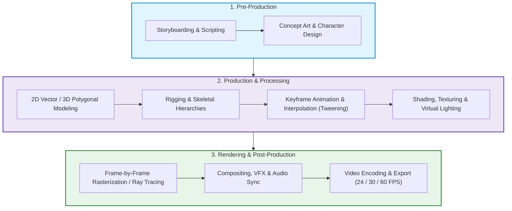

---

### 3. Step-by-Step Mechanisms & Categories

#### A. 2D Computer Animation
* **Mechanism:** Operates on a 2D coordinate grid $(X, Y)$ utilizing raster (bitmap) or vector graphics.
* **Techniques:**
  * **Morphing:** Seamless shape and color transformation from one image to another.
  * **Cut-out / Puppet Animation:** Layered vector segments connected by digital bones.
  * **[Tweening](#concept-keyframing-tweening):** Algorithmic calculation of intermediate frames between two defined keyframes.

#### B. 3D Computer Animation
* **Mechanism:** Constructs and manipulates geometric objects in a virtual 3-dimensional coordinate space $(X, Y, Z)$.
* **Core Stages:**
  1. **3D Modeling:** Designing polygon meshes, vertices, edges, and curved surfaces.
  2. **Rigging & Skinning:** Building an underlying skeleton and binding it to the surface mesh.
  3. **Animation:** Keyframing transformations using Forward Kinematics (FK), Inverse Kinematics (IK), or Motion Capture data.
  4. **Texturing & Virtual Lighting:** Applying UV surface maps and positioning virtual illumination sources.
  5. **Rendering:** Algorithmic calculation of reflections, shadows, and light paths into rasterized frames.

---

### 4. Implementation Best Practices & Optimization Layers

| Layer | Best Practices & Implementation Strategies |
|---|---|
| **Technical Layer (Performance & Quality)** | • Maintain standardized [Frame Rates (FPS)](#concept-frame-rate) (24 fps for cinematic motion blur, 60+ fps for real-time interactivity).<br>• Use Level of Detail (LOD) mesh optimization for real-time 3D pipelines.<br>• Apply anti-aliasing and motion blur to eliminate digital strobing and jagged edges. |
| **Administrative & Pipeline Layer** | • Enforce strict asset naming conventions and modular directory structures.<br>• Implement version control across 3D models, textures, rigs, and scene timelines.<br>• Perform early audio-video synchronization checks to avoid late-stage re-rendering. |

---

### 5. Summary Comparison: Traditional vs. Computer-Based Animation

| Parameter | Traditional (Cel) Animation | Computer-Based Animation (2D/3D) |
|---|---|---|
| **Medium** | Physical paper, acetate cels, paint | Digital workspace (Vectors, 3D Polygons, Pixels) |
| **Inbetweening** | Manually drawn frame-by-frame by hand | Automated algorithmic interpolation ([Tweening](#concept-keyframing-tweening)) |
| **Modification / Reusability** | Extremely difficult; requires complete redrawing | High reusability of models, rigs, motions, and textures |
| **Depth & Camera Control** | Simulated manually with layered multiplane stands | Full mathematical 3D virtual cameras with dynamic depth of field |
| **Production Efficiency** | Labor-intensive, time-consuming, expensive | Highly scalable, automated, and cost-efficient for complex scenes |

---

<a id="q2"></a>
## Q2. What is sampling?

### 1. Core Definitions & Principles
* **Definition:** **Sampling** is the initial fundamental stage in Analog-to-Digital Conversion (ADC) in which a continuous analog signal (e.g., sound pressure waves or continuous optical scenes) is measured at uniform, discrete time or spatial intervals.
* **Core Function:** It **discretizes the continuous time domain (or spatial domain)** into distinct measurement points along the time axis ($T_s$).
* **Sampling Rate ($f_s$):** The total number of discrete samples captured per second, expressed in **Hertz (Hz)**:
  $$f_s = \frac{1}{T_s}$$
* **Governing Principle:** Strictly defined by the [Nyquist-Shannon Sampling Theorem](#concept-nyquist-theorem), which requires:
  $$f_s \ge 2 \times f_{\max}$$
  *(where $f_{\max}$ is the highest frequency component contained in the original analog signal).*

---

### 2. Conceptual Flow & Signal Transformation Diagram


---

### 3. Step-by-Step Mechanisms & Domains

#### A. Temporal Sampling (Audio & Speech)
1. **Low-Pass Filtering:** The input analog wave passes through an analog anti-aliasing filter to eliminate components above the Nyquist frequency ($f_s / 2$).
2. **Sample-and-Hold:** An electronic circuit samples the instantaneous voltage at constant intervals $T_s$ and holds the value stable for the quantizer.
3. **Standard Industry Sampling Rates:**
   * **Telephone Speech Quality:** $f_{\max} = 4\text{ kHz} \implies f_s = 8\text{ kHz}$ (8,000 samples/sec).
   * **Clear Speech Recording:** $f_{\max} = 8\text{ kHz} \implies f_s = 16\text{ kHz}$ (16,000 samples/sec).
   * **Audio CD Standard:** $f_{\max} = 20\text{ kHz} \implies f_s = 44.1\text{ kHz}$ (44,100 samples/sec).
   * **Professional Studio / Video:** $f_s = 48\text{ kHz}$ or $96\text{ kHz}$.

#### B. Spatial Sampling (Digital Images)
* In 2D digital image acquisition, spatial sampling discretizes the continuous optical image plane $(x, y)$ into a discrete 2D grid of **pixels**. The spatial sampling frequency directly dictates the **image resolution** (e.g., DPI or pixel dimensions $M \times N$).

---

### 4. Technical Best Practices & Failure Countermeasures

| Layer | Technical Strategy / Countermeasure |
|---|---|
| **Aliasing Prevention (Technical Layer)** | • Apply an analog **Anti-Aliasing Filter (Low-Pass Filter)** prior to sampling to eliminate frequencies above $f_s / 2$.<br>• Use **Oversampling** ($f_s \gg 2 f_{\max}$) to simplify analog filter design and improve Signal-to-Noise Ratio (SNR). |
| **System & Bandwidth Optimization** | • Select $f_s$ appropriate for the use-case (e.g., 8 kHz for VoIP to save bandwidth; 44.1 kHz / 48 kHz for high-fidelity music). |

---

### 5. Summary Comparison: Sampling vs. Quantization

| Parameter | [Sampling](#concept-quantization-vs-sampling) | [Quantization](#concept-quantization-vs-sampling) |
|---|---|---|
| **Discretized Axis** | **Time / Spatial axis** ($x$-axis) | **Amplitude / Intensity axis** ($y$-axis) |
| **Input $\rightarrow$ Output** | Continuous-time signal $\rightarrow$ Discrete-time signal | Continuous-amplitude sample $\rightarrow$ Discrete-level value |
| **Primary Metric** | **Sampling Rate** ($f_s$ in Hz / kHz) | **Bit Depth** ($N$ bits, Levels $= 2^N$) |
| **Distortion if Insufficient** | [Aliasing Distortion](#concept-aliasing) (ghost frequencies) | **Quantization Error / Noise** (granular hiss) |
| **Standard Values (CD)** | $44.1\text{ kHz}$ (44,100 samples/sec) | $16\text{ bits}$ ($2^{16} = 65,536$ levels) |

---

<a id="q3"></a>
## Q3. What is sound?

### 1. Core Definitions & Principles
* **Definition:** **Sound** is a form of **mechanical energy** that propagates through a physical medium (such as air, water, or solids) as particle vibrations.
* **Propagation Nature:** It travels as a **longitudinal mechanical wave**, where the particles of the medium oscillate back and forth parallel to the direction of wave propagation.
* **Generation Mechanism:** When a physical object vibrates, it disturbs surrounding medium particles, creating alternating cycles of:
  * **[Compression](#concept-compression-rarefaction):** Regions where particles are pushed tightly together (high pressure / high density).
  * **[Rarefaction](#concept-compression-rarefaction):** Regions where particles are spread apart (low pressure / low density).
* **Medium Requirement:** Sound strictly **requires a physical medium** to propagate and **cannot travel through a vacuum**.

---

### 2. Conceptual Wave Propagation & Property Relationships

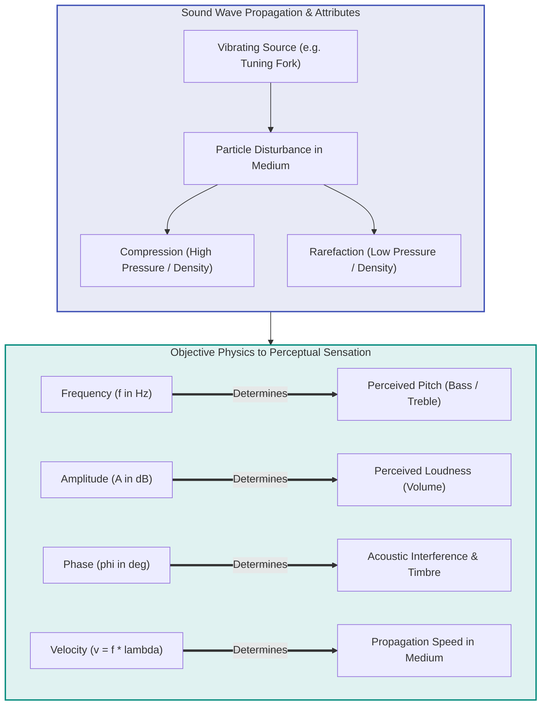

---

### 3. Key Physical Properties & Mathematical Formulas

1. **Frequency ($f$):**
   * Number of complete cycles per second: $f = \frac{\text{Number of cycles}}{\text{Time (seconds)}}$
   * **Unit:** Hertz (Hz). Perceived as **Pitch**.
   * **Human Hearing Range:** **$20\text{ Hz}$ to $20,000\text{ Hz}$ ($20\text{ kHz}$)**.
   * *Example:* $440$ oscillations/second $= 440\text{ Hz}$ (Standard Concert Pitch A).

2. **Wavelength ($\lambda$):**
   * Spatial distance between two consecutive compressions or rarefactions: $\lambda = \frac{v}{f}$
   * *Example:* For a $440\text{ Hz}$ wave in air ($v = 343\text{ m/s}$), $\lambda = \frac{343}{440} \approx 0.78\text{ m}$.

3. **Amplitude ($A$):**
   * Maximum displacement of particles from equilibrium. Perceived as **Loudness**.
   * Measured logarithmically in **Decibels (dB)** (e.g., whisper $\approx 40\text{ dB}$; jet engine $\ge 120\text{ dB}$).

4. **Velocity / Speed of Sound ($v$):**
   * Speed of sound wave propagation: $v = f \times \lambda$
   * **Air ($20^\circ\text{C}$):** $\approx 343\text{ m/s}$ | **Water:** $\approx 1500\text{ m/s}$ | **Steel:** $\approx 5960\text{ m/s}$

5. **[Phase ($\phi$)](#concept-wave-phase):**
   * Fractional point in the wave cycle measured in degrees ($^\circ$) or radians.
   * **In-Phase ($0^\circ$):** Constructive interference (amplified sound).
   * **Out-of-Phase ($180^\circ$):** Destructive interference (phase cancellation / silence).

---

### 4. Classification: Types of Sound in Multimedia

| Sound Type | Acoustic & Structural Characteristics | Primary Applications |
|---|---|---|
| **1. Speech** | • Structured sequence of phonemes.<br>• Dynamic variations in pitch, rhythm, and tone.<br>• Contains voiced and unvoiced components. | • Voice assistants (Siri, Alexa).<br>• Speech recognition & NLP.<br>• VoIP & Telephony. |
| **2. Music** | • Harmonic combinations structured into notes, chords, and scales.<br>• Rich harmonic multiples of fundamental frequency ($f_0$). | • Audio synthesizers & MIDI systems.<br>• MP3 / AAC streaming.<br>• Video game & film scoring. |
| **3. Noise** | • Random, aperiodic mix of frequencies with no recognizable pitch or pattern. | • Active Noise Cancellation (ANC).<br>• Equalization & Audio filtering. |

---

### 5. Summary Comparison: Fundamental Sound Properties

| Property | Symbol & Unit | Physical Definition | Perceived Sensation | Governed By Formula |
|---|---|---|---|---|
| **Frequency** | $f$ (Hz) | Cycles per unit time | **Pitch** (Bass / Treble) | $f = \frac{1}{T}$ |
| **Amplitude** | $A$ (dB) | Particle displacement | **Loudness / Volume** | $\text{dB} = 20 \log_{10}(P/P_0)$ |
| **Wavelength** | $\lambda$ (m) | Distance per full cycle | Physical wave scale | $\lambda = \frac{v}{f}$ |
| **Velocity** | $v$ (m/s) | Wave travel speed | Arrival latency | $v = f \times \lambda$ |
| **Phase** | $\phi$ ($^\circ$ / rad) | Offset in wave cycle | Interference / Timbre | $\Delta \phi = \frac{2\pi \Delta x}{\lambda}$ |

---

<a id="q4"></a>
## Q4. What do you mean by digital audio?

### 1. Core Definitions & Principles
* **Definition:** **Digital Audio** refers to the numerical, binary representation of physical sound waves $(0\text{s and } 1\text{s})$ that enables acoustic signals to be stored, manipulated, copied, and transmitted by digital computer systems without generational signal degradation.
* **Fundamental Purpose:** Natural sound is continuous (analog) in both time and amplitude. Digital audio bridges this by digitizing the analog waveform into a stream of discrete binary numbers through the three-step **Analog-to-Digital Conversion (ADC)** pipeline.
* **Storage Reality:** Unlike symbolic musical formats (such as MIDI), a digital audio file **stores the actual physical sound wave data** in digital format.

---

### 2. Conceptual Architecture: Audio Digitization & Storage Pipeline

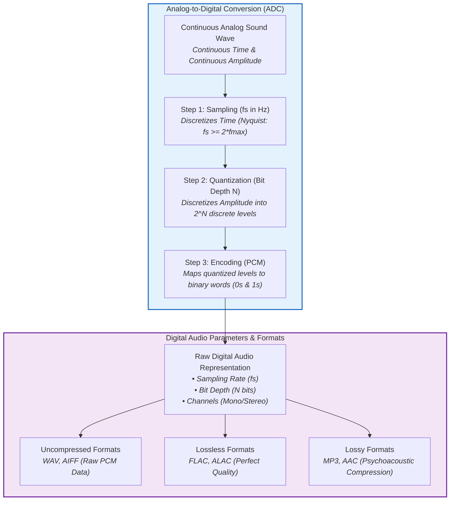

---

### 3. Step-by-Step Mechanisms & Digitization Process

1. **Step 1: [Sampling](#concept-quantization-vs-sampling)**
   * Measures the amplitude of the continuous analog sound wave at fixed time intervals $T_s$.
   * Governed by the [Nyquist–Shannon Theorem](#concept-nyquist-theorem) ($f_s \ge 2 \times f_{\max}$).
   * *Example:* For standard human audible limit ($20\text{ kHz}$), CD Audio samples at $44.1\text{ kHz}$ ($44,100\text{ samples/sec}$).

2. **Step 2: [Quantization](#concept-quantization-vs-sampling)**
   * Maps each sampled continuous amplitude to the nearest discrete level from a finite set of $2^{\text{Bit Depth}}$ values.
   * **Formula:** $\text{Discrete Levels} = 2^{\text{Bit Depth}}$
   * *Example:* An 8-bit system yields $2^8 = 256$ discrete levels; a 16-bit system yields $2^{16} = 65,536$ discrete amplitude levels.

3. **Step 3: Encoding ([PCM](#concept-pcm))**
   * Transforms discrete, quantized amplitude numbers into binary words ($0\text{s and } 1\text{s}$).
   * *Example:* A decimal quantized sample value of $150$ in an 8-bit system is encoded as `10010110`.

---

### 4. Key Parameters Defining Digital Audio

* **1. Sampling Rate ($f_s$):** The number of samples taken per second (e.g., $44.1\text{ kHz}$ for CD, $48\text{ kHz}$ for video soundtracks). Higher $f_s \rightarrow$ captures higher audio frequencies accurately.
* **2. [Bit Depth / Sample Size](#concept-bit-depth):** Number of bits used per sample (e.g., 16-bit, 24-bit). Higher bit depth $\rightarrow$ greater dynamic range and reduced quantization noise.
* **3. Channels:** 
  * **Mono (1 channel):** Single signal delivered uniformly to all speakers.
  * **Stereo (2 channels):** Independent Left ($L$) and Right ($R$) audio channels for spatial stereo imaging.
  * **Surround Sound (5.1 / 7.1 channels):** Multi-channel configurations providing immersive 3D positional audio.
* **4. Bitrate ($\text{bps}$):** Total data processed per second:
  $$\text{Bitrate} = f_s \times \text{Bit Depth} \times \text{Number of Channels}$$
  * *Example (Standard CD Audio):*
    $$\text{Bitrate} = 44,100\text{ Hz} \times 16\text{ bits} \times 2\text{ channels} = 1,411,200\text{ bps} \approx 1411.2\text{ kbps}$$

---

### 5. Technical Best Practices & Audio Format Selection

| Audio Category | Standard Formats | Technical Trade-offs | Recommended Use-Cases |
|---|---|---|---|
| **Uncompressed** | **WAV**, **AIFF** | Stores raw [PCM](#concept-pcm) stream; highest fidelity, very large file sizes. | Studio recording, professional DAW mixing, audio master copies. |
| **Lossless Compressed** | **FLAC**, **ALAC** | Perfect bit-for-bit audio recreation; ~50% smaller file size than raw WAV. | Audiophile playback, high-grade archival, mastering backup. |
| **Lossy Compressed** | **MP3**, **AAC**, **OGG** | Discards psychoacoustically inaudible frequencies; ultra-compact file sizes (~10:1 ratio). | Web streaming (Spotify, YouTube), podcasts, mobile devices. |

---

### 6. Summary Comparison: Digital Audio vs. MIDI

| Parameter | Digital Audio | MIDI (Musical Instrument Digital Interface) |
|---|---|---|
| **Underlying Nature** | Digital representation of **physical sound waves** (sample stream) | **Control instructions/commands** representing musical performance |
| **Data Content** | Stores **actual sound data** as a series of 0s and 1s | Stores **no actual sound**; transmits Note-On, Pitch, Velocity, Channel |
| **File Size** | Large file sizes (proportional to duration and quality) | Extremely small and compact (text/command-based) |
| **Acoustic Fidelity** | Reproduces the exact recorded voice, instrument, or acoustic event | Sound depends on the receiving synthesizer / sound font module |
| **Primary Usage** | Recording, editing, and playback of voice, music, and sound effects | Controlling synthesizers, sequencers, electronic keyboards, drum machines |

---

<a id="q5"></a>
## Q5. What is MIDI?

### 1. Core Definitions & Principles
* **Definition:** **MIDI** stands for **Musical Instrument Digital Interface**. Introduced in 1983, it is an industry-standard digital communications protocol and specification that enables electronic musical instruments (keyboards, drum machines), computers, and audio hardware to communicate musical performance data.
* **Core Principle:** **MIDI does NOT store or transmit actual digitized audio waveforms.** Instead, it transmits symbolic performance **instructions/commands** describing how music should be generated by a target sound synthesizer.
* **Key Commands Transmitted:**
  * Which note is pressed (Note Number $0\text{--}127$).
  * When a note starts and stops ([Note-On / Note-Off](#concept-midi-architecture)).
  * How hard or fast the key was struck ([Velocity](#concept-midi-velocity) $0\text{--}127$).
  * Performance modifiers (Pitch Bend, Modulation, Aftertouch, Program/Instrument Changes).

---

### 2. Conceptual Architecture & Data Flow Pipeline

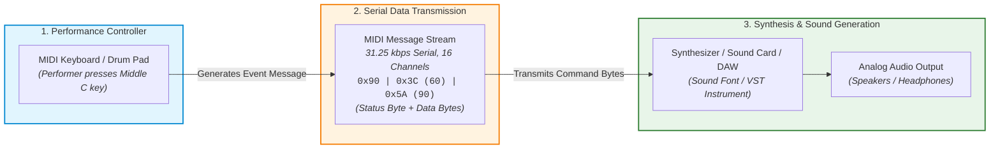

---

### 3. Step-by-Step Mechanisms: Message Structure & Specs

#### A. Structure of a Standard MIDI Channel Message (3 Bytes)
Standard MIDI event commands are transmitted as 3-byte packets:

```
+------------------------------------+------------------------------------+------------------------------------+
|            STATUS BYTE             |            DATA BYTE 1             |            DATA BYTE 2             |
+------------------------------------+------------------------------------+------------------------------------+
|  Event Type + Channel (1 to 16)    |     Note Number (0 to 127)         |      Velocity (0 to 127)           |
|  e.g., 0x90 (Note-On, Channel 1)   |     e.g., 60 (Middle C)            |      e.g., 90 (Key Strike Force)   |
+------------------------------------+------------------------------------+------------------------------------+
```

* **[Status Byte](#concept-midi-architecture):** MSB is `1` (range `0x80` to `0xFF`). Defines the event type (e.g., `0x9_` = Note-On, `0x8_` = Note-Off) and the target channel ($1\text{--}16$).
* **Data Byte 1:** MSB is `0` (range `0` to `127`). Identifies the note pitch ($60 = \text{Middle C}$).
* **[Data Byte 2 (Velocity)](#concept-midi-velocity):** MSB is `0` (range `0` to `127`). Represents key impact dynamics (loudness/attack).

#### B. Hardware & Transmission Specifications
* **Communication Type:** Asynchronous serial transmission.
* **Baud Rate:** Exactly **$31.25\text{ kbps}$** ($\pm 1\%$).
* **Multi-Channel Architecture:** Supports **16 discrete logical channels** over a single standard 5-pin DIN or USB MIDI connection.
* **Connectors:** Traditional 5-pin DIN cable ports:
  * **MIDI IN:** Receives incoming MIDI messages.
  * **MIDI OUT:** Transmits MIDI messages generated by the device.
  * **MIDI THRU:** Direct duplicate passthrough of the incoming MIDI IN stream for daisy-chaining devices.

---

### 4. Technical Best Practices & System Integration

| Layer | Technical Strategy / Best Practice |
|---|---|
| **System & Routing Layer** | • Use **General MIDI (GM)** standard mapping for universal instrument bank consistency across different synthesizers.<br>• Utilize MIDI over USB or virtual MIDI loopbacks to eliminate serial cable latency and jitter in modern DAWs. |
| **Performance & Sound Design** | • Combine MIDI tracks with high-resolution sample libraries (VST plugins) for realistic orchestral rendering.<br>• Apply quantize filters carefully in software sequencers to prevent music from sounding unnaturally rigid/robotic. |

---

### 5. Summary Comparison: Digital Audio vs. MIDI

| Parameter | Digital Audio (PCM, WAV, MP3) | MIDI (.mid) |
|---|---|---|
| **Fundamental Nature** | Digitized stream of physical sound waves | Digital score / control instructions for synthesizers |
| **Stored Content** | Actual sound waveform data ($0\text{s and } 1\text{s}$) | Performance events (Note-On, Pitch, Velocity, Channel) |
| **File Size** | **Large** (e.g., ~10 MB per minute for WAV, ~1 MB for MP3) | **Extremely Tiny** (e.g., ~10 KB to 50 KB for an entire song) |
| **Hardware Dependency** | Sounds identical on any playback system | Sound quality depends entirely on the receiving sound synthesizer / sound card |
| **Editability** | Difficult to alter individual instruments or notes after recording | Extremely easy to modify pitch, tempo, key, instrument, and velocity note-by-note |
| **Voice & Acoustics** | Can record human voice, singing, live guitar, ambient sound | Cannot directly record human speech or organic vocals |

---

<a id="q7"></a>
## Q7. What is pixel?

### 1. Core Definitions & Principles
* **Definition:** A **pixel** (portmanteau of **"Picture Element"**) is the smallest, indivisible, addressable unit of a digital [raster image](#concept-pixelation) or digital display screen.
* **Structural Role:** Digital raster images are organized as a two-dimensional rectangular matrix (grid) of rows and columns, where each coordinate $(x, y)$ corresponds to a single discrete pixel containing specific numeric brightness and color information.
* **Subpixel Architecture:** On physical display hardware (LCD, OLED, LED), each individual pixel is composed of three physical **subpixels** (Red, Green, Blue) that blend additively to emit the full spectrum of visible colors.
* **Mathematical Representation:** An image of dimension $M \times N$ contains $M \cdot N$ total pixels, represented mathematically as an intensity matrix $I(x, y)$:
  $$I(x, y) = \begin{bmatrix} p_{0,0} & p_{0,1} & \dots & p_{0,N-1} \\ p_{1,0} & p_{1,1} & \dots & p_{1,N-1} \\ \vdots & \vdots & \ddots & \vdots \\ p_{M-1,0} & p_{M-1,1} & \dots & p_{M-1,N-1} \end{bmatrix}$$

---

### 2. Conceptual Architecture: Pixel Grid & RGB Subpixel Structure

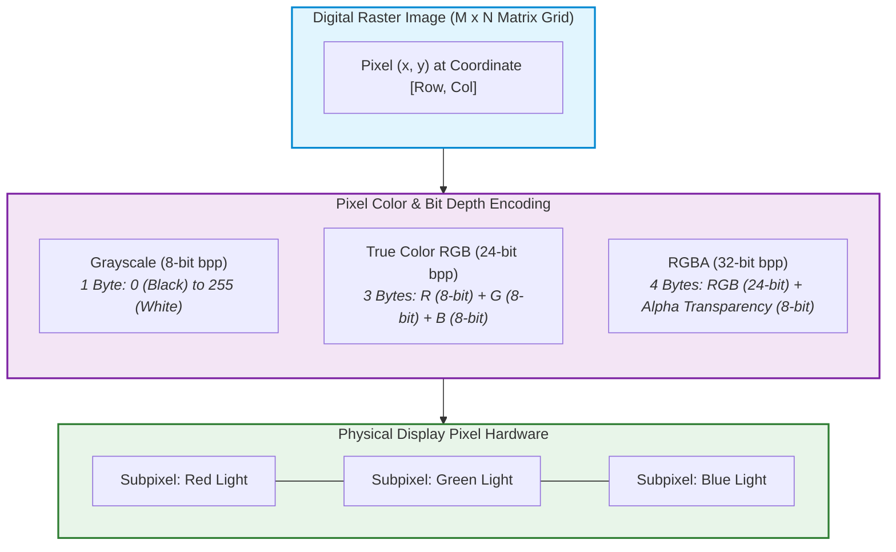

---

### 3. Step-by-Step Mechanisms: Color Depth & Spatial Resolution

#### A. [Color Depth (Bits Per Pixel / bpp)](#concept-color-depth)
The amount of digital memory allocated to each pixel dictates the total number of distinct colors it can represent:
* **Monochrome / 1-bit:** $2^1 = 2$ colors (Pure Black or Pure White).
* **Grayscale / 8-bit:** $2^8 = 256$ shades of gray ($0 = \text{Black}$, $255 = \text{White}$).
* **Indexed Color / 8-bit:** $2^8 = 256$ palette-mapped colors (Standard GIF).
* **High Color / 16-bit:** $2^{16} = 65,536$ colors (RGB 5-6-5 format).
* **True Color / 24-bit:** $2^{24} = 16,777,216$ colors (8 bits Red + 8 bits Green + 8 bits Blue).
* **True Color with Alpha / 32-bit:** 24-bit RGB + 8-bit Alpha channel ($\alpha$) representing transparency levels ($0\text{--}255$).

#### B. [Spatial Resolution & File Size Calculation](#concept-spatial-resolution)
The total pixel count dictates the detail and uncompressed file size of a raster bitmap:
$$\text{Total Pixels} = \text{Width (pixels)} \times \text{Height (pixels)}$$
$$\text{Raw File Size (Bytes)} = \frac{\text{Width} \times \text{Height} \times \text{Bits Per Pixel (bpp)}}{8}$$

* **Exam Numerical Example:**
  * For a Full HD image ($1920 \times 1080$) at 24-bit True Color:
  $$\text{Total Pixels} = 1920 \times 1080 = 2,073,600\text{ pixels } (\approx 2.07\text{ Megapixels})$$
  $$\text{Raw Size} = \frac{2,073,600 \times 24}{8} = 6,220,800\text{ Bytes} \approx 6.22\text{ MB}$$

---

### 4. Technical Best Practices & Failure Countermeasures

| Layer | Technical Strategy / Countermeasure |
|---|---|
| **Image Scaling & Resampling** | • When scaling up raster images, apply **Bicubic** or **Lanczos interpolation** to reduce blocky [Pixelation Artifacts](#concept-pixelation).<br>• Use vector formats (SVG) for geometric logos/icons where infinite, resolution-independent scaling is required. |
| **Storage & Bandwidth Optimization** | • Convert uncompressed raster bitmaps (BMP) to lossy (JPEG) or lossless (PNG/WebP) formats using entropy and DCT compression to reduce bandwidth without visible loss. |

---

### 5. Summary Comparison: Pixel Properties Across Color Modes

| Image Mode | Bits Per Pixel (bpp) | Total Color Levels | Bytes Per Pixel | Primary Use-Case |
|---|---|---|---|---|
| **1-Bit Monochrome** | $1\text{ bpp}$ | $2^1 = 2$ colors | $0.125\text{ Bytes}$ | Black-and-white faxes, binary masks, thresholded text |
| **8-Bit Grayscale** | $8\text{ bpp}$ | $2^8 = 256$ levels | $1\text{ Byte}$ | Medical X-rays, CT scans, computer vision edge detectors |
| **8-Bit Indexed** | $8\text{ bpp}$ | $256$ indexed palette | $1\text{ Byte}$ | GIF animations, simple 2D web icons |
| **24-Bit True Color** | $24\text{ bpp}$ ($8\text{R}+8\text{G}+8\text{B}$) | $2^{24} \approx 16.7\text{ Million}$ | $3\text{ Bytes}$ | JPEG/BMP digital photography, web photos |
| **32-Bit RGBA** | $32\text{ bpp}$ ($24\text{ RGB}+8\text{ Alpha}$) | $16.7\text{M} + 256\text{ Transparency}$ | $4\text{ Bytes}$ | PNG web graphics, UI overlays, alpha composites |

---

<a id="q8"></a>
## Q8. What is tweening?

### 1. Core Definitions & Principles
* **Definition:** **Tweening** (short for **"in-betweening"**) is the process in computer and traditional animation of generating intermediate frames between two distinct [keyframes](#concept-keyframing-tweening) to produce the smooth illusion of movement.
* **Fundamental Purpose:** An animator defines only the critical boundary states (e.g., initial position at Keyframe 1 and final position at Keyframe 2); the computer algorithmically calculates, interpolates, and renders all the intervening transition frames ("tweens").
* **Mathematical Basis:** Operates on mathematical [interpolation algorithms](#concept-interpolation-curves) applied to geometric parameters across time $t$:
  $$P(t) = (1 - t) \cdot P_1 + t \cdot P_2 \quad \text{for } t \in [0, 1] \quad (\text{Linear Interpolation})$$
* **Perceptual Integration:** Relies on [Persistence of Vision](#concept-persistence-of-vision) and the continuous playback rate (e.g., 24, 30, or 60 [FPS](#concept-frame-rate)) to convert discrete mathematical steps into fluid visual motion.

---

### 2. Conceptual Architecture: Keyframing & In-Between Interpolation

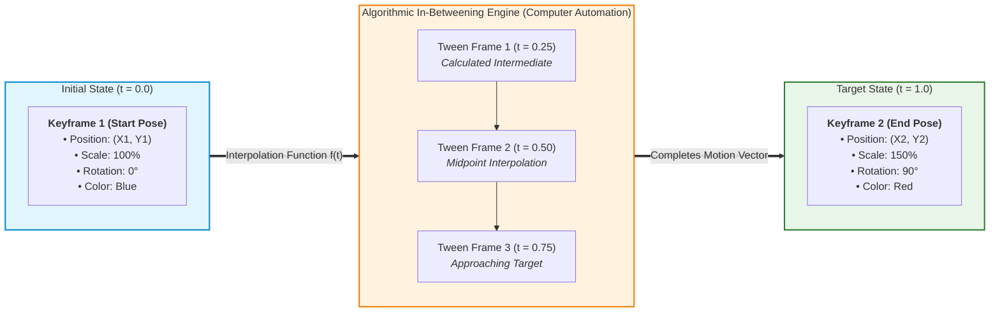

---

### 3. Step-by-Step Mechanisms & Classifications of Tweening

Tweening in multimedia is classified into three major procedural types:

#### A. Motion / Position Tweening
* **Mechanism:** Interpolates spatial coordinates $(X, Y, Z)$, rotation angles $(\theta_x, \theta_y, \theta_z)$, and scale dimensions $(S_x, S_y, S_z)$ of an object along a predefined motion path.
* **Example:** Moving a car sprite from $(X=100, Y=200)$ at Frame 1 to $(X=800, Y=200)$ at Frame 30.

#### B. Shape / Vector Tweening ([Morphing](#concept-morphing-vs-motion))
* **Mechanism:** Interpolates individual vertices and path vectors of one 2D shape into an entirely different shape.
* **Example:** Transitioning a vector star into a circle by recalculating vertex coordinate displacements over time.

#### C. Color & Property Tweening
* **Mechanism:** Smoothly shifts surface attributes such as RGB color values, opacity/alpha channel transparency ($0\% \rightarrow 100\%$), or camera focal length.

---

### 4. Implementation Best Practices & Easing Curves

| Layer | Technical Strategy / Implementation |
|---|---|
| **Motion Realism & Dynamics** | • Apply **Easing Functions (Ease-In / Ease-Out)** using cubic [Bézier Curves](#concept-interpolation-curves) rather than linear motion to simulate real-world physics (acceleration due to gravity and deceleration due to friction). |
| **Asset Optimization & Performance** | • In 2D skeletal animation, tween transformation matrices rather than redrawing raster frames to save memory and CPU overhead.<br>• Place keyframes on whole frame boundaries to prevent rounding jitter in real-time game engines. |

---

### 5. Summary Comparison: Traditional vs. Computer-Generated Tweening

| Parameter | Traditional In-Betweening | Computer-Based Algorithmic Tweening |
|---|---|---|
| **Execution Method** | Hand-drawn manually frame-by-frame by assistant animators ("in-betweeners") | Automated mathematical interpolation computed instantaneously by software |
| **Production Speed** | Extremely slow, tedious, and labor-heavy | Instantaneous, scalable, and automated |
| **Accuracy & Consistency** | Subject to human drawing errors, line wobble, and size drifting | 100% mathematically exact geometric paths and color consistency |
| **Flexibility / Editing** | Changing a keyframe requires redrawing dozens of physical paper sheets | Moving a keyframe instantly recalculates all in-betweens on the fly |
| **Primary Tools** | Light tables, animation paper, cel peg bars | Adobe Animate, Blender, Maya, After Effects, CSS/JS web engines |

---

<a id="q9"></a>
## Q9. What is JPEG?

### 1. Core Definitions & Principles
* **Definition:** **JPEG** stands for **Joint Photographic Experts Group** (standardized in 1992 as ISO/IEC 10918-1). It is the world's most widely adopted [lossy image compression](#concept-lossy-vs-lossless) standard and digital raster image file format (`.jpg`, `.jpeg`).
* **Underlying Philosophy:** Engineered specifically for continuous-tone photographic images and natural scenes containing smooth color gradients. It exploits limitations of the human visual system (HVS)—which is far more sensitive to brightness (luminance) variations than to color (chrominance) variations, and insensitive to subtle high-frequency spatial noise.
* **Core Algorithm:** Operates primarily on block-based 2D [Discrete Cosine Transform (DCT)](#concept-dct), perceptual quantization, and Huffman entropy encoding.
* **Adjustable Trade-off:** Allows continuous tuning of the compression ratio ($10:1$ to $100:1$), letting developers balance file size reduction against perceptual image fidelity.

---

### 2. Conceptual Architecture: End-to-End JPEG Compression Pipeline

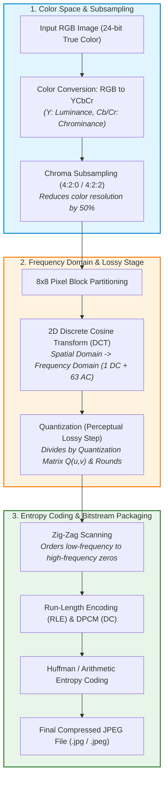

---

### 3. Step-by-Step Mechanisms: Inside the JPEG Engine

1. **Color Space Conversion ($RGB \rightarrow YC_bC_r$):**
   * Separates grayscale brightness ($Y$) from color blue-difference ($C_b$) and red-difference ($C_r$).
2. **[Chroma Subsampling](#concept-chroma-subsampling):**
   * Discards $50\%$ to $75\%$ of color data (e.g., $4:2:0$ format) with negligible human perceptible loss.
3. **$8 \times 8$ Block Partitioning & Level Shifting:**
   * Divides image planes into $8 \times 8$ pixel blocks and shifts values from $[0, 255]$ to $[-128, +127]$.
4. **2D [Discrete Cosine Transform (DCT)](#concept-dct):**
   * Converts spatial pixel intensities into 64 spatial frequency coefficients:
     * **1 DC Coefficient:** Represents average block brightness/color.
     * **63 AC Coefficients:** Represent progressively higher spatial frequency details (textures/edges).
5. **Perceptual Quantization (The Irreversible Lossy Step):**
   * Each DCT coefficient $F(u, v)$ is divided by a psychovisual quantization table entry $Q(u, v)$ and rounded to the nearest integer:
     $$F_Q(u, v) = \text{round}\left(\frac{F(u, v)}{Q(u, v)}\right)$$
   * High-frequency coefficients round to zero, drastically reducing stored information.
6. **Zig-Zag Ordering & Entropy Encoding:**
   * Groups trailing zeros together via a diagonal zig-zag scan, followed by Run-Length Encoding (RLE) and Huffman coding to produce the final compressed byte stream.

---

### 4. Technical Best Practices & Failure Countermeasures

| Layer | Technical Strategy / Countermeasure |
|---|---|
| **Quality & Artifact Prevention** | • Avoid repeatedly saving/re-editing JPEG files (avoids **generation loss** and cumulative compression artifacts).<br>• Avoid JPEG for sharp line-art, diagrams, text screenshots, or logos; high-contrast step edges cause **ringing ("mosquito noise")** and block boundary checkerboarding. |
| **Format Selection Strategy** | • Use JPEG for continuous-tone photography, social media uploads, and web background photos.<br>• Choose PNG for transparent overlays or lossless graphics; choose SVG for vector icons. |

---

### 5. Summary Comparison: JPEG vs. Other Common Raster Formats

| Parameter | JPEG (`.jpg`) | PNG (`.png`) | BMP (`.bmp`) | GIF (`.gif`) |
|---|---|---|---|---|
| **Compression Type** | [Lossy](#concept-lossy-vs-lossless) (DCT-based) | Lossless (Deflate/LZ77) | Uncompressed (Raw) | Lossless (LZW) |
| **Color Depth** | 24-bit True Color (16.7M colors) | 24-bit / 32-bit (with Alpha) | 1-bit to 24-bit / 32-bit | 8-bit (max 256 colors) |
| **Transparency** | ❌ None | ✅ 8-bit Alpha Channel (256 levels) | ❌ None | ⚠️ 1-bit binary only |
| **Animation** | ❌ No | ❌ No (APNG is separate) | ❌ No | ✅ Yes |
| **Ideal Use-Case** | Natural photography, web images | Logos, text, screenshots, transparent UI | Raw image processing labs | Animated memes, simple icons |

---

<a id="q10"></a>
## Q10. What is RAW image?

### 1. Core Definitions & Principles
* **Definition:** A **RAW image** (or digital negative) is a minimally processed or completely uncompressed data file containing the raw, direct photometric readings captured by a digital camera's optical sensor photosites (CCD or CMOS) before any in-camera image processing algorithms are applied.
* **The "Digital Negative" Concept:** Much like an exposed but undeveloped film negative in analog photography, a RAW image is not a viewable RGB bitmap yet; it requires specialized post-processing software ("demosaicing") to interpret and develop into a standard displayable raster image (such as JPEG or TIFF).
* **High Bit Precision:** While standard JPEG images are strictly baked down to 8 bits per channel ($24\text{-bit True Color}$), RAW files preserve the full sensor [dynamic range and bit depth](#concept-raw-dynamic-range)—typically **12-bit, 14-bit, or 16-bit per pixel component**.
* **Proprietary & Standard Formats:** 
  * **Proprietary:** `.CR2`/`.CR3` (Canon), `.NEF` (Nikon), `.ARW` (Sony), `.RAF` (Fujifilm).
  * **Open Standard:** `.DNG` (Digital Negative, developed by Adobe).

---

### 2. Conceptual Architecture: Camera RAW vs. In-Camera JPEG Pipeline

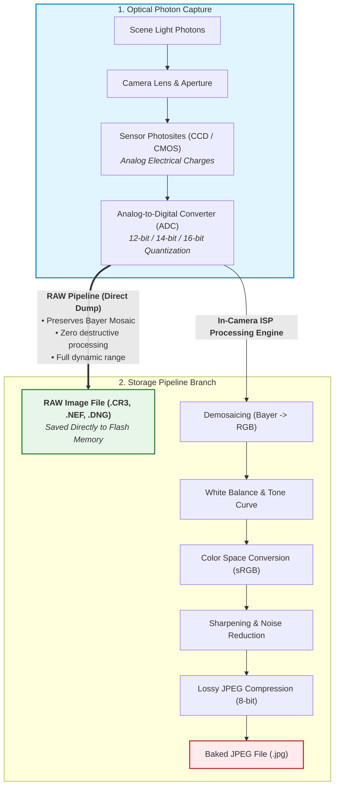

---

### 3. Step-by-Step Mechanisms & Data Layout

#### A. Sensor Architecture & [Bayer Filter Array](#concept-bayer-demosaicing)
* Most modern digital camera sensors do not record color directly. Instead, each photosite is overlaid with a tiny color filter arranged in a **Bayer Mosaic Grid** ($50\%$ Green, $25\%$ Red, $25\%$ Blue—matching human eye sensitivity to green luminance).
* A RAW file stores this raw, single-channel scalar mosaic grid alongside camera capture metadata (ISO, shutter speed, focal length, color temperature).

#### B. The Development Process ([Demosaicing / De-Bayering](#concept-bayer-demosaicing))
To convert a RAW file into an image, external software (Adobe Lightroom, Darktable) performs:
1. **Demosaicing:** Interpolates surrounding neighbor pixel filters to reconstruct full 3-channel RGB values at every pixel coordinate.
2. **Non-Destructive Exposure & White Balance Adjustment:** Since exposure metadata is merely a tag rather than a permanent pixel transform, highlight clipping and shadows can be recovered losslessly within a $\pm 3\text{ to } 5\text{ EV}$ stop range.

---

### 4. Implementation Best Practices & Failure Countermeasures

| Layer | Technical Strategy / Best Practice |
|---|---|
| **Professional Workflow & Archival** | • Capture in **RAW+JPEG mode** during critical shoots to have instant preview files along with the full-fidelity RAW master for post-production editing.<br>• Convert proprietary vendor formats (`.NEF`, `.CR2`) to the open archival standard **Adobe DNG** to guarantee long-term future-proof accessibility. |
| **Storage & Compute Resource Management** | • RAW files are **$3\times$ to $6\times$ larger** than high-quality JPEGs; ensure high-speed UHS-II / CFexpress memory cards to prevent camera buffer bottlenecks during continuous burst shooting. |

---

### 5. Summary Comparison: RAW Image vs. JPEG Image

| Parameter | RAW Image File | JPEG Image File (`.jpg`) |
|---|---|---|
| **Analogy** | Undeveloped photographic film negative | Final, glossy printed photograph |
| **Bit Depth & Dynamic Range** | **12-bit to 16-bit per channel** ($4,096\text{--}65,536$ levels) | Strictly **8-bit per channel** ($256$ levels per RGB) |
| **Compression** | Uncompressed or Lossless compression | [Lossy compression](#concept-lossy-vs-lossless) (DCT & Quantization) |
| **White Balance & Color Space** | Not permanently applied; 100% adjustable post-capture | Permanently "baked in" by the camera hardware |
| **File Size** | Very large (e.g., $25\text{ MB} - 60\text{ MB}$ per image) | Small and compact (e.g., $3\text{ MB} - 8\text{ MB}$) |
| **Viewability** | Requires specialized software/codecs to render | Universally viewable on every browser and device |
| **Primary Use-Case** | Professional photography, forensic imaging, cinema | Web publishing, social media, consumer sharing |

---

<a id="q11"></a>
## Q11. Write the difference between raster and vector image.

### 1. Core Definitions & Principles
* **Raster Image (Bitmap):** An image represented as a two-dimensional rectangular grid (matrix) of tiny discrete dots called [pixels](#concept-pixelation), where each pixel stores explicit color information (e.g., RGB, CMYK, or Grayscale).
* **Vector Image:** An image constructed from **geometric primitives** (points, lines, curves, circles, polygons) defined using **mathematical equations** rather than fixed pixel grids.
* **Fundamental Divergence:**
  * Raster images are **resolution-dependent**: scaling up forces pixel enlargement, leading to jagged [pixelation artifacts](#concept-pixelation).
  * Vector images are **[resolution-independent](#concept-resolution-independence)**: equations recalculate dynamically at any scale factor, rendering infinitely sharp at all display resolutions.

---

### 2. Conceptual Architecture: Representation & Scaling Pipeline

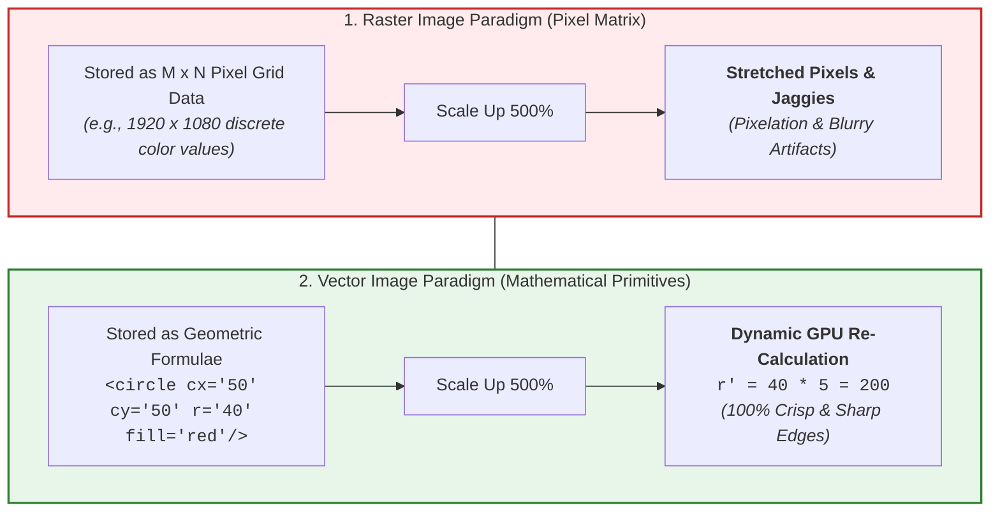

---

### 3. Step-by-Step Mechanisms & Structural Differences

#### A. Mathematical Representation
* **Raster:** Stores an array of numbers $I(x, y)$ in memory. A 24-bit $1000 \times 1000$ image stores $1,000,000$ individual 3-byte RGB records ($\approx 3\text{ MB}$).
* **Vector:** Stores geometric coordinate paths and fill rules. A red circle is stored simply as:
  $$\text{Circle}(x_c, y_c, r, \text{Color}) \implies \text{Size} \approx 50\text{ bytes (constant regardless of screen dimensions)}$$

#### B. Rendering & Display Conversion ([Rasterization Engine](#concept-rasterization-engine))
* Because physical computer screens consist of physical LCD/OLED pixels, vector graphics must eventually pass through a **Rasterization Engine** (Scanline/GPU pipeline) to be rendered into pixels at the display device's native DPI.

---

### 4. Technical Best Practices & Usage Guidelines

| Layer | Technical Strategy / Implementation |
|---|---|
| **Design & Typography (Vector)** | • Use vector formats (**SVG, EPS, PDF**) for company logos, fonts, UI icons, infographics, and architectural CAD blueprints to ensure razor-sharp rendering on Retina/4K/8K displays and giant billboards alike. |
| **Photographic Imaging (Raster)** | • Use raster formats (**JPEG, PNG, WebP, RAW**) for real-world natural photography, medical X-rays, and video frames where continuous-tone color gradients and complex organic textures cannot be modeled mathematically. |

---

### 5. Comprehensive Summary Comparison: Raster vs. Vector Graphics

| Parameter / Feature | Raster (Bitmap) Graphics | Vector Graphics |
|---|---|---|
| **Fundamental Structure** | Grid / Matrix of individual **pixels** | Mathematical formulas & **geometric primitives** (curves, lines, polygons) |
| **Resolution Nature** | **Resolution-dependent** (degrades upon zoom/scaling) | **Resolution-independent** (infinitely scalable without quality loss) |
| **Visual Complexity** | Excels at complex, continuous-tone scenes (photographs, organic shading, realistic textures) | Ideal for clean geometric graphics, typography, logos, icons, diagrams, and blueprints |
| **File Size Determinant** | Proportional to pixel dimensions ($M \times N$) and [color bit depth](#concept-color-depth) | Proportional to the number and complexity of shapes/paths (independent of display size) |
| **Storage Scale Example** | A high-res company logo PNG $\approx 200\text{ KB}$ | Identical company logo in SVG $\approx 10\text{ KB}$ ($20\times\text{ smaller}$) |
| **Standard File Formats** | **BMP, JPEG, PNG, GIF, TIFF, WebP, PSD** | **SVG, EPS, AI, CDR, PDF** (vector layers) |
| **Primary Editing Software** | Adobe Photoshop, GIMP, Corel Photo-Paint | Adobe Illustrator, CorelDRAW, Inkscape, AutoCAD |
| **Web & Native Support** | Universally supported natively by all web browsers and operating systems | Supported natively via SVG and modern HTML5 canvas/WebGL engines |
| **Conversion Process** | Vector $\rightarrow$ Raster: **Rasterization** (Fast, lossless) | Raster $\rightarrow$ Vector: **Vector Tracing / Digitizing** (Complex, approximate) |

---

<a id="q12"></a>
## Q12. Digital Audio VS MIDI (Comprehensive Comparison)

### 1. Core Definitions & Principles
* **Digital Audio:** The discrete numerical representation ($0\text{s and } 1\text{s}$) of **actual physical sound waves** generated through [Analog-to-Digital Conversion (Sampling, Quantization, Encoding)](#concept-pcm). It captures the true acoustic vibrations of voices, acoustic instruments, or real-world ambient sound environments.
* **MIDI (Musical Instrument Digital Interface):** A symbolic digital communication protocol and command architecture introduced in 1983. It **stores NO actual digitized sound waves**; instead, it transmits control performance messages ([Note-On, Pitch, Velocity, Channel, Duration](#concept-midi-architecture)) instructing a hardware or software synthesizer on how to recreate musical notes.
* **Core Paradigm Shift:** Digital audio is analogous to an **audio cassette or CD recording** (direct playback of captured sound), whereas MIDI is analogous to **sheet music / player piano roll** (instructions that require an instrument/performer to generate sound).

---

### 2. Conceptual Architecture: Dual Processing Paradigms

```mermaid
flowchart TD
    subgraph DigitalAudioParadigm ["1. Digital Audio Pipeline (Waveform Capture)"]
        DA1["Acoustic Sound Source<br><i>(Singer's Vocals / Acoustic Guitar)</i>"]
        --> DA2["Microphone & A/D Converter<br><i>(44.1 kHz, 16-bit PCM Sampling)</i>"]
        --> DA3["<b>Digital Audio Stream / File (.WAV, .MP3)</b><br><i>(Stores exact pressure waveform data)</i>"]
        --> DA4["Direct DAC & Speaker Playback<br><i>(Sounds 100% Identical Everywhere)</i>"]
    end

    subgraph MIDIAudioParadigm ["2. MIDI Protocol Pipeline (Instruction Synthesis)"]
        MI1["Performance Controller<br><i>(MIDI Keyboard / Guitar Controller)</i>"]
        --> MI2["Event Generator<br><i>(Status Byte + Data Bytes: Note 60, Vel 90)</i>"]
        --> MI3["<b>MIDI Instruction File (.MID)</b><br><i>(Stores tiny score commands: ~10 KB)</i>"]
        --> MI4["Target Sound Synthesizer / SoundFont<br><i>(Generates acoustic waveform on the fly)</i>"]
        --> MI5["Speaker Output<br><i>(Sound depends on playback synthesizer)</i>"]
    end

    style DigitalAudioParadigm fill:#e1f5fe,stroke:#0288d1,stroke-width:2px;
    style MIDIAudioParadigm fill:#fff3e0,stroke:#f57c00,stroke-width:2px;
```

---

### 3. Step-by-Step Mechanisms & Operational Divergence

#### A. Storage & Data Bandwidth
* **Digital Audio:** File size is strictly proportional to duration, [sampling rate ($f_s$)](#concept-nyquist-theorem), [bit depth](#concept-bit-depth), and channels:
  $$\text{Size}_{\text{Audio}} = f_s \times \text{Bit Depth} \times \text{Channels} \times \text{Time (sec)}$$
  * *Example:* 3 minutes of uncompressed stereo CD audio ($44.1\text{ kHz}, 16\text{-bit}$) $\approx \mathbf{31.7\text{ MB}}$.
* **MIDI:** File size is determined solely by the number of musical events (note triggers). A 3-minute complex polyphonic song with thousands of notes requires only $\mathbf{\approx 20\text{ KB} - 50\text{ KB}}$ ($>1000\times\text{ smaller}$).

#### B. Editing & Composition Flexibility
* **Digital Audio:** Editing individual notes within a mixed recording (e.g., retuning a single wrong note in a chord or changing a piano to a saxophone) is extremely difficult or destructive.
* **MIDI:** Completely parametric and non-destructive. A composer can change the tempo without affecting pitch, transpose keys instantly, modify individual note velocities, or assign an entirely different virtual instrument (VST) with a single click.

---

### 4. Technical Best Practices & Audio Engineering Guidelines

| Layer | Technical Strategy / Implementation |
|---|---|
| **Music Production & Scoring** | • Compose and arrange music using **MIDI tracks** in a Digital Audio Workstation (DAW) for infinite flexibility, then bounce/freeze tracks into **Digital Audio (PCM 24-bit/48 kHz)** for final mixing, vocal integration, and mastering. |
| **Bandwidth-Constrained Environments** | • Use MIDI in legacy video games, microcontrollers, and embedded hardware (musical greeting cards, synthesizers) where memory and bandwidth are severely restricted. |

---

### 5. Definitive Exam Comparison Table: Digital Audio vs. MIDI

*(Directly aligned with Unit 3 Lecture Notes & Question Bank)*

| Parameter / Feature | Digital Audio (PCM, WAV, MP3, AAC) | MIDI (Musical Instrument Digital Interface) |
|---|---|---|
| **1. Fundamental Definition** | Reproduction and transmission of **actual sound** converted to digital format | Standardized protocol for representing **musical performance information** |
| **2. Representation Nature** | **Digital representation of physical sound waves** (continuous air pressure variations) | **Abstract representation** of musical notes, events, and performance parameters |
| **3. Stored Data Content** | Series of binary numbers ($0\text{s and } 1\text{s}$) representing instantaneous sample amplitudes | Series of numeric **event commands** (`Note-On`, `Note-Off`, `Pitch`, `Velocity`, `Channel`) |
| **4. Actual Sound Stored?** | **YES** — The actual recorded acoustic waveform is stored in the file | **NO** — No actual sound data is stored in the file |
| **5. File Size & Storage** | **Large file sizes** (proportional to time, sampling rate, and bit depth) | **Extremely small and compact** (independent of audio playback duration) |
| **6. Quality vs File Size** | Sound quality is **strictly proportional** to file size (higher sample rate/bit depth $\rightarrow$ larger size) | Sound quality is **NOT proportional** to file size (depends on output synth quality) |
| **7. Reproduction Fidelity** | Reproduces the **exact original acoustic sound** identically on all devices | Sounds **different across devices** depending on the quality of the receiving synthesizer |
| **8. Vocal & Speech Capability** | Can record **human speech, singing, natural ambient sound, and live guitars** | **Cannot record human vocals** or non-synthesizable organic sounds directly |
| **9. Editing Flexibility** | Difficult to modify individual notes, tempo, or instruments post-recording | Extremely flexible; easy to change tempo, pitch, velocity, and instrument patches |
| **10. Primary Applications** | Audio playback, voiceovers, podcasts, streaming (Spotify/YouTube), CD/DVD audio | Controlling electronic synthesizers, drum machines, sequencing in DAWs, scoring |

---

<a id="q13"></a>
## Q13. Explain Different Types of Sound (Speech, Music, Noise)

### 1. Core Definitions & Principles
* **Sound in Multimedia:** Sound is categorized into three fundamental acoustic domains—**Speech**, **Music**, and **Noise**—each characterized by distinct mathematical predictability, harmonic structure, and frequency distributions.
* **Structural Predictability:**
  * **Speech:** Semi-structured, highly dynamic acoustic phoneme patterns.
  * **Music:** Highly organized, periodic, harmonic mathematical ratios.
  * **Noise:** Aperiodic, stochastic, random statistical frequency distributions.

---

### 2. Conceptual Architecture: Frequency Spectra & Waveform Anatomy

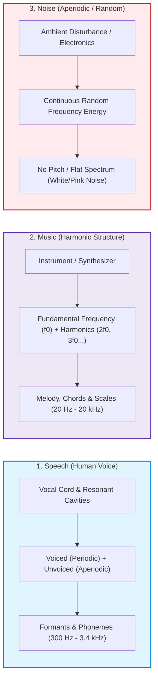

---

### 3. Step-by-Step Mechanisms & Detailed Classifications

#### A. Speech
* **Source:** Produced by the human vocal tract (lungs, vocal cord vibrations, and vocal tract resonators including tongue, lips, pharynx, and nasal cavity).
* **Characteristics:**
  * Composed of discrete phonetic units called **phonemes** (vowels, consonants).
  * **Voiced Sounds:** Produced with vocal fold oscillation (periodic, e.g., /a/, /m/).
  * **Unvoiced Sounds:** Turbulent air rush without cord oscillation (aperiodic/fricative, e.g., /s/, /f/, /sh/).
  * **Core Telephony Bandwidth:** $300\text{ Hz} - 3,400\text{ Hz}$ (sampled at $8\text{ kHz}$ for standard PSTN/VoIP).
* **Multimedia Applications:** Voice assistants (Siri, Alexa), Automatic Speech Recognition (ASR), Text-To-Speech (TTS), VoIP telephony.

#### B. Music
* **Source:** Produced by structured acoustic instruments, percussions, and electronic synthesizers.
* **Characteristics:**
  * Structured around pitches, scales, intervals, tempo, and timbre.
  * Rich in **Harmonics / Overtones**: Whole integer multiples ($2f_0, 3f_0, \dots, nf_0$) of a fundamental frequency $f_0$.
  * Full human audible spectrum coverage ($20\text{ Hz} - 20\text{ kHz}$).
* **Multimedia Applications:** Digital audio processing, music synthesis & MIDI systems, psychoacoustic compression (MP3, AAC, FLAC), soundtrack scoring.

#### C. Noise
* **Source:** Unwanted acoustic interference, thermal electrical agitation in circuits, atmospheric turbulence, ambient environment.
* **Characteristics:**
  * Random, chaotic waveform with no recognizable fundamental pitch or harmonic periodicity.
  * **White Noise:** Equal energy per Hertz across the entire spectrum.
  * **Pink Noise:** Equal energy per octave (falls at $-3\text{ dB/octave}$, matching human logarithmic hearing).
* **Multimedia Applications:** Active Noise Cancellation (ANC), audio denoising filters, sound masking, acoustic calibration.

---

### 4. Technical Best Practices & Audio Processing Layers

| Layer | Processing & Mitigation Strategies |
|---|---|
| **Speech Processing** | • Apply **Bandpass Filters ($300\text{ Hz} - 3.4\text{ kHz}$)** and Linear Predictive Coding (LPC) to optimize bandwidth during VoIP transmission. |
| **Music Engineering** | • Utilize 24-bit high dynamic range recording ($>120\text{ dB}$) and psychoacoustic masking models during lossy encoding to preserve transient harmonics. |
| **Noise Countermeasures** | • Implement **Spectral Subtraction** and adaptive Wiener filtering to isolate voice from ambient noise floor. |

---

### 5. Summary Comparison: Speech vs. Music vs. Noise

| Parameter | Speech | Music | Noise |
|---|---|---|---|
| **Waveform Nature** | Semi-periodic (mixed voiced/unvoiced) | Highly periodic & harmonic | Aperiodic & completely random |
| **Frequency Range** | $300\text{ Hz} - 3.4\text{ kHz}$ (intelligible) | $20\text{ Hz} - 20,000\text{ Hz}$ (wide) | Distributed across entire bandwidth |
| **Pitch & Timbre** | Dynamic, fluctuating pitch | Defined musical notes, chords, keys | No identifiable pitch |
| **Perceptual Sensation** | Informative (communication) | Pleasing & emotional | Distracting, masking, or unpleasant |
| **Core Applications** | ASR, TTS, telephony, voice AI | Streaming, MIDI, soundtracks | ANC, audio filtering, room tuning |

---

<a id="q14"></a>
## Q14. Compare and Contrast JPEG and MPEG

### 1. Core Definitions & Principles
* **JPEG (Joint Photographic Experts Group):** The international standard for compressing **still raster images**. It exploits **[Spatial Redundancy](#concept-temporal-redundancy)** within individual 2D pixel grids.
* **MPEG (Moving Picture Experts Group):** A family of international standards for compressing **moving video and synchronized audio** (MPEG-1, MPEG-2, MPEG-4/H.264, HEVC/H.265). It exploits both **[Spatial Redundancy](#concept-temporal-redundancy)** (within frames) and **[Temporal Redundancy](#concept-temporal-redundancy)** (across successive time frames).

---

### 2. Conceptual Architecture: Spatial vs. Spatio-Temporal Compression


---

### 3. Step-by-Step Mechanisms: Inside the MPEG Video Engine

While JPEG treats every image in isolation, MPEG utilizes a **Group of Pictures (GOP)** architecture comprising three frame types:
1. **[I-Frames (Intra-coded Frames)](#concept-temporal-redundancy):** Self-contained, standalone frames compressed exactly like independent JPEG images (removes spatial redundancy only; anchor frame).
2. **[P-Frames (Predictive-coded Frames)](#concept-temporal-redundancy):** Contain forward motion-compensated prediction vectors referencing previous I or P frames (stores only what moved/changed).
3. **[B-Frames (Bidirectional-coded Frames)](#concept-temporal-redundancy):** Highest compression; interpolates motion vectors looking forward and backward simultaneously (references preceding and succeeding frames).

---

### 4. Technical Best Practices & Compression Ratios

| Layer | Technical Strategy / Best Practice |
|---|---|
| **Bandwidth & Compression** | • Use MPEG standards for continuous motion video to achieve **$50:1$ to $200:1$ compression ratios** without video stutter.<br>• For still web photos, keep JPEG compression quality between $75\% - 85\%$ for optimal visual fidelity/size balance. |
| **GOP Configuration** | • Use shorter GOP lengths (e.g., $N=12$) in MPEG for video editing (faster seeking), and longer GOP lengths ($N=30$) for live broadcast streaming to maximize bandwidth savings. |

---

### 5. Summary Comparison Table: JPEG vs. MPEG

| Parameter / Feature | JPEG (Joint Photographic Experts Group) | MPEG (Moving Picture Experts Group) |
|---|---|---|
| **Primary Media Type** | **Still Digital Images** | **Motion Video + Synchronized Audio** |
| **Redundancy Exploited** | **Spatial Redundancy only** (within the same image) | **Spatial + Temporal Redundancy** (across time frames) + **Audio Psychoacoustics** |
| **Frame Processing** | Processes a single, discrete $M \times N$ image grid | Processes sequences of **I-Frames, P-Frames, and B-Frames** |
| **Motion Compensation** | ❌ None (no temporal awareness) | ✅ Advanced Motion Estimation & Vector Compensation |
| **Audio Integration** | ❌ No audio stream capability | ✅ Integrated multiplexed audio layer (e.g., MP3, AAC) |
| **Compression Ratio** | Moderate: **$10:1$ to $30:1$** | Very High: **$50:1$ to $200:1$** |
| **Computational Overhead** | Low (simple 2D block transform) | Very High (requires complex macroblock search algorithms) |
| **Standard Output Formats** | `.jpg`, `.jpeg`, `.jfif` | `.mpg`, `.mp4`, `.ts`, `.mkv`, `.avi` |
| **Primary Use-Cases** | Digital photos, web banners, print graphics | Netflix/YouTube streaming, DVD/Blu-ray, broadcast TV |

---

<a id="q15"></a>
## Q15. Explain RGB Model Briefly. RGB Vs CMYK.

### 1. Core Definitions & Principles
* **RGB Color Model:** An **[additive color model](#concept-additive-subtractive)** based on the primary colors of light: **Red (R), Green (G), and Blue (B)**.
* **Mechanism:** Light emitted from three primary colored sources is combined together. When combined at maximum intensity, they produce **White light**:
  $$\text{Red} + \text{Green} + \text{Blue} = \text{White}$$
  $$\text{Red} + \text{Green} = \text{Yellow} \quad | \quad \text{Green} + \text{Blue} = \text{Cyan} \quad | \quad \text{Red} + \text{Blue} = \text{Magenta}$$
* **Biological Origin:** Closely matches the trichromatic physiological response of the three types of cone photoreceptors in the human retina (L, M, S cones).
* **Geometric Architecture:** Represented mathematically as a **3D Color Unit Cube** $[0, 1]^3$, where Black $(0,0,0)$ sits at the origin, White $(1,1,1)$ sits at the opposite diagonal vertex, and the main grayscale line runs directly along the diagonal.

---

### 2. Conceptual Architecture: Additive vs. Subtractive Color Mixing

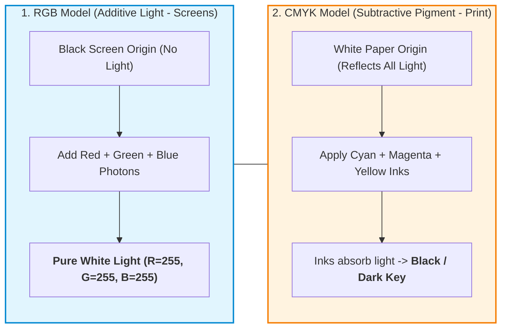

---

### 3. Step-by-Step Mechanisms & Mathematical Mapping

#### A. RGB Plane Architecture
* A 24-bit True Color RGB raster image consists of three independent 8-bit image planes ($R$, $G$, $B$), each holding values from $[0, 255]$.
* Total possible simultaneous color combinations:
  $$256 \times 256 \times 256 = 2^{24} = \mathbf{16,777,216\text{ colors}}$$

#### B. Subtractive [CMYK Principle](#concept-cmyk) & Mathematical Conversion
When converting RGB light to CMY ink pigments:
$$C = 1 - R \quad | \quad M = 1 - G \quad | \quad Y = 1 - B$$
Because physical ink impurities prevent $C+M+Y$ from absorbing $100\%$ of light (rendering muddy brown), pure Black ink ($K$) is extracted:
$$K = \min(C, M, Y)$$

---

### 4. Technical Best Practices & Color Workflow

| Layer | Technical Strategy / Best Practice |
|---|---|
| **Display vs Print Workflow** | • Always design web/UI assets in **RGB (sRGB / Adobe RGB)** color profile for monitors, televisions, and mobile displays.<br>• Convert digital artwork to **CMYK profile** before sending to commercial 4-color offset printing to prevent dull, clipped out-of-gamut print errors. |
| **Efficiency Trade-offs** | • Note from Unit 4: RGB is inefficient for transmission/compression because all 3 planes require equal resolution; convert to $YC_bC_r$ for video/JPEG compression. |

---

### 5. Definitive Summary Comparison: RGB vs. CMYK

| Parameter / Feature | RGB Color Model | CMYK Color Model |
|---|---|---|
| **Full Form** | **Red, Green, Blue** | **Cyan, Magenta, Yellow, Key (Black)** |
| **Color Physics** | **[Additive Color Mixing](#concept-additive-subtractive)** (Light Emission) | **[Subtractive Color Mixing](#concept-additive-subtractive)** (Light Absorption/Reflection) |
| **Origin Baseline** | Starts with **Black** (screen dark; no light emitted) | Starts with **White** (blank paper; reflects all ambient light) |
| **Combined Color (100%)** | $R + G + B = \mathbf{White}$ | $C + M + Y + K = \mathbf{Pure\ Black}$ |
| **Color Space Geometry** | 3D Color Cube (Origin = Black, Corner = White) | Subtractive 3D Color Cube (Origin = White, Corner = Black) |
| **Color Gamut** | **Wider Gamut** (can display vivid neon/vibrant hues) | **Narrower Gamut** (limited by physical ink absorption) |
| **Channels / Planes** | 3 channels ($R, G, B$ — 24-bit) | 4 channels ($C, M, Y, K$ — 32-bit) |
| **Target Hardware** | Computer monitors, OLED/LCD TVs, phone screens, cameras | Inkjet/Laser printers, magazine printing, offset presses |

---

<a id="q16"></a>
## Q16. Explain All Common Raster Image Formats (BMP, JPEG, PNG, GIF, TIFF)

### 1. Core Definitions & Principles
* **Raster Image Format:** A standardized digital container and encoding specification that dictates how 2D rectangular matrices of [pixels](#concept-pixelation) and color metadata are organized, compressed, and stored in computer memory.
* **Core Selection Criteria (from Unit 4):**
  1. Lossless vs. Lossy storage requirement.
  2. File size vs. Image fidelity trade-off.
  3. Color depth (8-bit vs 24-bit / 32-bit).
  4. Specialized features (transparency, animation, multi-page layers).

---

### 2. Conceptual Architecture: Raster Format Taxonomy

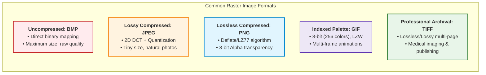

---

### 3. Step-by-Step Mechanisms & Format Specifications

*(Directly structured from Unit 4 Lecture Notes)*

#### A. BMP (Bitmap Image File)
* **History & Origin:** Developed by Microsoft for Windows operating systems.
* **Technical Details:** Stores pixel data **uncompressed** with direct bit-to-pixel mapping (e.g., 24-bit = 3 raw bytes per pixel).
* **Pros & Cons:** Exact pixel-by-pixel accuracy; easy to parse programmatically in labs. Disadvantage: **Extremely huge file sizes**.
* **Applications:** Image processing labs, low-level OS wallpaper buffering, raw unaltered test data.

#### B. JPEG (Joint Photographic Experts Group)
* **History & Origin:** Introduced in 1992 (ISO/IEC standard).
* **Technical Details:** Block-based [Lossy compression using 2D DCT](#concept-dct) and perceptual quantization ($RGB \rightarrow YC_bC_r$).
* **Pros & Cons:** Extremely small file size; ideal for natural photos. Disadvantage: Generation loss upon repeated saving; poor for line-art/text.
* **Applications:** Digital photography, social media, web images.

#### C. PNG (Portable Network Graphics)
* **History & Origin:** Created in 1996 as an open, patent-free replacement for GIF.
* **Technical Details:** Lossless compression utilizing the **Deflate algorithm** (LZ77 + Huffman). Supports full **8-bit alpha transparency** (256 levels of opacity).
* **Pros & Cons:** Razor-sharp lossless edges with smooth transparency. Disadvantage: Larger file sizes than JPEG for photos.
* **Applications:** Company logos, UI screenshots, web icons, transparent graphics.

#### D. GIF (Graphics Interchange Format)
* **History & Origin:** Created in 1987 by CompuServe.
* **Technical Details:** Strictly restricted to an **8-bit color palette (max 256 colors)**. Uses [LZW lossless compression](#concept-lzw-compression). Supports simple multi-frame flipbook animation.
* **Pros & Cons:** Small size for flat-color graphics; supports animation. Disadvantage: Severely limited color depth (unsuitable for photos).
* **Applications:** Web animation memes, simple animated banners, retro pixel art.

#### E. TIFF (Tagged Image File Format)
* **History & Origin:** Developed by Aldus (now Adobe) in the 1980s.
* **Technical Details:** Highly flexible container supporting uncompressed, lossless (LZW, ZIP), or lossy formats. Supports multi-page documents and up to 32-bit floating-point deep color.
* **Pros & Cons:** Highest professional archival fidelity. Disadvantage: Huge file sizes; not natively supported in web browsers.
* **Applications:** Medical imaging (X-rays, CT/MRI scans), desktop publishing, professional print pre-press.

---

### 4. Technical Best Practices & Selection Matrix

| Scenario / Requirement | Recommended Format | Technical Rationale |
|---|---|---|
| **Real-World Photos for Web** | **JPEG** | Optimal compression ratio ($10:1 - 20:1$) with negligible perceptual loss. |
| **Logos, Icons, Text Overlays** | **PNG** | Lossless compression preserves sharp step-edges; supports true alpha transparency. |
| **Animated Short Loops** | **GIF** | Universal native support across all chat and browser engines. |
| **Medical Imaging & Archival** | **TIFF** | Bit-for-bit lossless data integrity required for accurate diagnosis. |
| **Raw Algorithm Lab Processing** | **BMP** | Zero compression decompression overhead for direct array manipulation. |

---

### 5. Master Summary Comparison: All Common Raster Formats

| Format | Compression Type | Max Color Depth | Alpha Transparency | Supports Animation? | Primary Use-Case |
|---|---|---|---|---|---|
| **BMP** | None (Uncompressed) | 24-bit True Color | ❌ No | ❌ No | Image processing labs, Windows OS |
| **JPEG** | [Lossy (DCT-based)](#concept-lossy-vs-lossless) | 24-bit True Color | ❌ No | ❌ No | Digital photography, web photos |
| **PNG** | Lossless (Deflate) | 32-bit (24-bit + Alpha) | ✅ Full 8-bit Alpha | ❌ No | Logos, screenshots, UI design |
| **GIF** | Lossless ([LZW](#concept-lzw-compression)) | 8-bit (256 colors) | ⚠️ 1-bit binary only | ✅ Yes | Animated memes, simple web banners |
| **TIFF** | Lossless / Lossy | Up to 32-bit Deep Color | ✅ Yes | ❌ No (Multi-page instead) | Medical scans (MRI/CT), pre-press print |

---

## 📚 Appendix: Conceptual Explanations & Terminology Deep Dives

<a id="concept-persistence-of-vision"></a>
### 📌 Concept: Persistence of Vision
* **Simple Analogy:** Think of spinning a glowing sparkler at night in a fast circle—you see a continuous glowing ring rather than isolated points of light.
* **Technical Definition:** The physiological phenomenon where an image remains retained on the retina of the human eye for a fraction of a second ($\approx 1/16^{\text{th}}$ to $1/10^{\text{th}}$ of a second) after the actual stimulus is removed. When static frames are shown faster than the eye's visual decay rate, the visual cortex fuses them into smooth motion.

---

<a id="concept-keyframing-tweening"></a>
### 📌 Concept: Keyframing & Inbetweening (Tweening)
* **Simple Analogy:** A master artist sketches only the extreme poses of a jump (crouch, peak jump, landing), and the assistant fills in all the tiny stepping poses in between.
* **Technical Definition:** 
  * **Keyframe:** A reference frame marking the beginning, apex, or termination of an action, explicitly defining parameters (position, rotation, scale, color).
  * **Tweening (In-Betweening):** The automated mathematical interpolation (linear, Bézier, or spline) performed by animation software to generate all transitional frames between two keyframes.

---

<a id="concept-frame-rate"></a>
### 📌 Concept: Frame Rate (FPS)
* **Simple Analogy:** The speed at which you flip the pages of a flipbook. Flip too slowly and it looks like a slideshow; flip fast enough and it becomes a movie.
* **Technical Definition:** The frequency at which consecutive images (frames) are captured or displayed per second, measured in **Frames Per Second (FPS)**. Common industry standards:
  * **24 FPS:** Standard Film / Cinema (natural motion blur)
  * **25 / 30 FPS:** Television broadcast (PAL / NTSC)
  * **60+ FPS:** Modern Interactive Video Games & Virtual Reality (eliminates latency and motion sickness)

---

<a id="concept-nyquist-theorem"></a>
### 📌 Concept: Nyquist-Shannon Sampling Theorem
* **Simple Analogy:** To know whether a seesaw is going up or down, you must look at it at least twice per swing (once at the top, once at the bottom). If you look only once per full swing, it will seem completely stationary.
* **Technical Definition:** A fundamental theorem of digital signal processing stating that a continuous-time signal containing maximum frequency $f_{\max}$ can be completely and uniquely reconstructed from its samples if and only if the sampling rate $f_s$ is strictly greater than or equal to twice the maximum frequency:
  $$f_s \ge 2 f_{\max}$$
  The threshold $2 f_{\max}$ is termed the **Nyquist Rate**, and $f_s / 2$ is the **Nyquist Frequency**.

---

<a id="concept-aliasing"></a>
### 📌 Concept: Aliasing & Anti-Aliasing Filter
* **Simple Analogy:** The "wagon-wheel effect" in Western movies where a stagecoach wheel moving rapidly forward appears to spin backward or stand still because the camera's frame rate is too slow to capture the true rotational speed.
* **Technical Definition:** A high-frequency signal sampled below the Nyquist rate ($f_s < 2 f_{\max}$) impersonates (aliases as) a non-existent lower-frequency artifact upon reconstruction. An **Anti-Aliasing Filter** is an analog low-pass filter placed prior to the sampler to cut off frequencies above $f_s / 2$.

---

<a id="concept-quantization-vs-sampling"></a>
### 📌 Concept: Quantization vs Sampling
* **Simple Analogy:** Imagine drawing a curved graph on graph paper. **Sampling** is drawing vertical grid lines (deciding how often in time to take a reading), while **Quantization** is snapping the readings to the nearest horizontal grid line (rounding the measured value to fixed steps).
* **Technical Definition:** 
  * **Sampling:** Discretization along the independent variable axis (Time $t$ for audio, Space $(x,y)$ for images).
  * **Quantization:** Discretization along the dependent variable axis (Amplitude/Voltage for audio, Brightness/Color intensity for images).

---

<a id="concept-compression-rarefaction"></a>
### 📌 Concept: Compression & Rarefaction
* **Simple Analogy:** Think of an accordion or a slinky spring. When pushed together, the coils squeeze tightly together (**compression**). When pulled apart, the coils stretch wide with lots of space between them (**rarefaction**).
* **Technical Definition:**
  * **Compression:** A region in a longitudinal sound wave where medium particles are compressed together under higher pressure and higher density.
  * **Rarefaction:** A region in a longitudinal sound wave where medium particles are spread apart under lower pressure and lower density.

---

<a id="concept-wave-phase"></a>
### 📌 Concept: Acoustic Wave Phase & Interference
* **Simple Analogy:** Two people pushing a swing at the exact same time make it go much higher (constructive interference). If one person pushes while the other pulls in the opposite direction, the swing stops moving completely (destructive interference).
* **Technical Definition:**
  * **Phase ($\phi$):** The specific fractional point in time or space within a wave's periodic cycle, measured in degrees ($0^\circ$ to $360^\circ$) or radians ($0$ to $2\pi$).
  * **In-Phase ($0^\circ$ difference):** Peaks match peaks, resulting in constructive summation and doubled acoustic power.
  * **Out-of-Phase ($180^\circ$ difference):** Peaks match troughs, resulting in destructive phase cancellation (the principle behind Active Noise-Cancelling headphones).

---

<a id="concept-pcm"></a>
### 📌 Concept: Pulse Code Modulation (PCM)
* **Simple Analogy:** Reading the temperature once an hour and writing down the rounded numbers in a digital diary as a row of binary numbers.
* **Technical Definition:** The standard raw method used to digitally represent analog audio signals. In PCM, the amplitude of the analog signal is sampled regularly at uniform intervals (sampling), and each sample is quantized to the nearest value within a range of digital steps, stored directly as binary words (used in WAV, AIFF, and Audio CD-DA).

---

<a id="concept-bit-depth"></a>
### 📌 Concept: Audio Bit Depth & Dynamic Range
* **Simple Analogy:** Measuring heights using a ruler marked only in feet versus a ruler marked in millimeters. The millimeter ruler gives far finer steps with negligible rounding errors.
* **Technical Definition:** The number of bits of information in each audio sample, which directly determines the resolution and **Dynamic Range** (the ratio between the quietest and loudest possible undistorted sound). 
  * Rule of thumb: **$\approx 6\text{ dB}$ of dynamic range per bit** ($16\text{-bit} \approx 96\text{ dB}$, $24\text{-bit} \approx 144\text{ dB}$).

---

<a id="concept-midi-architecture"></a>
### 📌 Concept: MIDI Channel & Status Byte Architecture
* **Simple Analogy:** Sheet music sent via digital mail. Instead of hearing the orchestra playing, the conductor receives a letter saying: *"Violins (Channel 1), play Middle C now with forte loudness (Velocity 90)"*.
* **Technical Definition:** The hierarchical message layout of the MIDI 1.0 specification. A status byte begins with a binary `1` bit (MSB=1), identifying commands such as `0x8_` (Note Off), `0x9_` (Note On), `0xB_` (Control Change), and `0xC_` (Program Change), multiplexing 16 individual instrument channels on one communication line.

---

<a id="concept-midi-velocity"></a>
### 📌 Concept: MIDI Velocity & Pitch Bend
* **Simple Analogy:** How gently or aggressively a pianist strikes the physical piano key.
* **Technical Definition:** 
  * **Velocity:** A 7-bit data value ($0\text{ to }127$) transmitted alongside Note-On events measuring key strike velocity, controlling output volume and timbre dynamics.
  * **Pitch Bend:** A 14-bit dual-byte parameter allowing smooth, continuous microtonal pitch variations up and down without jumping discrete chromatic steps.

---

<a id="concept-color-depth"></a>
### 📌 Concept: Color Depth (Bits Per Pixel / bpp)
* **Simple Analogy:** Think of an artist's paint palette. A 1-bit palette has only 2 colors (Black & White). An 8-bit palette gives 256 colors. A 24-bit True Color palette gives a massive selection of 16.7 million distinct blended shades.
* **Technical Definition:** The number of bits used to represent the color of a single pixel in a digital image. It directly dictates the maximum number of simultaneous unique colors possible in the image ($\text{Colors} = 2^{\text{bpp}}$).

---

<a id="concept-spatial-resolution"></a>
### 📌 Concept: Spatial Resolution & Pixel Density (PPI/DPI)
* **Simple Analogy:** Think of a mosaic made of floor tiles. If you use thousands of tiny microscopic tiles per square inch, the mosaic looks like a crystal-clear photorealistic painting. If you use large chunky bathroom tiles, the picture looks blocky.
* **Technical Definition:** 
  * **Spatial Resolution:** The physical or digital dimensions of an image measured in total horizontal and vertical pixels (e.g., $1920 \times 1080$).
  * **Pixel Density:** The concentration of pixels per unit of physical display distance, measured in **PPI (Pixels Per Inch)** for digital screens or **DPI (Dots Per Inch)** for print output.

---

<a id="concept-pixelation"></a>
### 📌 Concept: Pixelation & Aliasing Artifacts
* **Simple Analogy:** Holding a magnifying glass right up to an old TV screen until the image dissolves into giant, ugly square colored bricks.
* **Technical Definition:** The visual degradation that occurs when a raster image is displayed at a scale larger than its native spatial resolution, causing individual square pixel boundaries to become distinctly visible to the human eye, producing jagged, staircase-like edges (**aliasing**).

---

<a id="concept-midi-guitar"></a>
### 📌 Concept: MIDI Guitar Controllers vs Audio Guitars
* **Simple Analogy:** 
  * A **Standard Electric Guitar** is like shouting through a megaphone (the guitar strings produce a raw electrical audio signal of vibrating steel that goes directly to an amplifier).
  * A **MIDI Guitar** is like a court stenographer translating your guitar strumming into written text commands (*"Strummed String 1, Fret 5, Note A4, Velocity 85"*). You can send this command to a synthesizer and make the guitar sound like a grand piano, a violin orchestra, or a flute!
* **Technical Definition:** A MIDI Guitar (or guitar equipped with a hexaphonic/piezo pickup) converts physical string vibrations into digital MIDI event messages (pitch detection $\rightarrow$ Note-On/Off bytes). It transmits zero audio waveforms; the sound is produced by an external sound module/synthesizer triggered by those commands.

---

<a id="concept-interpolation-curves"></a>
### 📌 Concept: Interpolation Curves: Linear vs Bézier vs Spline
* **Simple Analogy:** 
  * **Linear:** A robotic elevator that starts moving instantly at top speed and stops dead on a dime (jerky and unnatural).
  * **Bézier / Ease-In-Ease-Out:** A sports car smoothly accelerating from a stoplight, cruising, and gently braking at the red light.
* **Technical Definition:** Mathematical equations determining how intermediate parameter values are calculated over time $t$. Linear interpolation creates constant velocity motion ($P(t) = P_1 + t(P_2 - P_1)$), whereas cubic Bézier and Catmull-Rom splines compute smooth curvature gradients ($C^1$ and $C^2$ continuity) allowing realistic acceleration and deceleration.

---

<a id="concept-morphing-vs-motion"></a>
### 📌 Concept: Morphing vs Motion Tweening
* **Simple Analogy:** 
  * **Motion Tweening:** Sliding a photo of a cat across the table from left to right.
  * **Morphing (Shape Tweening):** Transforming a photo of a cat seamlessly into a photo of a tiger.
* **Technical Definition:** 
  * **Motion Tweening:** Preserves object topology while altering spatial coordinate matrices (translation, rotation, scale).
  * **Morphing (Shape Tweening):** Dynamically alters the internal vector mesh topology, calculating point-to-point vertex displacement vectors from a source polygon shape to a target polygon shape.

---

<a id="concept-dct"></a>
### 📌 Concept: Discrete Cosine Transform (DCT) in JPEG
* **Simple Analogy:** Decomposing a complex musical chord into individual pure musical notes. DCT breaks down an $8 \times 8$ pixel image tile into a combination of simple smooth cosine waves with varying frequencies.
* **Technical Definition:** A mathematical transformation that maps spatial pixel intensities $f(x, y)$ into spatial frequency coefficients $F(u, v)$. Most image energy concentrates in low-frequency cosine bases (smooth areas), allowing high frequencies (imperceptible fine noise) to be aggressively discarded during quantization without noticeable distortion.

---

<a id="concept-chroma-subsampling"></a>
### 📌 Concept: Chroma Subsampling (YCbCr vs RGB)
* **Simple Analogy:** The human eye has about 120 million rod cells (measuring brightness/sharpness) and only 6 million cone cells (measuring color). If you blur the colors in a high-detail black-and-white sketch, nobody notices!
* **Technical Definition:** An encoding technique that reduces color resolution ($C_b, C_r$) while preserving full luminance resolution ($Y$). In standard $4:2:0$ subsampling, color information is sampled only once per $2 \times 2$ pixel block, reducing uncompressed data footprint by $50\%$ before compression even begins.

---

<a id="concept-lossy-vs-lossless"></a>
### 📌 Concept: Lossy vs Lossless Image Compression
* **Simple Analogy:** 
  * **Lossless (ZIP / PNG):** Folding a shirt neatly to fit in a suitcase. When unpacked, it returns to its exact original form without a single thread missing.
  * **Lossy (JPEG / MP3):** Trimming the rough loose threads off a jacket to save space. It looks virtually identical from a meter away, but the removed threads can never be recovered.
* **Technical Definition:**
  * **Lossless:** Algorithms (e.g., Huffman, Deflate, LZW) reconstruct the exact identical bitstream upon decompression ($PSNR = \infty$).
  * **Lossy:** Irreversibly discards mathematically redundant and psycho-visually negligible information to achieve massive compression ratios ($10:1$ to $50:1$).

---

<a id="concept-bayer-demosaicing"></a>
### 📌 Concept: Bayer Filter Array & Demosaicing
* **Simple Analogy:** Looking at a room through a stained-glass window where each glass square is either Red, Green, or Blue. A computer analyzes the checkerboard pattern and guesses the blended color behind every single square with extreme accuracy.
* **Technical Definition:** 
  * **Bayer Filter Array:** A color filter mosaic placed on top of camera sensors containing a $2 \times 2$ cell pattern of $50\%$ Green (G), $25\%$ Red (R), and $25\%$ Blue (B) filters.
  * **Demosaicing:** The algorithmic reconstruction process that uses spatial interpolation across adjacent photosites to restore missing primary color channels for every individual pixel coordinate.

---

<a id="concept-raw-vs-jpeg"></a>
### 📌 Concept: RAW vs Processed JPEG Pipeline
* **Simple Analogy:** 
  * **RAW:** Buying fresh raw ingredients (flour, tomatoes, cheese). You can bake any style of pizza you want at home.
  * **JPEG:** Buying a fully cooked, frozen supermarket pizza. It's ready to eat immediately, but you cannot unbake it to change the recipe.
* **Technical Definition:** RAW captures the unmodified, uncompressed linear voltage data straight off the photosite ADC. JPEG permanently applies gamma corrections, sharpening, white balance, tone mapping, and 8-bit chroma quantization, discarding the original sensor measurements forever.

---

<a id="concept-raw-dynamic-range"></a>
### 📌 Concept: Dynamic Range & Bit Depth in RAW Files
* **Simple Analogy:** Writing with 4,096 shades of gray versus only 256 shades of gray. With 4,096 shades, you can still see distinct details hidden inside dark shadowy corners or bright sunlit clouds.
* **Technical Definition:** The ratio between the maximum non-saturating signal and the noise floor of the image sensor. Because RAW files record in 12-bit ($4,096$ levels) to 14-bit ($16,384$ levels) per channel compared to JPEG's 8-bit ($256$ levels), they allow up to 14+ stops of exposure latitude for shadow lifting and highlight recovery without posterization artifacts.

---

<a id="concept-resolution-independence"></a>
### 📌 Concept: Resolution Independence in Vectors
* **Simple Analogy:** A recipe that tells you: *"Use 1 part sugar to 2 parts flour"*. You can use it to bake 1 cupcake or a 100-foot wedding cake—the proportion and recipe stay perfectly balanced without changing the recipe card.
* **Technical Definition:** The property of mathematical vector formats (SVG, PostScript) where visual geometry is stored as abstract scale-invariant parametric curves. When rendered on any screen or printer, the rendering device computes coordinates at its maximum native DPI without interpolation distortion.

---

<a id="concept-rasterization-engine"></a>
### 📌 Concept: Rasterization Engine: Vector to Pixels
* **Simple Analogy:** A laser projection show on a brick wall. The computer knows the exact smooth mathematical circles to draw, but the physical light must illuminate discrete rectangular bricks on the wall.
* **Technical Definition:** The computational rendering pipeline (executed via GPU pixel shaders or CPU scanline engines) that converts continuous 2D/3D vector primitive equations into discrete color-filled fragments/pixels mapped to a hardware display frame buffer.

---

<a id="concept-cmyk"></a>
### 📌 Concept: CMYK Color Model (Cyan, Magenta, Yellow, Key/Black)
* **Simple Analogy:** Mixing physical watercolor paints on white paper. The white paper reflects all light. As you add more paint pigments, they *soak up (subtract)* light until the page turns dark/black.
* **Technical Definition:** 
  * **C** = **Cyan** (White minus Red)
  * **M** = **Magenta** (White minus Green)
  * **Y** = **Yellow** (White minus Blue)
  * **K** = **Key (Black)**: The primary alignment key plate in commercial 4-color offset printing.
  * **Subtractive Principle:** Pigments absorb specific wavelengths of reflected light. Because theoretical $100\%$ mix of $C+M+Y$ creates a muddy brown due to chemical ink impurities, pure carbon Black ($K$) ink is added to render deep blacks and save expensive colored ink.

---

<a id="concept-wavetable-synthesis"></a>
### 📌 Concept: Wavetable Synthesis vs Sampled Audio Playback
* **Simple Analogy:** 
  * **Sampled Audio:** Playing a tape recording of a dog barking.
  * **Wavetable Synthesis (MIDI Synth):** Giving a digital organ a set of mathematical tone profiles and pressing the keys to generate custom dog barks at any speed, pitch, or duration.
* **Technical Definition:** A synthesis technique used by MIDI soundcards and hardware synths where short, single-cycle digital waveforms are stored in ROM/RAM tables and dynamically looped, interpolated, and pitch-shifted across octaves in response to MIDI Note-On frequencies.

---

<a id="concept-audio-vs-midi-rates"></a>
### 📌 Concept: Audio Bitrate vs MIDI Baud Rate
* **Simple Analogy:** 
  * **Audio Bitrate ($1411\text{ kbps}$):** A firehose blasting 44,100 high-pressure water droplets every second.
  * **MIDI Baud Rate ($31.25\text{ kbps}$):** A telegraph operator tapping out short Morse code letters at a steady 3,125 bytes per second.
* **Technical Definition:** 
  * **Digital Audio Bitrate:** Measures audio data throughput ($\text{Bitrate} = f_s \times \text{BitDepth} \times \text{Channels}$).
  * **MIDI Baud Rate:** The fixed asynchronous serial clock speed ($31,250\text{ bits/sec}$), transmitting 1 status byte + 2 data bytes in $\approx 0.96\text{ ms}$ per 3-byte message.

---

<a id="concept-temporal-redundancy"></a>
### 📌 Concept: Temporal vs Spatial Redundancy (I, P, B Frames)
* **Simple Analogy:** In a video of a newscaster speaking in front of a blue studio wall, only their mouth and eyes move from frame to frame. There is no need to re-transmit the unchanged blue background 30 times a second; just tell the TV *"keep the blue wall, only redraw the lips"*.
* **Technical Definition:** 
  * **Spatial Redundancy:** Pixel correlation within the same image frame (addressed by 2D DCT in JPEG and MPEG I-Frames).
  * **Temporal Redundancy:** Pixel correlation across successive video time frames. MPEG uses block-matching motion estimation to generate **P-Frames** (forward prediction) and **B-Frames** (bidirectional interpolation), storing only motion vectors and small prediction error residuals.

---

<a id="concept-additive-subtractive"></a>
### 📌 Concept: Additive vs Subtractive Color Mixing
* **Simple Analogy:** 
  * **Additive (Stage Lights):** Shining Red, Green, and Blue spotlights on a dark stage wall blends into pure White illumination.
  * **Subtractive (Crayons / Inks):** Layering Red, Green, and Blue paint strokes on white paper blocks and filters out light, blending into dark murky brown/black.
* **Technical Definition:** Additive mixing directly emits light spectra that sum at the human retina ($R+G+B = \text{White}$). Subtractive mixing uses chemical pigments that filter/absorb specific light wavelengths reflected from a white background ($C+M+Y = \text{Black}$).

---

<a id="concept-rgb-cube"></a>
### 📌 Concept: RGB Color Cube Geometry & Gamut
* **Simple Analogy:** A 3D room where the corner on the floor at the door is pitch black $(0,0,0)$. Walking across the room to the opposite high ceiling corner brings you to blinding pure white light $(1,1,1)$.
* **Technical Definition:** A normalized geometric representation of the RGB color space defined on $[0, 1]^3$ (or $[0, 255]^3$). Primary colors ($R, G, B$) and secondary complementary colors ($C, M, Y$) sit at opposing vertices, with the neutral grayscale line running straight along the main diagonal from Black origin $(0,0,0)$ to White $(1,1,1)$.

---

<a id="concept-lzw-compression"></a>
### 📌 Concept: LZW Compression Algorithm
* **Simple Analogy:** A shorthand secret code. Instead of writing *"multimedia systems and multimedia applications"*, the coder defines `Code 256 = "multimedia "` and saves huge amounts of space every time that exact repeated phrase appears.
* **Technical Definition:** Lempel-Ziv-Welch (LZW) is a lossless dictionary-based entropy coding algorithm (used in GIF and TIFF). It scans the byte stream sequentially, builds an adaptive dictionary of recurring character patterns on the fly, and replaces repeated data strings with compact integer tokens without losing a single bit of information.


